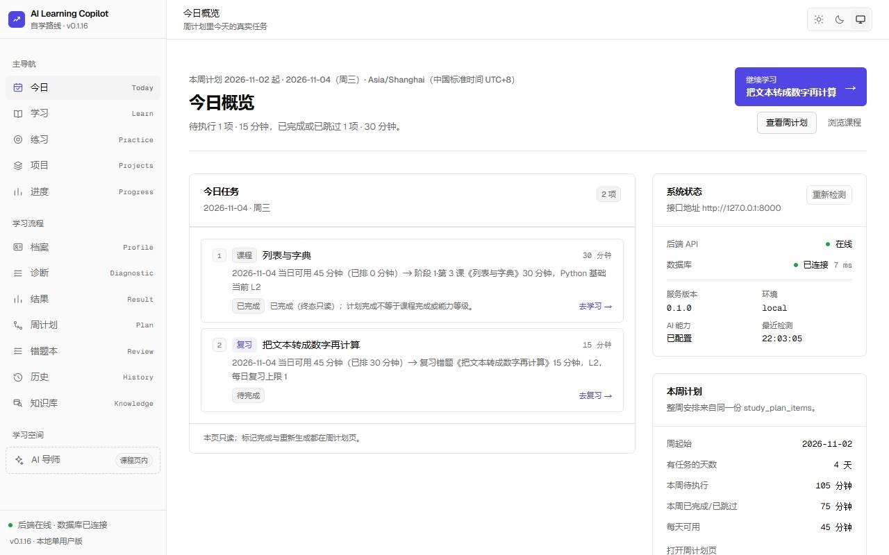
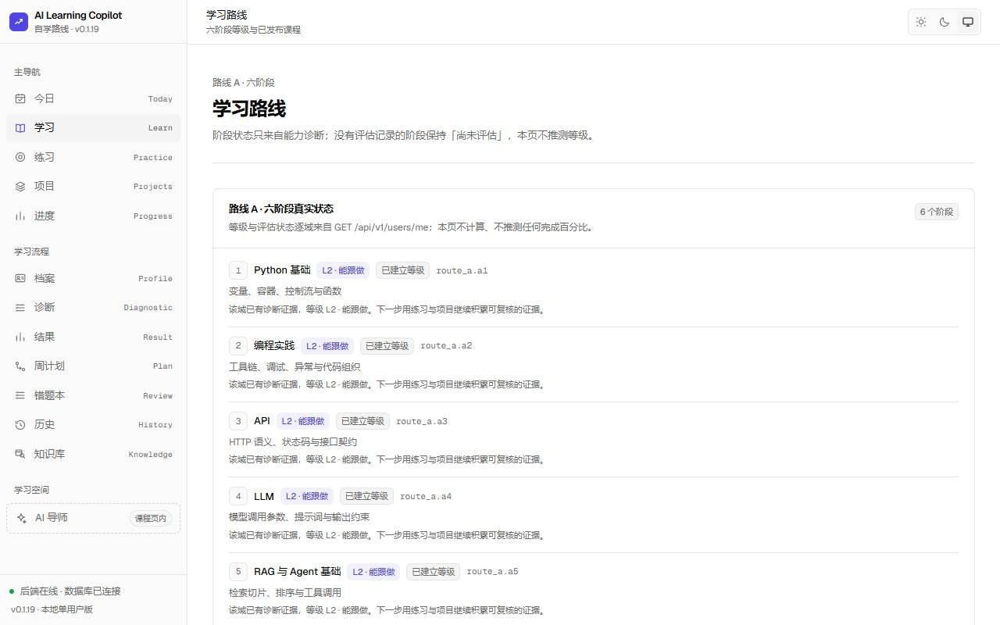
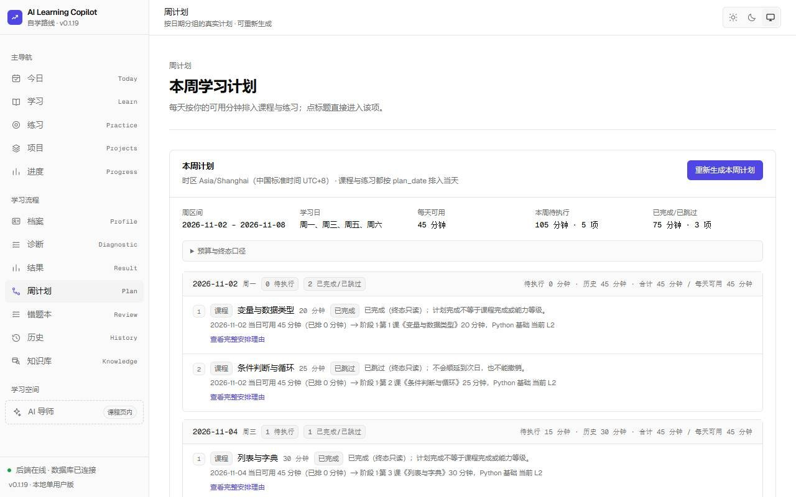
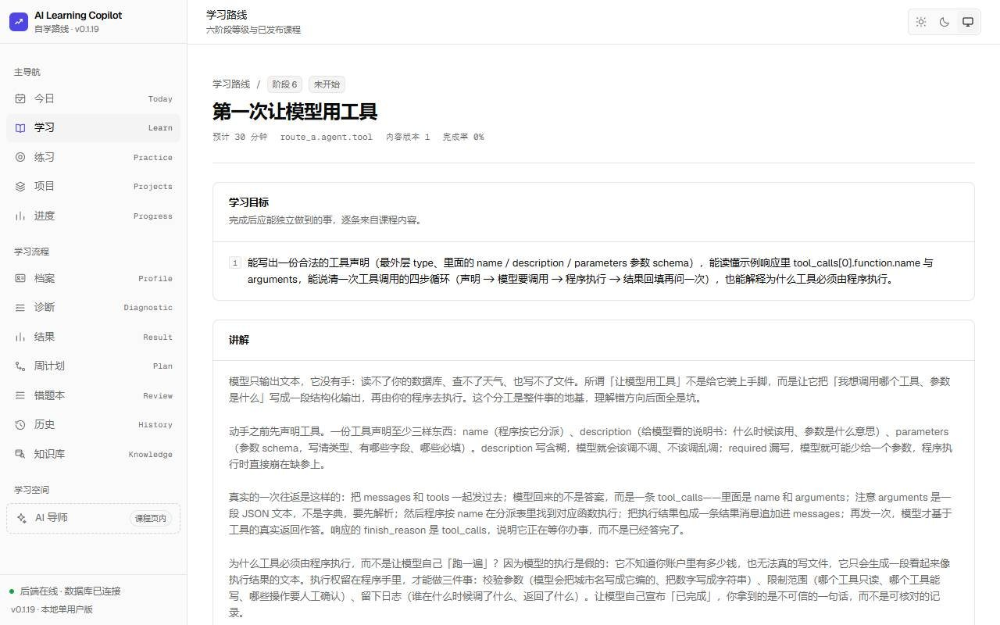
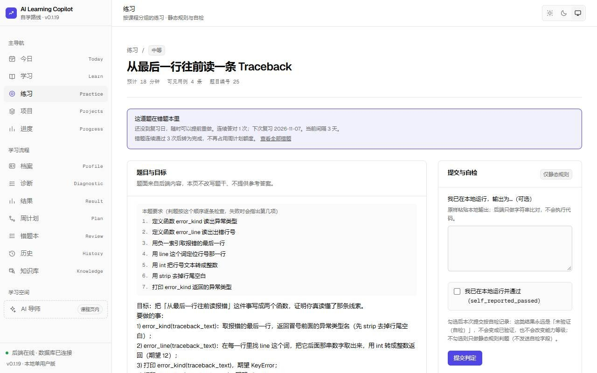
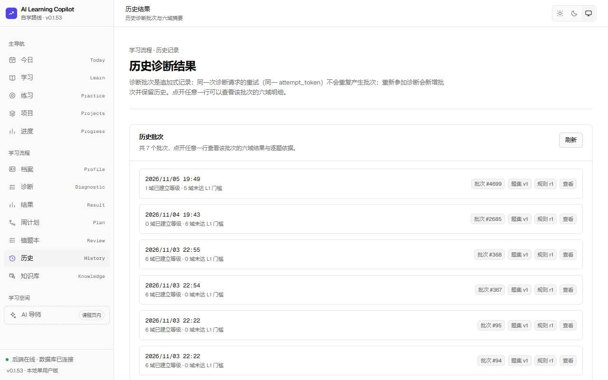

# AI Learning Copilot

面向**非计算机理工科背景、编程基础薄弱、希望转向 AI 应用开发**的初学者的自学平台。
目标不是把课程播放完，而是让学习者最终能**独立开发并展示一个简单的 AI 应用**。

> **当前版本 v0.1.18（单用户本地 MVP）**：数据库迁移 head 为 `0014_sprint10_requirement_labels`（共 14 个版本），
> 后端共 **37 个操作 / 34 条路径**、**15 张业务表**；前端 **14 条页面路由**全部可访问。
> 已完成：学习档案、20 题能力诊断与六域画像、**11 节课程**（Python 基础 5 节 + 编程实践 2 节 + API / LLM / RAG / Agent 4 节）与进度、周计划（含练习项）、
> **22 道练习**的静态规则判题、DeepSeek AI 导师（额度与超时护栏）、知识库入库与引用检索。
> **未完成**：登录鉴权、真实代码执行沙箱、第三方人工评审（作品可提交并自评，但没有第二个人能评审）。
> 详见下方 [v0.1.8 能力清单](#v018-已实现--未实现)。

## 首版范围：路线 A

```
Python 基础 → 编程实践 → API → LLM → RAG/Agent 基础 → 简单 AI 项目
```

产品原则：教用户独立解决问题而不是直接给答案；学习评估尽量基于可验证数据；允许自由使用 AI 提示但必须记录提示依赖；**不把课程完成率等同于掌握程度**。

## v0.1.8 已实现 / 未实现

### ✅ 已实现（可运行、有接口、有测试）

| 能力 | 落地形态 |
| --- | --- |
| 学习档案 | `GET/PUT /api/v1/users/me(+/profile)`：`study_days` / `daily_minutes` / 时区确认，档案只前进不回退 |
| 能力诊断 | 20 题题面（不含答案键）+ 提交计分：单事务写 1 批次 + 6 条等级证据；同 token 幂等回放、冲突 409；批次历史与逐题明细 |
| 六域画像 | `GET /api/v1/skills` + `user_skill_levels` 证据分层（`level=0` 表示未评估，自评永不写等级） |
| 最小课程 | **11 节**课程正文（五块结构：Python 基础 5 节 + 编程实践 2 节 + API / LLM / RAG / Agent 4 节）；打开课程不写库；进度 `not_started → in_progress → completed` 只进不退，`completed` 同事务关闭关联计划项 |
| 周计划 | 预览（纯内存）、落库计划、生成/刷新（同周重生成行数不变，历史行不改写）、计划项标记 `done/skipped`（终态不可改写）；计划项可指向课程或练习 |
| 练习与判题 | **22 道**练习（每课 2 道）；提交走**静态规则 + 自报输出比对**判定，**不执行任何提交的代码**，不自动晋升技能等级。判题前会**剥离注释与 docstring**，把要求抄进注释不能通过 |
| AI 导师 | `POST /api/v1/ai/tutor`：`assistance_level` 四档、每次调用落库用量、单次超时（`AI_TIMEOUT_SECONDS`）、每日 token 上限（`AI_DAILY_TOKEN_LIMIT`）、缺 Key 时 503 且不发起上游请求 |
| 知识库 | 白名单文档入库（默认关闭）、关键词检索、导师回答附带引用与新鲜度标记 |
| 前端 | 14 条页面路由、侧栏导航、深浅色主题、系统状态（后端在线 / 数据库已连接 / 离线三态） |
| 工程化 | 统一错误体 + `request_id`、Alembic 迁移到 0007、两档 Pytest、ESLint / tsc / build、GitHub Actions CI |

| 结业作品提交与自评 | `draft → submitted → reviewed` 状态机；提交时把四条达标要求**快照存档**；自评必须显式确认「本次是本人自评」，数据库层禁止写入非 `self` 的评审人 |
| 错题本与间隔复习 | 答错自动进入复习，答对按 `1 / 3 / 7 / 14` 天推进、连续 3 次通过后置 `done`；`/review` 页展示到期与全部复习项；周计划会把到期复习排在**新练习之前** |

### ❌ 未实现（界面标注「开发中」或根本没有入口）

| 能力 | 现状 |
| --- | --- |
| 登录 / 注册 / 鉴权 | **没有任何鉴权**，所有端点作用于同一个种子用户（设计取舍，见 [docs/API.md](docs/API.md) 第 1 节） |
| 真实代码执行沙箱 | 不做，也**不会**用普通 Docker 容器冒充安全沙箱 |
| 第三方人工评审 | 作品可以提交并**由本人自评**（`reviewer` 列在数据库层只允许 `'self'`）；**没有第三方评审者**，因为本版本没有多用户与鉴权 |
| 自动停留计时 | 打开课程不累计 `time_spent_seconds`，界面不宣称计时 |
| 逐题解析文本 | 20 道诊断题**全部带解析**（v0.1.15 起）：提交后在批次明细里逐题显示「为什么对 + 最易错的那一项错在哪」。发卷接口不返回解析，避免泄题 |
| 部署 | 无 Docker 镜像、无部署脚本；**只在本机回环地址运行** |

## 界面（真实截图）

以下截图取自 **v0.1.17** 的实际运行界面（1280×800，Chromium），不是设计稿、未修图。数据来自本机开发库的一次真实使用。

| 今日概览 | 学习路线 |
| --- | --- |
|  |  |
| **周计划**（每天为什么这样排都写在行内） | **课程正文**（六块结构之一） |
|  |  |
| **练习页**（顶部说明这是欠着的复习；「本题要求」编号与判题失败时的「第 N 项」一一对应） | **诊断历史**（批次可追溯） |
|  |  |

截图会过时，所以 `scripts/docs-consistency-check.mjs` 会读取 `docs/images/VERSION` 与当前版本比对：不一致时打印提示，提醒重新截图。**宁可被告知截图旧了，也不放一张没人核对的图。**

其余页面（`/projects` `/progress` `/onboarding` `/diagnostic` `/result` `/review` `/knowledge`）本地启动后可直接打开：

```powershell
powershell -NoProfile -ExecutionPolicy Bypass -File .\scripts\start-dev.ps1
powershell -NoProfile -ExecutionPolicy Bypass -File .\scripts\smoke.ps1   # 全 PASS 再截图
```

重新截图的规矩：`npm run build` 后用真实数据打开页面，1280 宽、浏览器缩放 100%，**不 P 图、不用设计稿冒充运行截图**，并把 `docs/images/VERSION` 更新为当前版本。

## 快速开始（两条命令）

```powershell
powershell -NoProfile -ExecutionPolicy Bypass -File .\scripts\start-dev.ps1   # 起库 + 迁移 + API + Web
```

**首次运行它会自动做三件事**（新克隆里这些都是缺的）：从 `.env.example` 生成 `apps/api/.env` 与 `apps/web/.env.local`、`npm ci` 安装前端依赖、构建前端（约几分钟）。之后每次启动只需几秒。

```powershell
powershell -NoProfile -ExecutionPolicy Bypass -File .\scripts\smoke.ps1       # 只读自检，全部 PASS 才算跑通
```

前置条件、逐步手动启动、测试与提交约定见 [CONTRIBUTING.md](CONTRIBUTING.md)。

## 技术栈（本机实测版本）

| 层 | 技术 | 版本 |
| --- | --- | --- |
| 前端 | Next.js（App Router）/ React / TypeScript / Tailwind CSS 4 | 16.4.4 / 19.3.0 / 5.9.3 / 4.3.4 |
| 后端 | Python / FastAPI / Pydantic v2 / SQLAlchemy 2.x / Alembic | 3.12.15 / 0.162.0 / 2.14.2 / 2.1.6 / 1.20.1 |
| 数据库 | PostgreSQL（Docker，仅本机回环） | 17-alpine |
| 工具 | uv（后端依赖）、npm（前端依赖）、Pytest、ESLint | uv 0.13.5 / npm 11.20.0 |
| AI | DeepSeek API（**默认不启用**：`DEEPSEEK_API_KEY` 留空时相关端点 503，不产生费用） | 模型 id 见 `apps/api/.env.example` |

## 目录结构

```
ai-learning-copilot/
├─ .github/workflows/ci.yml   # CI：api（postgres + alembic + pytest 两档）/ web（npm ci + tsc + lint + build）
├─ apps/
│  ├─ web/                    # Next.js 16 前端（14 条页面路由）
│  │  └─ src/{app,components,lib}
│  └─ api/                    # FastAPI 后端（uv 管理）
│     ├─ app/{main.py,core,api/v1,schemas,services,cli}
│     ├─ migrations/          # Alembic：0001 空基线 → 0007（head）
│     └─ tests/               # 26 个测试模块 + conftest.py，单元档 / 集成档两档
├─ infra/docker-compose.yml   # 仅 PostgreSQL，只绑定 127.0.0.1
├─ docs/                      # 设计文档、契约、API 参考
│  └─ reports/                # 各阶段交付报告与测试记录（历史存档）
├─ scripts/{start-dev,smoke}.ps1  # 一键启动 / 只读自检
├─ .env.example               # 全部环境变量参考（三段：后端 / 前端 / 数据库）
├─ CONTRIBUTING.md            # 本地启动、测试、提交与 PR 约定
├─ CHANGELOG.md
└─ README.md
```

## 本地启动（Windows PowerShell）

以下命令均在 PowerShell 中逐行执行。**不要用 `&&` 串联**，Windows PowerShell 5.1 不支持。

> **本地监听约定（安全默认）**：web `127.0.0.1:3000`、api `127.0.0.1:8000`、postgres `127.0.0.1:5432`，
> 三者都只监听回环地址，局域网与公网都访问不到。本版本没有任何认证，**不要把绑定地址改成 0.0.0.0，也不要部署到公网**。
> web 的回环绑定由 `apps/web/package.json` 的 `dev` / `start` 脚本中的 `-H 127.0.0.1` 保证（Next 默认绑定全部网卡，实测会暴露到局域网）。

### 0. 前置检查

```powershell
node -v          # 需要 20+（本机实测 26.13.0）
npm -v
uv --version     # 需要 uv 0.13+（本机实测 0.13.5）
uv python list   # 需要 cpython-3.12.x；若没有：uv python install 3.12
docker --version
docker compose version
```

### 1. 进入仓库

```powershell
cd <你克隆到的路径>\ai-learning-copilot
```

### 2. 启动数据库（Docker）

```powershell
Copy-Item infra\.env.example infra\.env
docker compose -f infra/docker-compose.yml up -d
docker compose -f infra/docker-compose.yml ps      # 等待 STATUS 显示 (healthy)
```

数据库只在 `127.0.0.1:5432` 监听，不对局域网或公网开放；口令是本地开发默认值，**不要用于任何公开环境**。

### 3. 启动后端

```powershell
cd apps\api
Copy-Item .env.example .env      # DEEPSEEK_API_KEY 留空即可，非 AI 功能照常工作
uv sync
uv run alembic upgrade head      # 迁移到 0013：业务表 + skills 与 11 节课程 / 22 道练习种子
uv run uvicorn app.main:app --host 127.0.0.1 --port 8000
```

后端接口文档：<http://127.0.0.1:8000/docs>（端点全表见 [docs/API.md](docs/API.md)）

### 4. 启动前端（新开一个 PowerShell 窗口）

```powershell
cd <你克隆到的路径>\ai-learning-copilot\apps\web
Copy-Item .env.example .env.local
npm install
npm run dev
```

打开 <http://localhost:3000>。页面侧栏底部的「系统状态」应显示 **后端在线 · 数据库已连接**。

首轮体验路径：`/onboarding`（填学习档案并确认时区）→ `/diagnostic`（20 题诊断）→ `/result`（六域按证据分级）→ `/plan`（生成本周计划并落库）→ `/learn`（11 节课程，打开不写进度）→ `/practice`（22 道练习，提交即判题）→ `/knowledge`（知识库来源与检索）。

### 5. 确认前后端已打通

```powershell
curl.exe -s http://127.0.0.1:8000/api/v1/health
curl.exe -s -w "`nHTTP=%{http_code}`n" http://127.0.0.1:8000/api/v1/ready
```

预期：`health` 返回 200 且 `status=ok`；`ready` 在数据库可用时返回 200 / `status=ready`，数据库不可用时返回 **503** 与 `status=not_ready`（服务本身不崩溃，这正是健康与就绪分离的意义）。

> PowerShell 里 `curl` 是 `Invoke-WebRequest` 的别名，请显式写 `curl.exe`。

## 常用命令

| 目的 | 命令 |
| --- | --- |
| 后端测试（单元档，不依赖数据库） | `cd apps\api` 然后 `uv run pytest -q` |
| 后端测试（集成档，需要数据库在线） | `uv run pytest -q -m integration` |
| 新增数据库迁移 | `uv run alembic revision -m "描述"` |
| 前端类型检查 | `cd apps\web` 然后 `npx tsc --noEmit` |
| 前端 lint | `npm run lint` |
| 前端生产构建 | `npm run build` |
| 前端生产运行 | `npm run start` |
| 停止数据库 | `docker compose -f infra/docker-compose.yml stop` |
| 停止并删除数据卷（会清空数据） | `docker compose -f infra/docker-compose.yml down -v` |

## 环境变量

四份 `.env.example`（根目录是汇总参考，各服务目录下的是唯一权威清单）：

| 文件 | 复制到 | 内容 |
| --- | --- | --- |
| `.env.example`（根） | —（只做参考，不被加载） | 后端 / 前端 / 数据库三段的汇总 |
| `apps\api\.env.example` | `apps\api\.env` | 后端全量：数据库、CORS、DeepSeek、AI 护栏、知识库 |
| `apps\web\.env.example` | `apps\web\.env.local` | `NEXT_PUBLIC_API_BASE_URL` |
| `infra\.env.example` | `infra\.env` | PostgreSQL 端口 / 账号 / 库名 |

Sprint 4 / 5 新增的六个后端变量：`AI_TIMEOUT_SECONDS`、`AI_DAILY_TOKEN_LIMIT`、`KNOWLEDGE_INGEST_ENABLED`、`KNOWLEDGE_STALE_DAYS`、`KNOWLEDGE_TOP_K`、`KNOWLEDGE_DOC_URLS`。
**任何真实密钥都不得写进仓库**：`DEEPSEEK_API_KEY` 在示例文件里恒为空，缺少它时服务照常启动，`/health` 返回 `ai_configured: false`。

## 质量门禁

本地跑通的命令与 CI 一致（见 [.github/workflows/ci.yml](.github/workflows/ci.yml)）：

| 检查 | 命令 | 说明 |
| --- | --- | --- |
| 后端单元档 | `uv run pytest -q` | 数据库停止也必须全绿 |
| 后端集成档 | `uv run pytest -q -m integration` | **hermetic**：用例自建夹具（临时库 + 自插基线行），在**全新数据库**上同样全绿 |
| 迁移 | `uv run alembic upgrade head` + `alembic current` | 应为 `0014_sprint10_requirement_labels (head)` |
| 前端 | `npx tsc --noEmit` / `npm run lint` / `npm run build` | 三项均应退出码 0 |

CI 只有两个 job：`api`（PostgreSQL service + `uv sync --locked` + `ruff check` + `alembic upgrade head` + head 校验 + 单元档 + 集成档）与 `web`（`npm ci` + tsc + lint + build），**不使用任何 secret**。

## 文档

| 文档 | 内容 |
| --- | --- |
| [docs/GETTING_STARTED.md](docs/GETTING_STARTED.md) | **第一次使用**：从空数据库到交出第一个作品，每步的预期结果与耗时 |
| [docs/API.md](docs/API.md) | **37 个操作 / 34 条路径的实测清单**：方法、路径、关键字段、成功/错误码、统一错误体与 `request_id` |
| [CONTRIBUTING.md](CONTRIBUTING.md) | 本地启动两条命令、测试命令、Conventional Commits、PR 检查清单、禁止事项 |
| [SECURITY.md](SECURITY.md) | 安全边界（无鉴权、不执行用户代码、Key 处理）、依赖告警的真实情况、自查命令 |
| [docs/README.md](docs/README.md) | 文档索引；`docs/reports/` 下各阶段报告的导航 |
| [docs/PRD.md](docs/PRD.md) | 产品定位、痛点、MVP 范围、用户故事、可验证验收条件、指标 |
| [docs/ARCHITECTURE.md](docs/ARCHITECTURE.md) | 前后端架构、模块边界、数据流、DeepSeek 调用流程、错误与安全 |
| [docs/DATABASE.md](docs/DATABASE.md) | 数据模型设计、ER 图、索引、约束清单、迁移策略 |
| [docs/ROADMAP.md](docs/ROADMAP.md) | 各 Sprint 的分步计划、逐条验收条件 |
| [docs/SPRINT1A_CONTRACT.md](docs/SPRINT1A_CONTRACT.md) | Sprint 1A 冻结契约：等级证据分层、L0 两态、JSONB 形态、API 契约 |
| [docs/DESIGN_SYSTEM.md](docs/DESIGN_SYSTEM.md) | 视觉风格、颜色/字体/布局令牌、组件与交互规范 |
| [CHANGELOG.md](CHANGELOG.md) | 变更记录（Keep a Changelog 格式） |

## 已知限制

1. **没有任何鉴权**：单用户本地 MVP，所有端点共享同一个种子用户。这是 v0.1.0 的设计取舍，不是遗漏；**不要部署到公网**。
2. **不执行用户代码**：判题只做静态规则匹配与自报输出比对，无法证明代码真的跑通；不使用普通 Docker 容器冒充安全沙箱。判题前会剥离注释与 docstring（v0.1.19 起），但**字符串里的文本仍参与匹配**——把要求塞进字符串常量依然能骗过静态规则，只是不再是一行注释就能做到。
3. **复习优先于新练习**：每日额度先排课程、再排到期复习、最后才排新练习。当日时长较紧时（例如 30 分钟课 + 15 分钟复习正好用满 45 分钟），唯一的 15 分钟槽位会被复习占用，因此**复习密集的周可能没有新练习**。这是刻意的取舍（把答错的题再考一次比多做一道新题更有价值）；错题连续通过 3 次后转为完成，不再占额度。
4. **DeepSeek 模型 id 需自行确认**：`deepseek-flash` / `deepseek-v4-pro` 是配置默认值，启用真实调用前请对照官方文档核实。
5. **单用户语义渗透到了服务层**：`generate_plan()` 已经接收显式 `user_id`，但 `read_plan()` / `build_preview()` 仍通过 `get_single_user()` 解析当前用户——加鉴权时需要把这条链路一并改造。
5. **AI 与知识库默认关闭**：不配 Key 时 `/ai/*` 返回 503 且不产生费用；`KNOWLEDGE_INGEST_ENABLED` 默认 `false`，入库端点返回 403。
6. **知识抓取白名单很窄**：只允许 `docs.python.org` 文档页与仓库内课程；扩大白名单需要单独评审。
7. **分页只有 `limit`**（`GET /diagnostics/history` 的 `cursor` 是唯一例外）；`GET /submissions/recent` 也不在 `/exercises` 命名空间下——两处都是已知的历史不一致，见 [docs/API.md](docs/API.md) 第 6 节。
8. **计划项终态不可撤销**：`done` / `skipped` 写入后不能改回，重新生成也不改写历史行。
9. **逾期复习不进周计划**：候选窗口是 `next_review_on` 落在 `[今天, 本周日]`，**已逾期的错题只在 `/review` 页的到期列表出现**，不会被排进本周计划。
10. **没有第三方评审**：作品提交后的结论一律是本人自评（`reviewer='self'`）；**自动停留计时未实现**（打开课程不写 `learning_progress`）。逐题解析自 v0.1.15 起已有（20 题全覆盖）。
11. **仓库不含截图**：界面以本地实际运行为准，见上文「界面清单（截图占位）」。
12. **`CHANGELOG.md` 已补到 v0.1.8**：Sprint 2–6 的变更摘要与两轮发布记录都在其中。

## 许可证

MIT，见 [LICENSE](LICENSE)（Copyright (c) 2026 AI Learning Copilot contributors）。

## 下一步

~~补齐 CHANGELOG~~（已完成）→ ~~集成测试自洽化~~（已完成，干净库 0 失败）→ ~~/progress 与 /projects 真实化~~（v0.1.1 已完成）→ ~~错题本与间隔复习~~（v0.1.2 已完成）→ ~~结业作品提交与自评~~（v0.1.3 已完成）→ 登录鉴权（之后才可能有多用户与真正的第三方评审）→ 部署方案（在完成鉴权之前不做任何公网部署）。
