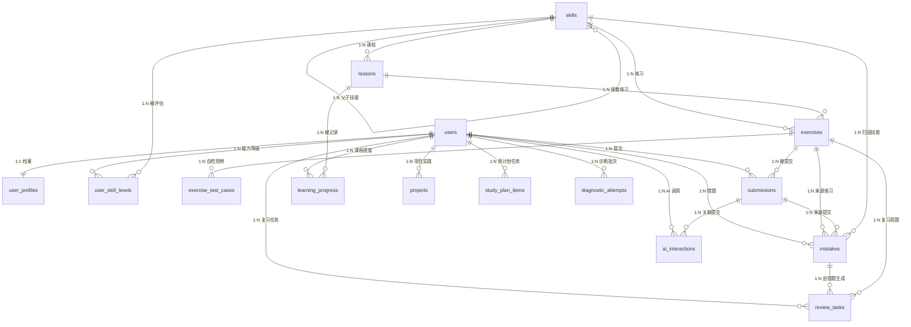

# AI Learning Copilot 数据库设计文档

**文档版本**：v1.1（Sprint 1A 契约 v2 冻结口径）
**文档性质**：设计文档，**不是已建表说明**
**当前落地程度**：只有 Alembic 骨架 + 空基线迁移；尚未创建任何业务表。本文档中的所有表、字段、索引与约束都是待实现的设计基线。

**上游文档**：PRD.md（功能需求）、ARCHITECTURE.md（分层与调用链）、ROADMAP.md（哪张表在哪个 Sprint 落地）
---

## 0. 实现现状（as-built，v0.1.8 实测）

> **读法**：本文档的历史部分（第 2 节起）是 **Sprint 1A 冻结的设计基线**；本节是**当前代码真实建了什么**。
> 两者不一致时，以本节 + `apps/api/migrations/versions/` + 实际数据库为准。

### 0.1 实际存在的 15 张业务表

```sql
-- 实测：information_schema.tables 中 public schema、排除 alembic_version
users, user_profiles, skills, user_skill_levels,
lessons, exercises, submissions, learning_progress,
study_plan_items, ai_interactions,
review_items, capstone_submissions,
knowledge_sources, knowledge_chunks, diagnostic_attempts
```

迁移：`0001` → `0014`（head `0014_sprint10_requirement_labels`），共 14 个版本文件。

### 0.2 设计稿里有、但**没有建**的表，以及实际用了什么

| 设计稿（第 4 节小节） | 实际 |
| --- | --- |
| `4.7 exercise_test_cases`（自检用例表） | **未建表**。自检用例存在 `exercises.visible_tests`（JSONB 数组）里；首版静态规则判题不需要独立的用例表 |
| `4.10 mistakes`（错题本条目） | **合并进 `review_items`**：答错即写一行，`source_submission_id` 记录来源提交 |
| `4.11 review_tasks`（间隔复习任务） | **由 `review_items` 承担**。但间隔阶梯是 **1 / 3 / 7 / 14 天**（连续 3 次通过置 `done`），**不是**设计稿写的 1/3/7/14/30 天 |
| `4.12 projects`（项目实践记录） | **由 `capstone_submissions` 承担**：`draft → submitted → reviewed` 状态机，提交时快照四条达标要求 |

### 0.3 实际有、但设计稿**没有覆盖**的表

| 表 | 迁移 | 用途 |
| --- | --- | --- |
| `review_items` | `0008` | 错题与间隔复习（替代 4.10 + 4.11） |
| `capstone_submissions` | `0009`（`0010` 修正约束） | 结业作品提交与本人自评（替代 4.12） |
| `knowledge_sources` | `0006` | 知识来源（域名白名单、内容 hash、抓取时间、状态） |
| `knowledge_chunks` | `0006` | 知识分块（检索单位，含 `keywords` 与过期判定） |

### 0.4 与设计稿一致的部分

`users`、`user_profiles`、`skills`、`user_skill_levels`、`lessons`、`exercises`、`submissions`、`learning_progress`、`study_plan_items`、`ai_interactions`、`diagnostic_attempts` 共 **11 张表**与第 4 节对应小节一致；字段以迁移文件为准（部分小节在既有列外追加了 Sprint 3–6 的列，例如 `exercises.visible_tests`、`submissions.verification_method`）。

### 0.5 因此第 2 节的 ER 图怎么读

第 2 节的 ER 图与「15 张表全部出现在图中」是按**设计基线**画的，其中 4 条关系对应上面 0.2 的纸面表。实际库的 ER 请以 0.1 + 各迁移文件为准。

---


术语与取值口径统一使用：路线 A、能力诊断、AI 导师、提示依赖、开发中。等级 L0–L4 与提示依赖四级（none、hint、partial_code、full_answer）的定义见 PRD.md 第 5.1 与 5.5 节，本文件不另立定义。

## 1. 设计原则与命名约定

### 1.1 设计原则

1. 可验证优先：能支持"是否真的学会"判断的字段必须落库（提交记录、判题来源、复习结果、提示依赖），而不是只存完成率。
2. 完成率与掌握度分离：learning_progress.progress_pct（完成）与 mastery_level（掌握）是两个字段，任何接口不得把一个当另一个返回。
3. 判题来源可追溯：每条 submissions 都要记录本次判定的手段（verification_method：none、self_report、static_rule、runtime_test、manual_review）并由它派生 verification_strength，因为首版不执行用户代码。
4. 提示依赖可统计：ai_interactions 每次调用一行，dependency_level 必填，能支撑"是否借助 AI 通过"的计算。
5. 只做单用户：唯一约束与索引按"单实例单用户"设计，不预留多租户列（tenant_id 之类），避免过早复杂化。
6. 结构胜于 JSON：需要过滤、排序、聚合的字段一律用列；JSONB 只用于非查询性快照，且必须带 schema_version。
7. 迁移可重放：任何一次迁移都能在空库上从零 upgrade head 成功，且命名稳定可预测。

### 1.2 命名约定

| 对象 | 约定 | 示例 |
|---|---|---|
| 表名 | 小写下划线，复数名词 | users、review_tasks |
| 主键 | 统一 id，bigint identity | users.id |
| 外键列 | 单数表名 + _id | exercise_id、user_id |
| 时间列 | 动词过去式 + _at，timestamptz | created_at、submitted_at |
| 布尔列 | is_ 或 has_ 前缀 | is_passed、is_hidden |
| 枚举列 | varchar + CHECK 约束，不用 PostgreSQL 原生 enum | status、dependency_level |
| 索引 | ix_<表>_<列>；唯一索引 uq_<表>_<列> | ix_submissions_user_time |
| 外键约束 | fk_<表>_<列>_<被引用表> | fk_submissions_exercise_exercises |
| 检查约束 | ck_<表>_<规则> | ck_submissions_attempt_no_positive |

为什么不用 PostgreSQL 原生 enum：原生 enum 增删值需要 ALTER TYPE，回滚成本高；varchar + CHECK 在 Alembic 中就是一条 drop/add constraint，迁移可逆性更好。

### 1.3 主键选择

所有表使用 `bigint GENERATED BY DEFAULT AS IDENTITY` 作为主键。理由：本地单用户、数据量在万级，bigint 索引比 uuid 更小更快；对外暴露的追踪标识只用在需要跨系统关联的地方（ai_interactions.request_id 用 uuid）。

### 1.4 JSONB 使用规则

允许使用 JSONB 的列只有六处：exercises.hints、projects.checklist、projects.verified_checks、ai_interactions.model_params、diagnostic_attempts.answers、diagnostic_attempts.domain_scores。规则：

- 每个 JSONB 值必须含 schema_version 字段（整数）；唯一例外是 diagnostic_attempts 的两列，其版本由 question_set_version 与 rule_version 两列显式承载，JSONB 内不再重复 schema_version。
- 不允许把需要 JOIN、过滤、排序的业务实体放进 JSONB。
- 写入前由 Pydantic v2 模型校验结构，读出不信任内容。

## 2. 实体关系总览



关系完整性说明：15 张表全部出现在图中；所有外键都在第 4 节逐表列出；没有孤立表，也没有只画不实现的关联。有两处引用按设计不画成外键连线：① study_plan_items.target_id 是按 kind 解释的多态引用（指向 lessons 或 exercises），理由见 4.14 节；② user_skill_levels.evidence_ref 是文本引用 `diag:<attempt_id>` / `sub:<submission_id>`，跨 Sprint 引用 submissions 时按 6.3 节规则不提前建外键，理由见 4.4 节。diagnostic_attempts 的连线是真实外键（user_id → users）。

## 3. 表清单与拆分说明

表数量为 15：需求给出的 12 张，加上为规范化拆出的 1 张 exercise_test_cases，以及统一口径新增的 2 张 study_plan_items 与 diagnostic_attempts。**S1 迁移只建其中 5 张**：users、user_profiles、skills、diagnostic_attempts、user_skill_levels；其余 10 张按本表「落地 Sprint」列建表。序号与第 4 节的节号一一对应（序号 N ↔ 第 4.N 节），新增表一律追加在末尾，不在中间插入，避免所有节号与既有引用一起重编。

| 序号 | 表名 | 用途一句话 | 落地 Sprint |
|---|---|---|---|
| 1 | users | 单用户档案主体（含时区确认来源，见 4.1 节） | S1 |
| 2 | user_profiles | 学习目标与可投入时间（1:1 扩展，见 4.2 节） | S1 |
| 3 | skills | 技能域（首版恰好 6 行，对应 A1–A6） | S1 |
| 4 | user_skill_levels | 能力等级证据历史（证据分层见 4.4 节） | S1 |
| 5 | lessons | 课程正文与元数据 | S2 |
| 6 | exercises | 练习题目、起始代码与判题方式 | S3 |
| 7 | exercise_test_cases | 自检用例（拆分而来，见第 3.1 节） | S3 |
| 8 | submissions | 每次提交的代码、运行输出与判题结果（见 4.8 节） | S3 |
| 9 | learning_progress | 每门课程对每个用户的进度与掌握度 | S2 |
| 10 | mistakes | 错题本条目与错误归因 | S5 |
| 11 | review_tasks | 间隔复习任务 | S5 |
| 12 | projects | 项目实践记录与验收清单结果 | S6 |
| 13 | ai_interactions | AI 调用记录与提示依赖 | S4 |
| 14 | study_plan_items | 周计划任务与可解释的排期理由（**S2 建表**，S1 不创建，见 4.14 节） | S2 |
| 15 | diagnostic_attempts | 诊断批次快照：答案、六域得分与版本（见 4.15 节） | S1 |

### 3.1 为什么把自检用例从 exercises 拆成 exercise_test_cases

需求原文列出 12 个表名，并允许为规范化再拆一张，拆出后为 13 张。选择拆 exercise_test_cases，理由有三条：

1. 基数关系是 1:N：一个练习通常有 3–6 条用例（含隐藏用例），放回 exercises 只能塞进 JSONB，丢掉了 is_hidden、weight、order_index 的查询与约束能力。
2. 行宽与生命周期不同：用例会被单独编辑、单独隐藏、单独删除，和练习正文的更新频率不同；分离后 exercises 行宽稳定，缓存友好。
3. 判题扩展需要可查询：将来若引入 static_rule 的权重计算，需要按 exercise_id 聚合 weight，列式存储才能用索引。

拆出后为 13 张（12 张需求表 + exercise_test_cases），再加上 4.14 节的 study_plan_items 与 4.15 节的 diagnostic_attempts，总数 15 与表清单、ER 图、迁移计划一致；exercises 本身不再存放用例字段。

## 4. 逐表说明

每张表给出用途、字段、主外键、索引与级联策略。字段类型为 PostgreSQL 类型。

### 4.1 users

**用途**：用户主体。首版是单用户，由种子数据写入 1 行，不做注册登录。

| 字段 | 类型 | 约束 | 说明 |
|---|---|---|---|
| id | bigint | PK, identity | 主键 |
| email | varchar(320) | NULL, 部分唯一 | 单用户时可空；填入时全局唯一 |
| display_name | varchar(80) | NOT NULL | 显示名 |
| timezone | varchar(64) | NOT NULL, default 'Asia/Shanghai' | 用于「今日」边界计算，是全部「今天/本周」计算的唯一来源 |
| timezone_source | varchar(16) | NOT NULL, default 'default', CHECK in ('default','user_confirmed') | 时区来源：默认值还是用户显式确认 |
| locale | varchar(16) | NOT NULL, default 'zh-CN' | 界面语言 |
| is_active | boolean | NOT NULL, default true | 是否启用 |
| created_at | timestamptz | NOT NULL, default now() | 创建时间 |
| updated_at | timestamptz | NOT NULL, default now() | 更新时间 |
| deleted_at | timestamptz | NULL | 软删除，见第 5 节 |

**主键与外键**：主键 id；本表被其余用户维度表引用。

**索引**：`uq_users_email`（email 唯一，条件 deleted_at IS NULL）。

**级联**：所有引用 users(id) 的子表（user_profiles、user_skill_levels、submissions、learning_progress、mistakes、review_tasks、projects、ai_interactions、study_plan_items、diagnostic_attempts）一律 ON DELETE CASCADE：删除用户即删除其全部学习数据。

**时区确认规则**：timezone_source='default' 时，前端必须在档案页要求用户显式确认时区；未确认前不得展示任何「今日/本周」相关推导（含计划预览与预览里的日期）。用户确认后写 'user_confirmed'，此后不得静默改回 'default'。所有「今天/本周」计算只用 users.timezone，禁止使用服务器时区。

待确认：email 是否在首版就需要（单用户场景可留空），以及是否引入认证字段。多用户认证是明确非目标，默认不加。

### 4.2 user_profiles

**用途**：与 users 一对一的学习设置，承载学习目标与可投入时间。

| 字段 | 类型 | 约束 | 说明 |
|---|---|---|---|
| user_id | bigint | PK, FK → users(id) | 与 users 一对一 |
| target_track | varchar(32) | NOT NULL, default 'route_a', CHECK in ('route_a') | 首版只支持路线 A |
| learning_goal | text | NULL | 用户目标自我描述 |
| study_days | smallint[] | NOT NULL, default '{1,3,5}' | 学习日，1=周一…7=周日；长度 1–7、元素 1–7、元素不重复（三条 CHECK + 触发器，见下） |
| daily_minutes | smallint | NOT NULL, default 60, CHECK 15–480 | 单个学习日可投入分钟数（15 与 480 都含端点） |
| weekly_minutes | smallint | 生成列 | GENERATED ALWAYS AS (cardinality(study_days) * daily_minutes) STORED，随两列自动同步 |
| onboarding_completed_at | timestamptz | NULL | 诊断与目标确认完成时间 |
| created_at / updated_at | timestamptz | NOT NULL, default now() | 时间戳 |

**主键与外键**：PK user_id；FK user_id → users(id) ON DELETE CASCADE。

**索引**：主键已足够，无需额外索引。

**级联**：随 users 删除。

**约束与 DDL 片段（契约 v2 定稿；S1 直接在 CREATE TABLE 内写齐）**：

| 约束名 | 表达式 | 拦住的输入 |
|---|---|---|
| ck_user_profiles_study_days_cardinality | `CHECK (cardinality(study_days) BETWEEN 1 AND 7)` | 空数组 `{}`、8 个及以上元素 |
| ck_user_profiles_study_days_range | `CHECK (study_days <@ ARRAY[1,2,3,4,5,6,7]::smallint[])` | `{0}`、`{8}`、负数 |
| ck_user_profiles_study_days_not_null | `CHECK (study_days IS NOT NULL)`，由 NOT NULL 隐含，不单独建约束 | NULL |

**元素去重只能靠触发器**：CHECK 无法在单个表达式里表达「元素互不相同」，因此加 BEFORE INSERT OR UPDATE 触发器，并同时在服务层校验：

```sql
ALTER TABLE user_profiles
  ADD COLUMN study_days smallint[] NOT NULL DEFAULT '{1,3,5}',
  ADD COLUMN daily_minutes smallint NOT NULL DEFAULT 60,
  ADD COLUMN weekly_minutes smallint GENERATED ALWAYS AS (cardinality(study_days) * daily_minutes) STORED;
ALTER TABLE user_profiles
  ADD CONSTRAINT ck_user_profiles_study_days_cardinality CHECK (cardinality(study_days) BETWEEN 1 AND 7),
  ADD CONSTRAINT ck_user_profiles_study_days_range CHECK (study_days <@ ARRAY[1,2,3,4,5,6,7]::smallint[]),
  ADD CONSTRAINT ck_user_profiles_daily_minutes CHECK (daily_minutes BETWEEN 15 AND 480);

CREATE FUNCTION fn_user_profiles_study_days_unique() RETURNS trigger AS $$
BEGIN
  IF cardinality(NEW.study_days) <> (SELECT count(DISTINCT d) FROM unnest(NEW.study_days) AS d) THEN
    RAISE EXCEPTION 'ck_user_profiles_study_days_unique: study_days 含重复元素 %', NEW.study_days;
  END IF;
  RETURN NEW;
END $$ LANGUAGE plpgsql;
CREATE TRIGGER trg_user_profiles_study_days_unique
  BEFORE INSERT OR UPDATE ON user_profiles
  FOR EACH ROW EXECUTE FUNCTION fn_user_profiles_study_days_unique();
```

服务层校验同一规则（写入前排序去重、发现重复直接拒绝），触发器是对绕过服务层的直接 SQL 与运维脚本的兜底；两层都要在，缺一不可。

**约束测试用例**（逐条期望见 4.16 节）：`{}` 拒绝、`{1,1}` 拒绝、`{8}` 拒绝、`{0}` 拒绝、`{1,2,3,4,5,6,7}` 通过、`{1,3,5}` 通过；daily_minutes=10 拒绝、daily_minutes=481 拒绝。

**生成列与时间边界**：周容量只有一种算法（学习日数 × 每日分钟），落成生成列后不可能出现「改了学习日却忘了改周容量」的脏数据，上限 7 × 480 = 3360 由两条 CHECK 共同保证，不再需要独立的区间校验。users.timezone（4.1 节）是「今日/本周」的唯一边界来源；timezone_source='default' 且用户未确认时不得计算「今日/本周」。study_plan_items 的 week_start 与 plan_date 一律按它计算后再落库，不使用服务器时区（S2 生效）。

### 4.3 skills

**用途**：技能域清单。首版恰好 6 行，对应路线 A 的 A1–A6；parent_id 为后续细分子技能预留。

| 字段 | 类型 | 约束 | 说明 |
|---|---|---|---|
| id | bigint | PK, identity | 主键 |
| code | varchar(64) | NOT NULL, UNIQUE | 稳定标识，如 route_a.a1 |
| name_zh | varchar(80) | NOT NULL | 中文名 |
| name_en | varchar(80) | NULL | 英文名 |
| level | varchar(16) | NOT NULL, default 'domain', CHECK in ('domain','topic') | 首版只有 domain |
| parent_id | bigint | NULL, FK → skills(id) | 父技能，预留 |
| route_code | varchar(32) | NOT NULL, default 'route_a' | 所属路线 |
| order_index | smallint | NOT NULL | 展示顺序 |
| description | text | NULL | 说明与达标标准 |
| created_at / updated_at | timestamptz | NOT NULL | 时间戳 |
| deleted_at | timestamptz | NULL | 软删除 |

**主键与外键**：PK id；FK parent_id → skills(id) ON DELETE RESTRICT。

**索引**：`uq_skills_code`、`ix_skills_route_order`（route_code, order_index）、`ix_skills_parent`（parent_id）。

**级联**：被 lessons、exercises、user_skill_levels、mistakes 引用，全部 RESTRICT，不允许删除仍有引用的技能。

为什么首版只能是 6 行：PRD.md 的 AC-09 要求诊断后 user_skill_levels 记录数为 6。若将来细分子技能，必须同时修改 PRD.md 的 AC-09 与本节说明，不允许只改数据库。

### 4.4 user_skill_levels

**用途**：用户在各技能域上的能力等级证据历史。追加式写入，不做原地覆盖；每条记录同时带证据来源（evidence_kind）与核验手段（verification_method），当前等级由本节解析规则算出，不靠单列冗余。

| 字段 | 类型 | 约束 | 说明 |
|---|---|---|---|
| id | bigint | PK, identity | 主键 |
| user_id | bigint | NOT NULL, FK → users(id) | 归属用户 |
| skill_id | bigint | NOT NULL, FK → skills(id) | 技能域 |
| level | smallint | NOT NULL, CHECK 0–4 | 本条证据支持的等级；L0 有两态，见下 |
| evidence_kind | varchar(16) | NOT NULL, CHECK in ('self_assessment','diagnostic','practice','transfer') | 证据来源（原 source 列改名）：自评 / 诊断 / 练习 / 迁移任务 |
| verification_method | varchar(16) | NOT NULL, CHECK in ('none','self_report','static_rule','runtime_test','manual_review') | 核验手段，决定 tier 与 evidence_strength |
| evidence_strength | varchar(16) | 生成列，表达式见下 | 由 verification_method 派生，不可直写 |
| assessment_state | varchar(24) | NOT NULL, CHECK in ('unassessed','assessed_below_threshold','established','requested_verification') | 评估状态；只有 established 参与当前等级解析 |
| evidence_ref | varchar(200) | NULL | 证据引用：诊断写 `diag:<attempt_id>`（4.15 节），练习写 `sub:<submission_id>` |
| evidence_count | smallint | NOT NULL, default 0, CHECK >= 0 | 支撑该等级的题数或练习数 |
| created_at / updated_at | timestamptz | NOT NULL | 时间戳；created_at 是解析排序的唯一业务时间 |

原 last_assessed_at 列删除：排序统一用 created_at，补录历史不会改变当前等级。原 source 列改名为 evidence_kind；原 verification_status 列的角色由 assessment_state 承担。

**evidence_strength 生成列（逐字，不可直写）**：

```sql
evidence_strength varchar(16) GENERATED ALWAYS AS (
  CASE WHEN verification_method IN ('runtime_test','manual_review') THEN 'verified'
       WHEN verification_method = 'static_rule' THEN 'assessed'
       WHEN verification_method = 'self_report' THEN 'self_reported'
       ELSE 'none' END) STORED
```

**证据分层（tier，数字越大越强）**：

| tier | 判定条件 | 能授予的上限 |
|---|---|---|
| 3 | verification_method in ('runtime_test','manual_review') | L3/L4 的唯一证据来源（Sprint 1–3 不可达） |
| 2 | evidence_kind in ('practice','transfer') 且 verification_method='static_rule' | 只到 L2：static_rule 不得授 L3/L4 |
| 1 | evidence_kind='diagnostic' | 诊断得分只到 L2 |
| 0 | evidence_kind='self_assessment' | 不产生等级 |

**读法前提**：evidence_kind='diagnostic' 的行其 verification_method 恒为 'static_rule'，含义是「机器按评分规则判定客观题对错」，不是「对用户代码做静态检查」；它属于 tier 1，不因写成 static_rule 而升到 tier 2。

**当前等级解析规则（唯一口径，前端与后端同此 SQL）**：只取 assessment_state='established' 的行，按 (tier DESC, created_at DESC, id DESC) 每域取第一条；requested_verification 行永不参与解析、永不作为展示等级。

```sql
WITH ranked AS (
  SELECT l.*,
         CASE WHEN l.verification_method IN ('runtime_test','manual_review') THEN 3
              WHEN l.evidence_kind IN ('practice','transfer') AND l.verification_method = 'static_rule' THEN 2
              WHEN l.evidence_kind = 'diagnostic' THEN 1
              ELSE 0 END AS tier
  FROM user_skill_levels l
  WHERE l.user_id = :user_id AND l.assessment_state = 'established'
), cur AS (
  SELECT DISTINCT ON (skill_id) skill_id, level, evidence_kind, evidence_strength, assessment_state
  FROM ranked ORDER BY skill_id, tier DESC, created_at DESC, id DESC
), latest_any AS (
  SELECT DISTINCT ON (skill_id) skill_id, assessment_state
  FROM user_skill_levels WHERE user_id = :user_id
  ORDER BY skill_id, created_at DESC, id DESC
)
SELECT s.id AS skill_id,
       COALESCE(c.level, 0)                  AS level,
       c.evidence_kind                       AS evidence_kind,
       COALESCE(c.evidence_strength, 'none') AS evidence_strength,
       COALESCE(c.assessment_state, a.assessment_state, 'unassessed') AS state
FROM skills s
LEFT JOIN cur c ON c.skill_id = s.id
LEFT JOIN latest_any a ON a.skill_id = s.id
ORDER BY s.order_index;
```

原「按 created_at DESC, id DESC 取最新一条」的旧口径作废：它会让一条自评覆盖掉三年后的诊断，与证据分层直接冲突。

**回退规则（该域没有任何 established 行时）**：展示 level=0、evidence_strength='none'、evidence_kind=NULL，state 取该域最新一条非 established 行的 assessment_state；一行记录都没有时取 'unassessed'。于是 L0 有两种含义，必须区分：

| 情形 | level | evidence_strength | state | 界面文案 |
|---|---|---|---|---|
| 该域从无任何评估记录 | 0 | 'none' | unassessed | 尚未评估 |
| 参加过诊断但该域正确率 < 60% | 0 | 'none' | assessed_below_threshold | 已测，未达 L1 门槛 |
| 用户申请核验（例如自评 L4） | 0 | 'none' | requested_verification | 待核验 |

两种 L0 都不得显示为「能力弱」：前者是「还没测过」，后者是「测过但没过线」，导流动作不同（去做诊断 / 补基础再测）。assessed_below_threshold 行的 evidence_ref 指向该次诊断批次。

**等级与授予来源（v2 口径，与 PRD.md 5.1 节一致）**：

| 等级 | 授予来源 | 对应 evidence_strength |
|---|---|---|
| L0 未评估 | 无 established 行；state 为 unassessed 或 assessed_below_threshold | 'none' |
| L1 认识概念 | 诊断该域正确率 >= 60%（tier 1），或 1 次 static_rule 练习通过（tier 2） | 'assessed' |
| L2 能跟做 | 诊断该域正确率 >= 85%，或 1 次 static_rule 练习通过（tier 2）；MVP 上限 | 'assessed' |
| L3 能独立完成 | tier 3 证据（runtime_test / manual_review）且 >= 3 次不同题目且 ai_assistance_level='none'；Sprint 1–3 不可达 | 'verified' |
| L4 能迁移应用 | 已满足 L3 且 >= 1 次 evidence_kind='transfer' 的通过；**MVP 不落成 level=4 行**：等级停在该域已建立的 L3，另存 1 行 level=0、assessment_state='requested_verification' 的申请行，界面文案为「待核验」（pending_review 不是存储值，assessment_state 枚举仅 unassessed / assessed_below_threshold / established / requested_verification 四值） | 'verified' |

**硬规则**：

1. 诊断得分通过（>=60% / >=85%）只证明客观题答对，不等于代码能力经过验证：这类行的 evidence_strength 只能是 'assessed'，不得写 'verified'（生成列按 verification_method 派生，写不进去）。
2. static_rule 只产出 'assessed'，不得授予 L3/L4；L3/L4 只认 tier 3 证据。
3. **MVP 等级上限 L2**：Sprint 1–3 期间任何域都不得自动出现 L3/L4；L3/L4 只能以 assessment_state='requested_verification' 的用户申请行存在（level=0）。
4. 用户自评只记证据、不产生等级：先诊断得 L2 后再自评 L4 -> 展示等级不变，另加 1 行 level=0、evidence_kind='self_assessment'、assessment_state='requested_verification'。
5. 弱层永不覆盖强层；同一 tier 内按 created_at 取最新，因此同层内可升可降（同层若要「不降级」需在 S2 前另行决策，本轮按同层取最新）。
6. 缺乏证据的技能域写 L0 且 state='unassessed'，不得用相邻域、平均分或问卷观感推测。
7. 一条 established 行的 evidence_ref 必须能追溯到真实记录：诊断写 `diag:<attempt_id>`，练习写 `sub:<submission_id>`；六行历史源于同一次诊断时必须写同一个 attempt_id。

**交叉约束（逐条测试见 4.16 节）**：`ck_user_skill_levels_strength_zero`：`CHECK (evidence_strength <> 'none' OR level = 0)`；`ck_user_skill_levels_state_zero`：`CHECK (assessment_state NOT IN ('unassessed','assessed_below_threshold','requested_verification') OR level = 0)`。evidence_strength 是生成列，任何 INSERT/UPDATE 直写都会报错。

为什么没有 (user_id, skill_id) 唯一约束：PRD.md 要求重复诊断只追加不覆盖，因此该表是历史表而不是快照表。当前等级完全由上面的解析规则决定，不靠唯一约束保证；证据溯源字段同样是追加式历史。

### 4.5 lessons

**用途**：路线 A 的课程内容。

| 字段 | 类型 | 约束 | 说明 |
|---|---|---|---|
| id | bigint | PK, identity | 主键 |
| skill_id | bigint | NOT NULL, FK → skills(id) | 所属技能域 |
| route_code | varchar(32) | NOT NULL, default 'route_a' | 所属路线 |
| slug | varchar(120) | NOT NULL, UNIQUE | URL 用稳定标识 |
| title | varchar(200) | NOT NULL | 标题 |
| summary | text | NULL | 一句话摘要 |
| content_md | text | NOT NULL | markdown 正文 |
| estimated_minutes | smallint | NOT NULL, default 15, CHECK 1–240 | 预计时长 |
| order_index | smallint | NOT NULL | 域内顺序 |
| difficulty | smallint | NOT NULL, default 1, CHECK 1–5 | 难度 |
| status | varchar(16) | NOT NULL, default 'draft', CHECK in ('draft','published','archived') | 发布状态 |
| created_at / updated_at | timestamptz | NOT NULL | 时间戳 |
| deleted_at | timestamptz | NULL | 软删除 |

**主键与外键**：PK id；FK skill_id → skills(id) RESTRICT。

**索引**：`uq_lessons_slug`、`ix_lessons_skill_order`（skill_id, order_index）、`ix_lessons_status`（status）。

**级联**：被 exercises.lesson_id（SET NULL）与 learning_progress.lesson_id（CASCADE）引用。

### 4.6 exercises

**用途**：练习题库。首版不执行用户代码，判题方式由 judging_mode 决定。exercises.judging_mode 是题目声明的判题方式（self_check / static_rule / manual），提交时按 4.8 节映射写入 submissions.verification_method；两张表共用同一套核验口径，不各自定义枚举。

| 字段 | 类型 | 约束 | 说明 |
|---|---|---|---|
| id | bigint | PK, identity | 主键 |
| lesson_id | bigint | NULL, FK → lessons(id) | 配套课程，可空 |
| skill_id | bigint | NOT NULL, FK → skills(id) | 所属技能域 |
| slug | varchar(120) | NOT NULL, UNIQUE | 稳定标识 |
| title | varchar(200) | NOT NULL | 题目标题 |
| prompt_md | text | NOT NULL | 题目描述 |
| language | varchar(20) | NOT NULL, default 'python' | 语言 |
| starter_code | text | NULL | 起始代码 |
| solution_code | text | NULL | 参考答案，只能后端读，绝不经 API 下发 |
| difficulty | smallint | NOT NULL, default 2, CHECK 1–5 | 难度 |
| estimated_minutes | smallint | NOT NULL, default 12, CHECK 1–180 | 预计时长 |
| judging_mode | varchar(16) | NOT NULL, default 'self_check', CHECK in ('self_check','static_rule','manual') | 判题来源 |
| kind | varchar(16) | NOT NULL, default 'practice', CHECK in ('practice','transfer') | 练习类型；transfer 为迁移应用任务，是 L4 的证据来源 |
| hints | jsonb | NULL | 本地降级引导要点（含 schema_version） |
| status | varchar(16) | NOT NULL, default 'draft', CHECK in ('draft','published','archived') | 发布状态 |
| created_at / updated_at | timestamptz | NOT NULL | 时间戳 |
| deleted_at | timestamptz | NULL | 软删除 |

**主键与外键**：PK id；FK lesson_id → lessons(id) ON DELETE SET NULL；FK skill_id → skills(id) RESTRICT。

**索引**：`uq_exercises_slug`、`ix_exercises_skill`（skill_id）、`ix_exercises_lesson`（lesson_id）、`ix_exercises_status`（status）。

**级联**：exercise_test_cases 随练习 CASCADE；submissions 与 review_tasks 的 exercise_id 为 RESTRICT/SET NULL，见各表。

### 4.7 exercise_test_cases

**用途**：自检用例。首版用于页面展示与用户自检对照，不参与代码执行。

| 字段 | 类型 | 约束 | 说明 |
|---|---|---|---|
| id | bigint | PK, identity | 主键 |
| exercise_id | bigint | NOT NULL, FK → exercises(id) | 所属练习 |
| name | varchar(80) | NOT NULL | 用例名 |
| input_text | text | NULL | 输入数据 |
| expected_output | text | NOT NULL | 期望输出 |
| is_hidden | boolean | NOT NULL, default false | 隐藏用例不下发前端 |
| weight | smallint | NOT NULL, default 1, CHECK 1–10 | 权重 |
| order_index | smallint | NOT NULL | 展示顺序 |
| created_at | timestamptz | NOT NULL, default now() | 时间戳 |

**主键与外键**：PK id；FK exercise_id → exercises(id) ON DELETE CASCADE。

**索引**：`uq_exercise_test_cases_order`（exercise_id, order_index）。

**级联**：随练习删除。本表不参与软删除，删除练习即删除其用例。

### 4.8 submissions

**用途**：练习提交记录。必须能表达「是否借助 AI 通过」，以及「这次结论是静态规则判的还是有真实执行证据」。本表 S3 建表，S1–S2 不建（见第 3 节表清单）。

| 字段 | 类型 | 约束 | 说明 |
|---|---|---|---|
| id | bigint | PK, identity | 主键 |
| user_id | bigint | NOT NULL, FK → users(id) | 提交人 |
| exercise_id | bigint | NOT NULL, FK → exercises(id) | 练习 |
| attempt_no | smallint | NOT NULL, CHECK >= 1 | 该练习的第几次提交 |
| code_text | text | NOT NULL | 用户代码，应用层限制 20000 字符 |
| language | varchar(20) | NOT NULL, default 'python' | 语言 |
| run_output_text | text | NOT NULL | 用户粘贴的本地运行输出，应用层限制 8000 字符 |
| judging_mode | varchar(16) | NOT NULL, CHECK in ('self_check','static_rule','manual') | 本次判定来源，保留列；它是写 verification_method 的依据，映射见下 |
| is_passed | boolean | NULL | 三态结论：true / false / NULL，含义见下 |
| verification_method | varchar(16) | NOT NULL, default 'none', CHECK in ('none','self_report','static_rule','runtime_test','manual_review') | 本次核验手段；由 judging_mode 按映射表派生，取代原 verification_status |
| verification_strength | varchar(16) | 生成列，表达式见下 | 由 verification_method 派生，不可直写 |
| score | smallint | NULL, CHECK 0–100 | 得分 |
| ai_assistance_level | varchar(16) | NOT NULL, default 'none', CHECK in ('none','hint','partial_code','full_answer') | 提示依赖等级快照，写入规则见下 |
| used_ai | boolean | 生成列，表达式见下 | 本次是否借助 AI |
| passed_with_ai | boolean | 生成列，表达式见下 | 是否借助 AI 通过 |
| duration_seconds | integer | NULL, CHECK >= 0 | 作答耗时 |
| submitted_at | timestamptz | NOT NULL, default now() | 提交时间 |
| judged_at | timestamptz | NULL | 判定时间 |
| created_at / updated_at | timestamptz | NOT NULL | 时间戳 |

**只有三列可写**：表达判定结果只允许写 is_passed、verification_method、ai_assistance_level（judging_mode 由判题入口同事务写入，且必须与 verification_method 符合下面的映射表）；verification_strength、used_ai、passed_with_ai 三列全部是生成列（直写直接报错）。has_prompt_dependency 已移除出本表，语义改为查询派生。

**is_passed 的三态**：true = 判定通过；false = 判定失败或用户确认未通过；NULL = 无法判定（verification_method='none'）。is_passed 只表示「可判定的结论」，不等于「已通过学习验证」。

**verification_method 与 judging_mode 的唯一映射（不允许取值更宽松）**：

| verification_method | judging_mode（保留列） | 原 verification_status（已删除） | verification_strength（生成列） |
|---|---|---|---|
| 'static_rule' | static_rule | verified | assessed |
| 'self_report' | self_check | self_reported | self_reported |
| 'none' | manual（人工复核前） | unverified | none |
| 'manual_review' | manual（人工复核通过后改写） | verified | verified |
| 'runtime_test' | 无（Sprint 1–3 不可达） | 无 | verified |
| 表中未列出的组合 | 一律禁止（服务层拒绝，CHECK 兜底） | 同左 | 不出现 |

原 verification_status 列删除，由 verification_method + 生成列 verification_strength 取代；judging_mode 是「提交时声明的判定方式」，verification_method 是「服务端最终记录的证据方式」，映射固定为上表：self_check->self_report、static_rule->static_rule、manual->none（人工复核通过后把该行改写为 manual_review），两列在同一次写入中一起落库。

**生成列定义（逐字，五份文档一致）**：

- `verification_strength GENERATED ALWAYS AS (CASE WHEN verification_method IN ('runtime_test','manual_review') THEN 'verified' WHEN verification_method = 'static_rule' THEN 'assessed' WHEN verification_method = 'self_report' THEN 'self_reported' ELSE 'none' END) STORED`
- `used_ai GENERATED ALWAYS AS (ai_assistance_level <> 'none') STORED`
- `passed_with_ai GENERATED ALWAYS AS (is_passed IS TRUE AND ai_assistance_level <> 'none') STORED`

**六种情况唯一取值表 v2（五份文档逐字一致）**：

| # | 情况 | is_passed | verification_method | verification_strength（生成列） | ai_assistance_level | used_ai（生成列） | passed_with_ai（生成列） | 可作 L3 证据 |
|---|---|---|---|---|---|---|---|---|
| 1 | 完全独立通过（静态规则） | true | static_rule | assessed | 'none' | false | false | 否 |
| 2 | 使用 hint 后通过 | true | static_rule | assessed | 'hint' | true | true | 否 |
| 3 | 使用 partial_code 后通过 | true | static_rule | assessed | 'partial_code' | true | true | 否 |
| 4 | 使用 full_answer 后通过 | true | static_rule | assessed | 'full_answer' | true | true | 否 |
| 5 | 练习未通过 | false | static_rule 或 self_report | assessed 或 self_reported | 任意 | 按等级 | false | 否 |
| 6 | 无法验证的自检结果 | NULL | none | none | 任意 | 按等级 | false | 否 |
| 7 | 真实执行通过（未来） | true | runtime_test 或 manual_review | verified | 任意 | 按等级 | 视等级 | 是（且需 none） |

**上表的三条读法**：① static_rule 只能产出 assessed，**不得授予 L3/L4**；第 7 行是唯一的 L3 证据来源，且要求 ai_assistance_level='none'。② **MVP 等级上限 L2**：Sprint 1–3 期间任何域都不得自动出现 L3/L4，只能以 requested_verification 用户申请存在。③ evidence_strength='verified' 只可能来自 runtime_test 与 manual_review，诊断与静态规则永不产出 verified。

**ai_assistance_level 的写入规则**：写入值 = max(用户自报等级, 本次关联 ai_interactions 的 dependency_level)，按 none < hint < partial_code < full_answer 取最大；没有 AI 参与时保持默认 'none'。该枚举与 4.13 节 dependency_level 是同一枚举、同一排序。

**DDL 片段（S3 建表时按此列定义写齐；业务表当前为 0，不需要 ALTER）**：

```sql
is_passed boolean,
verification_method varchar(16) NOT NULL DEFAULT 'none'
  CHECK (verification_method IN ('none','self_report','static_rule','runtime_test','manual_review')),
verification_strength varchar(16) GENERATED ALWAYS AS (
  CASE WHEN verification_method IN ('runtime_test','manual_review') THEN 'verified'
       WHEN verification_method = 'static_rule' THEN 'assessed'
       WHEN verification_method = 'self_report' THEN 'self_reported'
       ELSE 'none' END) STORED,
used_ai boolean GENERATED ALWAYS AS (ai_assistance_level <> 'none') STORED,
passed_with_ai boolean GENERATED ALWAYS AS (is_passed IS TRUE AND ai_assistance_level <> 'none') STORED
```

**约束**：

- `ck_submissions_verification_method`：`CHECK (verification_method IN ('none','self_report','static_rule','runtime_test','manual_review'))`。
- `ck_submissions_none_not_passed`：`CHECK (NOT (verification_method = 'none' AND is_passed IS TRUE))`，无法判定的提交不得写成通过。
- `ck_submissions_attempt_no_positive`：`CHECK (attempt_no >= 1)`。
- 原 `ck_submissions_passed_with_ai_requires_ai` 已删除：它的语义由 passed_with_ai 的生成列表达式直接保证；合法组合已被上面的取值表穷尽，数据库只校验取值范围，组合一致性由写入事务保证。

**主键与外键**：PK id；FK user_id → users(id) CASCADE；FK exercise_id → exercises(id) RESTRICT。

**索引**：`ix_submissions_user_exercise`（user_id, exercise_id, submitted_at DESC）、`ix_submissions_user_time`（user_id, submitted_at DESC）、`ix_submissions_exercise`（exercise_id）。

**级联**：随用户删除；练习被引用时不可删除。

**派生列与提示依赖的查询形态**：

- used_ai 与 passed_with_ai 只由 ai_assistance_level 与 is_passed 派生，数据库保证同步，任何 INSERT/UPDATE 都不能单独写入其中一列。
- has_prompt_dependency 不再落库，改为查询派生：`EXISTS (SELECT 1 FROM ai_interactions i WHERE i.submission_id = submissions.id AND i.dependency_level <> 'none')`。事实源是 ai_interactions，submissions 存的是快照。
- 两条硬约束：① 不可能出现 ai_assistance_level <> 'none' AND is_passed = true AND passed_with_ai = false（生成列表达式保证）；② verification_strength <> 'verified' 的记录不得计为「已验证通过」，也不得计入任何掌握度或 L3 证据。

### 4.9 learning_progress

**用途**：每门课程对每个用户的进度与掌握度。完成率与掌握度分列，禁止互相替代。

| 字段 | 类型 | 约束 | 说明 |
|---|---|---|---|
| id | bigint | PK, identity | 主键 |
| user_id | bigint | NOT NULL, FK → users(id) | 用户 |
| lesson_id | bigint | NOT NULL, FK → lessons(id) | 课程 |
| status | varchar(16) | NOT NULL, default 'not_started', CHECK in ('not_started','in_progress','completed') | 状态 |
| progress_pct | smallint | NOT NULL, default 0, CHECK 0–100 | 完成率，来自用户显式操作（停留/滚动统计未实现，延期 S3） |
| mastery_level | smallint | NOT NULL, default 0, CHECK 0–4 | 掌握度，来自用户显式标记与练习证据 |
| time_spent_seconds | integer | NOT NULL, default 0, CHECK >= 0 | 累计停留秒数（自动统计未实现，延期 S3；当前保持 0 或历史值） |
| first_opened_at | timestamptz | NULL | 首次打开 |
| last_opened_at | timestamptz | NULL | 最近打开，用于 30 天留存 |
| completed_at | timestamptz | NULL | 完成时间 |
| created_at / updated_at | timestamptz | NOT NULL | 时间戳 |

**主键与外键**：PK id；FK user_id → users(id) CASCADE；FK lesson_id → lessons(id) CASCADE。

**索引**：`uq_learning_progress_user_lesson`（user_id, lesson_id 唯一）、`ix_learning_progress_user_status`（user_id, status）、`ix_learning_progress_user_last`（user_id, last_opened_at DESC）。

**级联**：随用户或课程删除。

**状态迁移只前进（冻结口径）**：not_started → in_progress → completed；相同状态重复提交幂等（200，不报错）；逆序请求（completed → in_progress / not_started、in_progress → not_started）由服务层拒绝并返回 422 `COURSE_PROGRESS_REGRESSION` 且不写库；数据库层保证 `completed_at` 首写后不回退、`progress_pct` 只增（completed 固定 100）。**并发不倒退（数据库层）**：`learning_progress` 的状态更新在数据库层带等级比较条件（新等级 < 旧等级则不更新），并发时不会倒退；`progress_pct` 取 GREATEST、`completed_at` 取 COALESCE 首写。

**取值与接口上限不同**：`mastery_level` / `self_assessment` 的 DB 取值允许 0–4（为未来 S3 留位），**课程自评接口上限为 2**，超限返回 422。课程 `status='completed'` 时，同一事务把 study_plan_items 中 target_id=lesson_id 且 status='scheduled' 的行置为 done，不改写 done/skipped/expired 行。

**为什么这里可以有唯一约束**：它是当前状态表（一个用户一门课一行），与 user_skill_levels 的历史表定位不同。两表定位差异必须写在代码注释里，避免后来者误改。

### 4.10 mistakes

**用途**：错题本条目与错误归因，是复习任务的来源。

| 字段 | 类型 | 约束 | 说明 |
|---|---|---|---|
| id | bigint | PK, identity | 主键 |
| user_id | bigint | NOT NULL, FK → users(id) | 用户 |
| exercise_id | bigint | NULL, FK → exercises(id) | 来源练习 |
| submission_id | bigint | NULL, FK → submissions(id) | 来源提交 |
| skill_id | bigint | NULL, FK → skills(id) | 归因技能域 |
| error_type | varchar(24) | NOT NULL, default 'other', CHECK in ('syntax','logic','api_usage','concept','prompt_dependency','other') | 错误类型 |
| note_md | text | NULL | 用户反思 |
| root_cause_md | text | NULL | 根因分析 |
| status | varchar(16) | NOT NULL, default 'open', CHECK in ('open','reviewing','resolved') | 状态 |
| review_count | smallint | NOT NULL, default 0, CHECK >= 0 | 已复习次数 |
| last_reviewed_at | timestamptz | NULL | 最近复习时间 |
| resolved_at | timestamptz | NULL | 解决时间 |
| created_at / updated_at | timestamptz | NOT NULL | 时间戳 |
| deleted_at | timestamptz | NULL | 软删除 |

**约束**：`ck_mistakes_source_present`：`CHECK (exercise_id IS NOT NULL OR submission_id IS NOT NULL)`，错题必须能指回一道题或一次提交。

**主键与外键**：PK id；FK user_id → users(id) CASCADE；FK exercise_id → exercises(id) SET NULL；FK submission_id → submissions(id) SET NULL；FK skill_id → skills(id) SET NULL。

**索引**：`ix_mistakes_user_status`（user_id, status）、`ix_mistakes_user_skill`（user_id, skill_id）、`ix_mistakes_exercise`（exercise_id）。

**级联**：随用户删除；练习与提交被删除时置空，保留错题与反思文本。

### 4.11 review_tasks

**用途**：间隔复习任务。间隔阶梯固定为 1、3、7、14、30 天。

| 字段 | 类型 | 约束 | 说明 |
|---|---|---|---|
| id | bigint | PK, identity | 主键 |
| user_id | bigint | NOT NULL, FK → users(id) | 用户 |
| mistake_id | bigint | NULL, FK → mistakes(id) | 来源错题 |
| exercise_id | bigint | NULL, FK → exercises(id) | 复习用练习 |
| scheduled_for | timestamptz | NOT NULL | 到期时间 |
| interval_days | smallint | NOT NULL, CHECK in (1,3,7,14,30) | 本次间隔 |
| repetition_no | smallint | NOT NULL, default 1, CHECK >= 1 | 第几次复习 |
| status | varchar(16) | NOT NULL, default 'scheduled', CHECK in ('scheduled','due','done','skipped') | 状态 |
| result | varchar(8) | NULL, CHECK in ('pass','fail') | 结果 |
| completed_at | timestamptz | NULL | 完成时间 |
| created_at / updated_at | timestamptz | NOT NULL | 时间戳 |

**约束**：`ck_review_tasks_source_present`：`CHECK (mistake_id IS NOT NULL OR exercise_id IS NOT NULL)`。

**主键与外键**：PK id；FK user_id → users(id) CASCADE；FK mistake_id → mistakes(id) CASCADE；FK exercise_id → exercises(id) SET NULL。

**索引**：`ix_review_tasks_user_due`（user_id, status, scheduled_for）、`ix_review_tasks_mistake`（mistake_id）。

**级联**：错题删除则其复习任务一并删除（错题不存在时复习无意义）。

**规则实现位置**：1、3、7、14、30 的推进与失败回落到 1 天，由服务层在完成任务时计算，数据库只做取值校验（CHECK in (1,3,7,14,30)）。连续 3 次通过后把 mistakes.status 置为 resolved 并停止生成新任务。

### 4.12 projects

**用途**：GitHub 项目实践记录。完成判定基于验收清单，不基于一个按钮。

| 字段 | 类型 | 约束 | 说明 |
|---|---|---|---|
| id | bigint | PK, identity | 主键 |
| user_id | bigint | NOT NULL, FK → users(id) | 用户 |
| slug | varchar(120) | NOT NULL | 模板标识 |
| title | varchar(200) | NOT NULL | 项目标题 |
| summary_md | text | NULL | 项目说明 |
| repo_url | varchar(500) | NULL, CHECK 以 https:// 开头 | 仓库地址 |
| demo_url | varchar(500) | NULL, CHECK 以 https:// 开头 | 演示地址 |
| status | varchar(16) | NOT NULL, default 'planned', CHECK in ('planned','in_progress','blocked','done') | 状态 |
| checklist | jsonb | NOT NULL, default '[]' | 验收清单快照（含 schema_version） |
| verified_checks | jsonb | NOT NULL, default '{}' | 每条清单项的校验结果与时间 |
| started_at | timestamptz | NULL | 开始时间 |
| completed_at | timestamptz | NULL | 完成时间 |
| created_at / updated_at | timestamptz | NOT NULL | 时间戳 |
| deleted_at | timestamptz | NULL | 软删除 |

**主键与外键**：PK id；FK user_id → users(id) CASCADE。

**索引**：`uq_projects_user_slug`（user_id, slug 唯一）、`ix_projects_user_status`（user_id, status）。

**级联**：随用户删除。

**完成判定**：status 置为 done 的前提是 verified_checks 中每条 checklist 项均为 true；该校验在服务层执行，数据库不承担业务判定。

### 4.13 ai_interactions

**用途**：AI 导师调用记录与提示依赖的唯一事实源。

| 字段 | 类型 | 约束 | 说明 |
|---|---|---|---|
| id | bigint | PK, identity | 主键 |
| user_id | bigint | NOT NULL, FK → users(id) | 用户 |
| request_id | uuid | NOT NULL, UNIQUE | 追踪标识，与日志 request_id 一致 |
| submission_id | bigint | NULL, FK → submissions(id) | 随 S4 建表一并加入（submissions 已在 S3 落地） |
| purpose | varchar(24) | NOT NULL, CHECK in ('tutor','hint','review_explain','diagnostic_followup') | 调用目的 |
| context_type | varchar(16) | NOT NULL, default 'none', CHECK in ('lesson','exercise','submission','mistake','none') | 上下文类型 |
| context_id | bigint | NULL | 上下文 id，按 context_type 解释 |
| provider | varchar(32) | NOT NULL, default 'deepseek' | 供应商 |
| model | varchar(64) | NOT NULL | 模型名，来自环境变量 |
| model_params | jsonb | NULL | temperature、max_tokens 等快照 |
| prompt_text | text | NULL | 脱敏后的提示词 |
| prompt_chars | integer | NULL | 原始提示词长度 |
| response_text | text | NULL | 脱敏后的响应文本 |
| response_chars | integer | NULL | 原始响应长度 |
| prompt_tokens | integer | NULL | 输入 token 数 |
| completion_tokens | integer | NULL | 输出 token 数 |
| latency_ms | integer | NULL | 端到端延迟 |
| status | varchar(16) | NOT NULL, default 'pending', CHECK in ('pending','streaming','succeeded','failed','cancelled') | 状态 |
| error_code | varchar(40) | NULL | 失败错误码，取值见 ARCHITECTURE.md 第 6.2 节 |
| dependency_level | varchar(16) | NOT NULL, default 'none', CHECK in ('none','hint','partial_code','full_answer') | 提示依赖等级；与 submissions.ai_assistance_level 同一枚举、同一排序 |
| dependency_declared_by | varchar(16) | NOT NULL, default 'user', CHECK in ('user','system') | 等级由谁声明 |
| redacted_at | timestamptz | NULL | 脱敏时间 |
| completed_at | timestamptz | NULL | 调用结束时间 |
| created_at / updated_at | timestamptz | NOT NULL | 时间戳 |

**约束**：`ck_ai_interactions_failed_error`：`CHECK (status <> 'failed' OR error_code IS NOT NULL)`，失败必须有错误码，禁止只置失败不写原因。

**主键与外键**：PK id；FK user_id → users(id) CASCADE；FK submission_id → submissions(id) SET NULL（随 S4 建表一并加入）。

**索引**：`uq_ai_interactions_request`（request_id）、`ix_ai_interactions_user_time`（user_id, created_at DESC）、`ix_ai_interactions_submission`（submission_id）、`ix_ai_interactions_status`（status）。

**级联**：随用户删除；提交被删除时置空，保留调用统计。

**与 submissions.ai_assistance_level 的关系**：两处使用**同一枚举、同一排序**（none < hint < partial_code < full_answer），dependency_level 与 ai_assistance_level 都是 NOT NULL，不存在各自定义一套取值的情况。事实源是 ai_interactions：一次助手调用一行，逐条记录 dependency_level；submissions.ai_assistance_level 是提交那一刻的快照，取值为 max(用户自报等级, 本次关联 ai_interactions 的 dependency_level)（见 4.8 节）。因此"调用记录与提交记录各说一套"在结构上不可能发生。

**为什么提示依赖必须落在这张表**：它是唯一同时具备"一次调用一行""含状态与失败原因""可关联提交"三点的表；把它拆成独立表会让"调用成功但依赖未记录"成为可能，违背 PRD.md 的 AC-18。

### 4.14 study_plan_items

**用途**：周计划任务（第 14 张表，**S2 建表，S1 不创建**）。每行是「某天做某事」，由规则化调度生成、不调用 AI；生成结果必须可解释、可幂等重算、可被用户跳过。Sprint 1 的「计划预览」是内存计算、不落库，不产生带 target_id 的行（契约 C.3）。

| 字段 | 类型 | 约束 | 说明 |
|---|---|---|---|
| id | bigint | PK, identity | 主键 |
| user_id | bigint | NOT NULL, FK → users(id) | 归属用户 |
| week_start | date | NOT NULL | 该周周一，按 users.timezone 的本地日历计算 |
| plan_date | date | NOT NULL | 计划执行日，落在 week_start 起 7 天内 |
| kind | varchar(16) | NOT NULL, CHECK in ('lesson','exercise','review') | 任务类型 |
| target_id | bigint | NOT NULL | 多态引用：kind='lesson' 指 lessons.id，否则指 exercises.id；按设计不建外键 |
| planned_minutes | smallint | NOT NULL, CHECK 15–480 | 预计占用分钟，R1 求和依据 |
| status | varchar(16) | NOT NULL, default 'scheduled', CHECK in ('scheduled','done','skipped','expired') | 任务状态 |
| rationale | varchar(200) | NOT NULL | 可解释性说明，UI 可展开 |
| dedupe_key | varchar(120) | NOT NULL | 去重键，格式见下 |
| created_at / updated_at | timestamptz | NOT NULL | 时间戳 |

**唯一约束**：`uq_study_plan_items_dedupe`（user_id, dedupe_key）。dedupe_key = `'{week_start}|{plan_date}|{kind}|{target_id}'`，例如 `2025-01-06|2025-01-08|exercise|42`；最长形态为 10+1+10+1+8+1+19 = 50 字符，120 的上限留足余量。

**主键与外键**：PK id；FK user_id → users(id) ON DELETE CASCADE。target_id 故意不加外键：它是按 kind 解释的多态引用，加外键会让课程或练习下架时连带删掉历史计划，破坏 R1–R6 的事后可核对性。

**索引**：`uq_study_plan_items_dedupe`、`ix_study_plan_items_user_week`（user_id, week_start, plan_date）。

**级联**：随用户删除；课程与练习下架由调度层在生成时过滤，已完成的历史计划保留。

**完成同步限定当周**：课程完成同步只更新**当周**（按 users.timezone 计算的周一，即 week_start = 当前周周一）的 `scheduled` 行，其他周次与 done/skipped/expired 终态一律不动。

**六条验收规则与字段的对应关系（R1–R6 整体属 Sprint 2 验收范围，Sprint 1 不适用）**：S1 不写本表、不生成周计划，只保留表设计；S1 的对外成果固定为四步——填学习档案 -> 完成 20 题诊断 -> 看到按证据分级的六域结果 -> 看到技能阶段级学习建议（advice）。

| 规则 | 可判定要求 | 由谁保证 |
|---|---|---|
| R1 时间不超支 | 同一 plan_date 的 sum(planned_minutes) <= user_profiles.daily_minutes | plan_date + planned_minutes 可求和；上限来自 daily_minutes（15–480 已校验） |
| R2 不强制每天 | 一周内 distinct(plan_date) 数 <= cardinality(study_days)，且每个 plan_date 属于 study_days；非学习日不分配任何计划项（契约 H.3） | user_profiles.study_days；生成时校验，本表只存结果 |
| R3 跳过不顺延 | 置 skipped 后不自动顺延到次日；跳过不写 mistakes、不计失败 | status='skipped'；本表与 mistakes 之间没有任何写入路径 |
| R4 幂等 | 同一 (user_id, week_start) 重复生成记录数不变，只允许更新 status='scheduled' 的行 | uq_study_plan_items_dedupe + dedupe_key 格式 |
| R5 可解释 | 每条任务必须有 rationale 且能在 UI 展开 | rationale NOT NULL（例："L2 + 周一可用 60 分钟 -> 1 节课 25 分钟 + 1 道练习 20 分钟"） |
| R6 时区 | week_start 与 plan_date 按 users.timezone 计算后落 date；前端不判断"今天" | users.timezone（4.1 节）+ 两个 date 列 |

**为什么 planned_minutes 取 NOT NULL**：R1 的求和只有在每行都有分钟数时才可判定，NULL 会让"未填"与"填了 0"无法区分；口径未标 NOT NULL，实现时按本行取最严值。

**幂等机制（契约 G，S2 实现；Sprint 1A 只冻结口径、不实现）**：周计划重生成必须在**单个事务**内完成——读现有行 -> 计算目标集合 -> 按 dedupe_key UPSERT -> 不删除 status in ('done','skipped') 的行。

不变量（用测试断言，不靠人工检查）：

- 同一 (user_id, week_start) 维度、同一输入下，count(*) 在重生成前后不变，id 集合也不变。
- status in ('done','skipped') 的行的 status 与 updated_at 不得被重生成改写。
- 重生成不得产生内容不同的第二行（uq_study_plan_items_dedupe 兜底）。

**状态口径（Sprint 2 Patch 冻结，三条硬约束）**：

- **终态不可改写**：`status in ('done','skipped')` 为终态，任何路径（重生成、课程完成同步、受控复活）都不得改写其 `status` 与 `updated_at`；不得删除历史行。
- **expired 受控复活**：`expired → scheduled` 仅允许由「重新生成」触发；重生成的 keep 集合必须与本次目标集合一致，不得保留已不在目标集合的 expired 键（否则形成死锁）。
- **不排过去日期**：生成时的候选日期为 `study_days ∩ [today_local, week_end]`（today_local 按 users.timezone）；不得为已过去日期新增 `scheduled` 行；该日已有的 `done`/`skipped` 历史行保持原样。

三个验收用例：

| # | 操作 | 断言 |
|---|---|---|
| G1 | 同一输入连续重生成 2 次 | 两次 count(*) 相等，且 id 集合不变 |
| G2 | 完成 1 项（status='done'）后再重生成 | 该行仍为 done，且 updated_at 不变 |
| G3 | 跳过 1 项（status='skipped'）后再重生成 | 该行仍为 skipped，且 updated_at 不变 |

### 4.15 diagnostic_attempts

**用途**：诊断批次快照（第 15 张表，**S1 建表**）。一次诊断提交一行，answers 与六域得分整份落库，使 user_skill_levels.evidence_ref 能指向同一真实批次；重复提交生成新行，绝不覆盖旧行。

| 字段 | 类型 | 约束 | 说明 |
|---|---|---|---|
| id | bigint | PK, identity | 主键，即批次号 |
| user_id | bigint | NOT NULL, FK → users(id) | 归属用户 |
| question_set_version | varchar(16) | NOT NULL | 题库版本，如 v1 |
| rule_version | varchar(16) | NOT NULL | 评分规则版本，如 r1 |
| answers | jsonb | NOT NULL | 原始答案快照，形态见下 |
| domain_scores | jsonb | NOT NULL | 六域得分与判定快照，形态见下 |
| total_correct | smallint | NOT NULL, CHECK >= 0 | 总答对数 |
| total_questions | smallint | NOT NULL, CHECK > 0 | 总题数（首版 20） |
| submitted_at | timestamptz | NOT NULL, default now() | 提交时间 |
| created_at | timestamptz | NOT NULL, default now() | 落库时间 |

**answers 形态**：`{"q01":{"choice":"B"},"q02":{"choice":"A"},...}`

**domain_scores 形态**：`{"route_a.a1":{"correct":3,"total":4,"rate":0.75,"level":1,"state":"established"}}`——rate、level 与 state 是本次判定的快照，user_skill_levels 的行由它派生，两处口径必须由同一个 rule_version 产生。

**约束**：`ck_diagnostic_attempts_total`：`CHECK (total_correct <= total_questions)`，答对数不得超过总题数。

**主键与外键**：PK id；FK user_id → users(id) CASCADE。**索引**：`ix_diagnostic_attempts_user_time`（user_id, submitted_at DESC）。**级联**：随用户删除；本表无 updated_at，落库即不可改，证据不可事后篡改。

**evidence_ref 写法**：user_skill_levels.evidence_ref 统一写 `diag:<attempt_id>`（练习来源写 `sub:<submission_id>`）。六行历史来自同一次诊断时必须写同一个 attempt_id，否则无法判断它们是否同一批证据。

**重复提交**：同一份 answers 再次提交产生新的 attempt 行（追加式），不得 UPSERT 覆盖旧行——否则后来的重测会追溯改写历史等级。

### 4.16 约束测试清单

**用途**：把第 4 节的库内约束逐条变成可执行断言（S1 起随 pytest + 临时库落地）；每行一条用例，不写「人工检查」。

| # | 对象 | 输入 | 期望 |
|---|---|---|---|
| C1 | user_profiles.study_days | `{}` | 拒绝：ck_user_profiles_study_days_cardinality |
| C2 | user_profiles.study_days | `{1,1}` | 拒绝：trg_user_profiles_study_days_unique |
| C3 | user_profiles.study_days | `{8}` | 拒绝：ck_user_profiles_study_days_range |
| C4 | user_profiles.study_days | `{0}` | 拒绝：ck_user_profiles_study_days_range |
| C5 | user_profiles.study_days | `{1,2,3,4,5,6,7}` | 通过，weekly_minutes = 7 × daily_minutes |
| C6 | user_profiles.study_days | `{1,3,5}` | 通过，weekly_minutes = 3 × daily_minutes |
| C7 | user_profiles.daily_minutes | 10 | 拒绝：ck_user_profiles_daily_minutes |
| C8 | user_profiles.daily_minutes | 481 | 拒绝：ck_user_profiles_daily_minutes |
| C9 | user_skill_levels | level=2 且 assessment_state='requested_verification' | 拒绝：ck_user_skill_levels_state_zero |
| C10 | user_skill_levels | level=0 且 verification_method='static_rule' | **允许（不拒绝）**：生成列 evidence_strength 取 'assessed'，与 level=0 并存，这正是 assessed_below_threshold 的 L0 行形态（诊断未达 60% 时六行里落在 L0 的那些行就是这条组合）。ck_user_skill_levels_strength_zero（实现名 ck_usk_strength_none_level0）只约束 evidence_strength='none' ⇒ level=0 这一个方向，不禁止 'assessed' 配 level=0 |
| C11 | user_skill_levels | level=2 且 verification_method='none' | 拒绝：ck_user_skill_levels_strength_zero（none 只能配 level=0） |
| C12 | 生成列 | INSERT 显式写 evidence_strength / verification_strength / used_ai / passed_with_ai | 拒绝：GENERATED ALWAYS 列不可写 |
| C13 | 解析规则 | 某域同时有 tier 1 established 行与 tier 2 requested_verification 行 | 展示等级取 tier 1 行；requested_verification 行永不参与 |
| C14 | 解析规则 | 某域只有 assessed_below_threshold 行 | level=0、evidence_strength='none'、state=assessed_below_threshold，文案「已测，未达 L1 门槛」 |
| C15 | 解析规则 | 某域无任何 user_skill_levels 行 | level=0、state=unassessed，文案「尚未评估」 |
| C16 | diagnostic_attempts | 同一 answers 提交两次 | 产生两行、attempt_id 不同，旧行字段不变 |
| C17 | submissions | verification_method='none' 且 is_passed=true | 拒绝：ck_submissions_none_not_passed |

## 5. 时间戳与软删除约定

### 5.1 时间

- 所有时间列使用 timestamptz，存 UTC；显示时按 users.timezone 转本地。
- "今日"的边界由 users.timezone 决定，不使用服务器时区。
- created_at 与 updated_at 由数据库默认值与 ORM onupdate 共同维护；业务时间（submitted_at、judged_at、completed_at）由服务层显式写入，不依赖数据库默认值。

### 5.2 软删除

| 表 | 软删除 | 理由 |
|---|---|---|
| users | 是 | 保留数据可审计，不物理删除 |
| skills、lessons、exercises | 是 | 内容下线不应破坏历史提交与进度 |
| projects、mistakes | 是 | 用户可能误删，需要可恢复 |
| ai_interactions | 否（用 redacted_at） | 隐私要求是脱敏而非假删除 |
| submissions、review_tasks、learning_progress、user_skill_levels、exercise_test_cases、study_plan_items、diagnostic_attempts | 否 | 随主体级联，或本身就是历史记录 |

规则：

- 软删除只写 deleted_at，不改变其他字段。
- 所有查询默认附加 `deleted_at IS NULL`；确需查历史时显式关闭该过滤，并在代码注释说明原因。
- 唯一索引必须带条件，例如 `CREATE UNIQUE INDEX uq_users_email ON users (email) WHERE deleted_at IS NULL`，否则软删除行会阻塞同名重建。

## 6. 迁移策略

### 6.1 当前状态

- apps/api/migrations/ 已有 Alembic 骨架与一个空基线迁移（不创建任何业务表）。
- 业务表数量当前为 0。DATABASE.md 的 15 张设计表全部是待实现设计，其中 S1 迁移只建 5 张（users、user_profiles、skills、diagnostic_attempts、user_skill_levels），其余 10 张按第 3 节的落地 Sprint 建表。

### 6.2 命名与约定

Alembic 依赖稳定的约束命名，SQLAlchemy Metadata 必须配置 naming_convention，否则 autogenerate 会生成漂移的约束名：

```python
from sqlalchemy import MetaData

NAMING_CONVENTION = {
    "ix": "ix_%(table_name)s_%(column_0_name)s",
    "uq": "uq_%(table_name)s_%(column_0_name)s",
    "ck": "ck_%(table_name)s_%(constraint_name)s",
    "fk": "fk_%(table_name)s_%(column_0_name)s_%(referred_table_name)s",
    "pk": "pk_%(table_name)s",
}

metadata = MetaData(naming_convention=NAMING_CONVENTION)
```

迁移文件命名：`alembic revision --autogenerate -m "add users and profiles"`，消息用小写动词短语，描述本次结构变化，不写 Sprint 编号。

### 6.3 每个 Sprint 的迁移计划

| Sprint | 迁移内容 | revision 消息示例 |
|---|---|---|
| S0 | 仅空基线（已完成） | baseline |
| S1 | users、user_profiles、skills、diagnostic_attempts、user_skill_levels + 6 行技能域种子 | add identity, diagnostics and skill levels |
| S2 | lessons、learning_progress、study_plan_items | add lessons, progress and study plan |
| S3 | exercises、exercise_test_cases、submissions | add practice tables |
| S4 | ai_interactions（含 submission_id 列与外键，被引用表已在 S3 落地） | add ai interactions |
| S5 | mistakes、review_tasks | add mistakes and review tasks |
| S6 | projects | add projects |
| S7 | 无新表；只补索引与约束调整 | polish indexes |

规则：

- 一个 Sprint 至少一次迁移；结构变更与数据变更分开两个 revision，不混写。
- 每次迁移必须能在空库上从零 upgrade head 成功；CI 用干净库验证。
- downgrade 尽力提供；破坏性操作（drop column）必须先在文档标注，且单独成一次迁移。
- 迁移里不写业务逻辑（不发通知、不调用外部接口）。
- 跨 Sprint 的前向引用一律延后到被引用表存在的那个 Sprint 再加列和外键。按新顺序 ai_interactions（S4）晚于 submissions（S3），因此 submission_id 与其外键可以在建表时一次加齐，不再需要二次迁移。

### 6.4 SQLAlchemy 约定

- 使用 SQLAlchemy 2.x 的声明式映射与 Mapped 类型注解，不用 1.x 的 declarative_base 风格。
- 会话使用异步 sessionmaker，依赖注入提供，不在模块级创建会话。
- 所有查询使用参数绑定；禁止拼接 SQL 字符串。

### 6.5 迁移 0002_sprint1a_identity_diagnostics 草案（S1 定稿，本轮不执行）

下一步是 `0002_sprint1a_identity_diagnostics`，down_revision 指向当前空基线。业务表数量为 0，因此**直接按最终列定义 CREATE TABLE**，不写 ALTER；第 4.2 与 4.8 节的 ALTER 片段只用于已存在旧结构的库。

只创建 5 张表（顺序即外键依赖顺序）：

| # | 表 | 关键约束与列要点 |
|---|---|---|
| 1 | users | timezone varchar(64) NOT NULL DEFAULT 'Asia/Shanghai'、timezone_source varchar(16) NOT NULL DEFAULT 'default' CHECK in ('default','user_confirmed')、deleted_at；条件唯一索引 uq_users_email（deleted_at IS NULL） |
| 2 | user_profiles | study_days 三条 CHECK + 触发器 trg_user_profiles_study_days_unique、daily_minutes CHECK 15–480、weekly_minutes 生成列 |
| 3 | skills | uq_skills_code、ix_skills_route_order；迁移末尾写入 6 行 A1–A6 种子 |
| 4 | diagnostic_attempts | answers / domain_scores 两个 jsonb、total_questions > 0、total_correct <= total_questions、ix_diagnostic_attempts_user_time |
| 5 | user_skill_levels | level / evidence_kind / verification_method / assessment_state / evidence_ref / evidence_count、生成列 evidence_strength、两个交叉 CHECK；不建 (user_id, skill_id) 唯一约束 |

**不创建**（S2 及以后）：study_plan_items（S2）、lessons（S2）、learning_progress（S2）、exercises（S3）、exercise_test_cases（S3）、submissions（S3）、ai_interactions（S4）、mistakes（S5）、review_tasks（S5）、projects（S6），合计 10 张，与第 3 节「15 = 5 + 10」自洽。

**禁止事项**：本迁移不出现任何 DROP TABLE / DROP COLUMN / DELETE / TRUNCATE，不执行 `docker compose down -v`；downgrade 只按外键反序 DROP 本迁移创建的 5 张表。6 行 skills 种子用 `INSERT ... ON CONFLICT DO NOTHING` 保证可重放，与 1 行 users / user_profiles 种子一起放在同一迁移末尾（只 INSERT，不改结构）。

**验收**：空库 `alembic upgrade head` 后业务表数量为 5（不含 alembic_version），`downgrade base` 后回到 0；两次都不出现 DROP 之外的结构变更。

## 7. 数据保留与隐私

### 7.1 保留期

| 数据 | 保留策略 |
|---|---|
| submissions、learning_progress、user_skill_levels、mistakes、review_tasks、projects、study_plan_items | 长期保留，随用户删除而删除 |
| ai_interactions 的统计字段（tokens、latency、status、dependency_level） | 长期保留，用于可用性与提示依赖统计 |
| ai_interactions 的 prompt_text 与 response_text | 默认保留 180 天，到期置 NULL 并写 redacted_at |

### 7.2 脱敏规则

写入 ai_interactions 之前，服务层必须对 prompt_text 与 response_text 执行：

1. 移除密钥形态字符串：匹配 sk- 前缀、32 位以上连续十六进制、Bearer 之后的令牌，替换为 [REDACTED]。
2. 移除邮箱与手机号，替换为 [EMAIL]、[PHONE]。
3. 移除 URL 查询串中的 token、key、signature 参数值。
4. 提示与响应分别截断到 8000 与 16000 字符，原始长度写入 prompt_chars 与 response_chars。

顺序要求：先脱敏再截断，避免截断把敏感片段切成无法识别的碎片。

### 7.3 导出与删除

- 导出：把该用户的 submissions、learning_progress、mistakes、review_tasks、projects、study_plan_items、ai_interactions 组装为单个 JSON 文件。脱敏后的文本可导出，原始未脱敏文本不保留，因此也不可导出。
- 删除：两条路径。用户级删除按 users 级联物理删除全部学习数据；仅删 AI 记录则把 prompt_text、response_text 置 NULL 并写 redacted_at，保留统计字段。
- 导出与删除入口属于 S7 交付，PRD.md 的 AC-28 是其验收条件。接口路径待确认（见第 9 节）。

### 7.4 不写入数据库的内容

- 任何形式的 API Key、Authorization 头、会话凭证。
- 用户未提交的草稿代码（草稿只存在浏览器）。
- 原始未脱敏的模型响应。

## 8. 数据量评估与分页策略

### 8.1 单实例数据量估算（S7 结束时）

| 表 | 预估行数 | 依据 |
|---|---|---|
| users | 1 | 单用户 |
| user_profiles | 1 | 单用户 |
| skills | 6 | 路线 A 六阶段 |
| user_skill_levels | 6–30 | 每域 1–5 次评估 |
| diagnostic_attempts | 20–60 | 每次诊断一行，首年重测 20–60 次 |
| lessons | 60 | 首版内容规模 |
| exercises | 150 | 首版内容规模 |
| exercise_test_cases | 600 | 每练习约 4 条 |
| submissions | 600–1500 | 每练习 4–10 次提交 |
| learning_progress | 60–200 | 课程数乘重学次数 |
| mistakes | 100–200 | 未通过练习的累积 |
| review_tasks | 400–800 | 每错题 3–5 次复习 |
| projects | 3 | 三个项目模板 |
| ai_interactions | 1000–3000 | 每次求助一行 |
| study_plan_items | 400–800 | 每周 3–5 天、每天 1–3 条，累计约 50 周 |

结论：所有表都在万级以下，不需要分区、不需要分库；索引足够。这也是首版不引入缓存的依据。

### 8.2 分页策略

| 场景 | 策略 | 参数 |
|---|---|---|
| 课程、练习列表（变化少） | 偏移分页 | page 从 1 开始，page_size 默认 20、上限 100 |
| submissions、ai_interactions、review_tasks（追加型） | 游标分页 | cursor 为 base64 编码的「created_at 与 id」组合，limit 默认 20、上限 100 |
| 周计划（study_plan_items） | 按 week_start 精确过滤，不分页 | 无（单周条数由 R1/R2 天然封顶） |
| 进度页聚合 | 不分页，直接聚合 | 无 |

响应封装统一为 `{ "items": [], "next_cursor": null, "has_more": false }`（与 ARCHITECTURE.md 第 4.2 节一致）。

规则：

- 追加型表一律游标分页，避免新数据插入导致翻页重复或漏项。
- 任何列表接口都必须有上限，禁止无 limit 的全表返回。
- 深分页（偏移超过 10000）在偏移分页接口上直接返回 422，提示改用筛选条件。

### 8.3 聚合查询约定

- 进度页的统计必须能在一次请求内完成，允许 4–6 条聚合查询并发执行，超时 3s。
- 低依赖通过率等指标使用 submissions 的生成列（used_ai、passed_with_ai）计算，不每次 JOIN ai_interactions；"是否存在提示依赖"没有落库列，需要时用 EXISTS 子查询派生。
- 统计口径必须落在服务层的一个函数里，前后端不得各写一套。

## 9. 待确认事项

- 待确认：users.email 在单用户首版是否保留。保留则允许为空但不重复；删除则需同步修改第 4.1 节与第 7 节。
- 待确认：ai_interactions 的 180 天保留期是否足够，以及到期清理由谁执行（应用启动时扫描、还是手动脚本）。默认先做成手动脚本，避免启动变慢。
- 待确认：导出与删除的接口路径与鉴权方式（单用户下是否需要二次确认），S7 前定稿。
- 待确认：projects 的仓库与演示地址是否需要真实可访问性校验。若需要外部请求，必须先定凭据与超时策略，否则维持仅格式校验。
- 待确认：是否引入 audit_log 记录内容变更。当前判断是不需要（单用户、无合规要求），若开源后有多人协作维护内容，再评估拆出第 16 张表（当前第 15 张已是 diagnostic_attempts）。
