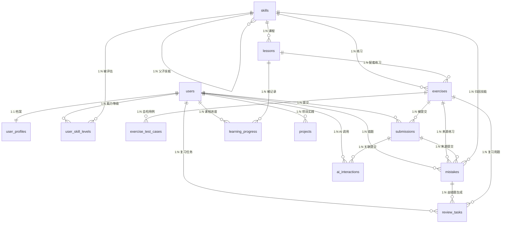

# AI Learning Copilot 数据库设计文档

**文档版本**：v1.0（Sprint 0 基线）
**文档性质**：设计文档，**不是已建表说明**
**当前落地程度**：只有 Alembic 骨架 + 空基线迁移；尚未创建任何业务表。本文档中的所有表、字段、索引与约束都是待实现的设计基线。

**上游文档**：PRD.md（功能需求）、ARCHITECTURE.md（分层与调用链）、ROADMAP.md（哪张表在哪个 Sprint 落地）

术语与取值口径统一使用：路线 A、能力诊断、AI 导师、提示依赖、开发中。等级 L0–L4 与提示依赖四级（none、hint、partial_code、full_answer）的定义见 PRD.md 第 5.1 与 5.5 节，本文件不另立定义。

## 1. 设计原则与命名约定

### 1.1 设计原则

1. 可验证优先：能支持"是否真的学会"判断的字段必须落库（提交记录、判题来源、复习结果、提示依赖），而不是只存完成率。
2. 完成率与掌握度分离：learning_progress.progress_pct（完成）与 mastery_level（掌握）是两个字段，任何接口不得把一个当另一个返回。
3. 判题来源可追溯：每条 submissions 都要记录本次判定的来源（self_check、static_rule、manual），因为首版不执行用户代码。
4. 提示依赖可统计：ai_interactions 每次调用一行，dependency_level 必填，能支撑"是否借助 AI 通过"的计算。
5. 只做单用户：唯一约束与索引按"单实例单用户"设计，不预留多租户列（tenant_id 之类），避免过早复杂化。
6. 结构胜于 JSON：需要过滤、排序、聚合的字段一律用列；JSONB 只用于非查询性快照，且必须带 schema_version。
7. 迁移可重放：任何一次迁移都能在空库上从零 upgrade head 成功，且命名稳定可预测。

### 1.2 命名约定

| 对象 | 约定 | 示例 |
|---|---|---|
| 表名 | 小写下划线，复数名词 | users、review_tasks |
| 主键 | 统一 id，bigint identity | users.id |
| 外键列 | 单数表名 + _id | exercise_id、user_id |
| 时间列 | 动词过去式 + _at，timestamptz | created_at、submitted_at |
| 布尔列 | is_ 或 has_ 前缀 | is_passed、has_prompt_dependency |
| 枚举列 | varchar + CHECK 约束，不用 PostgreSQL 原生 enum | status、dependency_level |
| 索引 | ix_<表>_<列>；唯一索引 uq_<表>_<列> | ix_submissions_user_time |
| 外键约束 | fk_<表>_<列>_<被引用表> | fk_submissions_exercise_exercises |
| 检查约束 | ck_<表>_<规则> | ck_submissions_passed_with_ai |

为什么不用 PostgreSQL 原生 enum：原生 enum 增删值需要 ALTER TYPE，回滚成本高；varchar + CHECK 在 Alembic 中就是一条 drop/add constraint，迁移可逆性更好。

### 1.3 主键选择

所有表使用 `bigint GENERATED BY DEFAULT AS IDENTITY` 作为主键。理由：本地单用户、数据量在万级，bigint 索引比 uuid 更小更快；对外暴露的追踪标识只用在需要跨系统关联的地方（ai_interactions.request_id 用 uuid）。

### 1.4 JSONB 使用规则

允许使用 JSONB 的列只有三处：exercises.hints、projects.checklist、projects.verified_checks、ai_interactions.model_params。规则：

- 每个 JSONB 值必须含 schema_version 字段（整数）。
- 不允许把需要 JOIN、过滤、排序的业务实体放进 JSONB。
- 写入前由 Pydantic v2 模型校验结构，读出不信任内容。

## 2. 实体关系总览



关系完整性说明：13 张表全部出现在图中；所有外键都在第 4 节逐表列出；没有孤立表，也没有只画不实现的关联。

## 3. 表清单与拆分说明

表数量为 13：需求给出的 12 张，加上为规范化拆出的 1 张 exercise_test_cases。

| 序号 | 表名 | 用途一句话 | 落地 Sprint |
|---|---|---|---|
| 1 | users | 单用户档案主体 | S1 |
| 2 | user_profiles | 学习目标与可投入时间（1:1 扩展） | S1 |
| 3 | skills | 技能域（首版恰好 6 行，对应 A1–A6） | S1 |
| 4 | user_skill_levels | 能力诊断与练习证据产生的等级历史 | S1 |
| 5 | lessons | 课程正文与元数据 | S3 |
| 6 | exercises | 练习题目、起始代码与判题方式 | S4 |
| 7 | exercise_test_cases | 自检用例（拆分而来，见第 3.1 节） | S4 |
| 8 | submissions | 每次提交的代码、运行输出与判题结果 | S4 |
| 9 | learning_progress | 每门课程对每个用户的进度与掌握度 | S3 |
| 10 | mistakes | 错题本条目与错误归因 | S5 |
| 11 | review_tasks | 间隔复习任务 | S5 |
| 12 | projects | 项目实践记录与验收清单结果 | S6 |
| 13 | ai_interactions | AI 调用记录与提示依赖 | S2 |

### 3.1 为什么把自检用例从 exercises 拆成 exercise_test_cases

需求原文要求 13 张表但只列出 12 个表名，并允许为规范化再拆一张。选择拆 exercise_test_cases，理由有三条：

1. 基数关系是 1:N：一个练习通常有 3–6 条用例（含隐藏用例），放回 exercises 只能塞进 JSONB，丢掉了 is_hidden、weight、order_index 的查询与约束能力。
2. 行宽与生命周期不同：用例会被单独编辑、单独隐藏、单独删除，和练习正文的更新频率不同；分离后 exercises 行宽稳定，缓存友好。
3. 判题扩展需要可查询：将来若引入 static_rule 的权重计算，需要按 exercise_id 聚合 weight，列式存储才能用索引。

拆出后总数 13 与表格、ER 图、迁移计划一致；exercises 本身不再存放用例字段。

## 4. 逐表说明

每张表给出用途、字段、主外键、索引与级联策略。字段类型为 PostgreSQL 类型。

### 4.1 users

**用途**：用户主体。首版是单用户，由种子数据写入 1 行，不做注册登录。

| 字段 | 类型 | 约束 | 说明 |
|---|---|---|---|
| id | bigint | PK, identity | 主键 |
| email | varchar(320) | NULL, 部分唯一 | 单用户时可空；填入时全局唯一 |
| display_name | varchar(80) | NOT NULL | 显示名 |
| timezone | varchar(64) | NOT NULL, default 'Asia/Shanghai' | 用于"今日"边界计算 |
| locale | varchar(16) | NOT NULL, default 'zh-CN' | 界面语言 |
| is_active | boolean | NOT NULL, default true | 是否启用 |
| created_at | timestamptz | NOT NULL, default now() | 创建时间 |
| updated_at | timestamptz | NOT NULL, default now() | 更新时间 |
| deleted_at | timestamptz | NULL | 软删除，见第 5 节 |

**主键与外键**：主键 id；本表被其余用户维度表引用。

**索引**：`uq_users_email`（email 唯一，条件 deleted_at IS NULL）。

**级联**：所有引用 users(id) 的子表（user_profiles、user_skill_levels、submissions、learning_progress、mistakes、review_tasks、projects、ai_interactions）一律 ON DELETE CASCADE：删除用户即删除其全部学习数据。

待确认：email 是否在首版就需要（单用户场景可留空），以及是否引入认证字段。多用户认证是明确非目标，默认不加。

### 4.2 user_profiles

**用途**：与 users 一对一的学习设置，承载学习目标与可投入时间。

| 字段 | 类型 | 约束 | 说明 |
|---|---|---|---|
| user_id | bigint | PK, FK → users(id) | 与 users 一对一 |
| target_track | varchar(32) | NOT NULL, default 'route_a', CHECK in ('route_a') | 首版只支持路线 A |
| learning_goal | text | NULL | 用户目标自我描述 |
| weekly_minutes | smallint | NOT NULL, default 240, CHECK 60–2400 | 每周可投入分钟数 |
| onboarding_completed_at | timestamptz | NULL | 诊断与目标确认完成时间 |
| created_at / updated_at | timestamptz | NOT NULL, default now() | 时间戳 |

**主键与外键**：PK user_id；FK user_id → users(id) ON DELETE CASCADE。

**索引**：主键已足够，无需额外索引。

**级联**：随 users 删除。

### 4.3 skills

**用途**：技能域清单。首版恰好 6 行，对应路线 A 的 A1–A6；parent_id 为后续细分子技能预留。

| 字段 | 类型 | 约束 | 说明 |
|---|---|---|---|
| id | bigint | PK, identity | 主键 |
| code | varchar(64) | NOT NULL, UNIQUE | 稳定标识，如 route_a.a1 |
| name_zh | varchar(80) | NOT NULL | 中文名 |
| name_en | varchar(80) | NULL | 英文名 |
| level | varchar(16) | NOT NULL, default 'domain', CHECK in ('domain','topic') | 首版只有 domain |
| parent_id | bigint | NULL, FK → skills(id) | 父技能，预留 |
| route_code | varchar(32) | NOT NULL, default 'route_a' | 所属路线 |
| order_index | smallint | NOT NULL | 展示顺序 |
| description | text | NULL | 说明与达标标准 |
| created_at / updated_at | timestamptz | NOT NULL | 时间戳 |
| deleted_at | timestamptz | NULL | 软删除 |

**主键与外键**：PK id；FK parent_id → skills(id) ON DELETE RESTRICT。

**索引**：`uq_skills_code`、`ix_skills_route_order`（route_code, order_index）、`ix_skills_parent`（parent_id）。

**级联**：被 lessons、exercises、user_skill_levels、mistakes 引用，全部 RESTRICT，不允许删除仍有引用的技能。

为什么首版只能是 6 行：PRD.md 的 AC-09 要求诊断后 user_skill_levels 记录数为 6。若将来细分子技能，必须同时修改 PRD.md 的 AC-09 与本节说明，不允许只改数据库。

### 4.4 user_skill_levels

**用途**：用户在各技能域上的能力等级历史。追加式写入，不做原地覆盖。

| 字段 | 类型 | 约束 | 说明 |
|---|---|---|---|
| id | bigint | PK, identity | 主键 |
| user_id | bigint | NOT NULL, FK → users(id) | 归属用户 |
| skill_id | bigint | NOT NULL, FK → skills(id) | 技能域 |
| level | smallint | NOT NULL, CHECK 0–4 | L0 未评估 至 L4 能迁移 |
| source | varchar(16) | NOT NULL, CHECK in ('diagnostic','exercise','review','manual') | 证据来源 |
| evidence_count | smallint | NOT NULL, default 0, CHECK >= 0 | 支撑该等级的题数或练习数 |
| last_assessed_at | timestamptz | NOT NULL, default now() | 最近一次评估时间 |
| created_at / updated_at | timestamptz | NOT NULL | 时间戳 |

**主键与外键**：PK id；FK user_id → users(id) CASCADE；FK skill_id → skills(id) RESTRICT。

**索引**：`ix_user_skill_levels_user_skill`（user_id, skill_id, last_assessed_at DESC）。

**级联**：随用户删除；技能被引用时不可删除。

**当前等级取法**（写入文档以便前端与后端一致）：对每个 skill_id 取 last_assessed_at 最大的一行；相同时间取 id 最大的一行。SQL 形态为 `DISTINCT ON (skill_id) ... ORDER BY skill_id, last_assessed_at DESC, id DESC`。

为什么没有 (user_id, skill_id) 唯一约束：PRD.md 要求重复诊断只追加不覆盖，因此该表是历史表而不是快照表。当前等级完全由查询规则决定，不靠唯一约束保证。

### 4.5 lessons

**用途**：路线 A 的课程内容。

| 字段 | 类型 | 约束 | 说明 |
|---|---|---|---|
| id | bigint | PK, identity | 主键 |
| skill_id | bigint | NOT NULL, FK → skills(id) | 所属技能域 |
| route_code | varchar(32) | NOT NULL, default 'route_a' | 所属路线 |
| slug | varchar(120) | NOT NULL, UNIQUE | URL 用稳定标识 |
| title | varchar(200) | NOT NULL | 标题 |
| summary | text | NULL | 一句话摘要 |
| content_md | text | NOT NULL | markdown 正文 |
| estimated_minutes | smallint | NOT NULL, default 15, CHECK 1–240 | 预计时长 |
| order_index | smallint | NOT NULL | 域内顺序 |
| difficulty | smallint | NOT NULL, default 1, CHECK 1–5 | 难度 |
| status | varchar(16) | NOT NULL, default 'draft', CHECK in ('draft','published','archived') | 发布状态 |
| created_at / updated_at | timestamptz | NOT NULL | 时间戳 |
| deleted_at | timestamptz | NULL | 软删除 |

**主键与外键**：PK id；FK skill_id → skills(id) RESTRICT。

**索引**：`uq_lessons_slug`、`ix_lessons_skill_order`（skill_id, order_index）、`ix_lessons_status`（status）。

**级联**：被 exercises.lesson_id（SET NULL）与 learning_progress.lesson_id（CASCADE）引用。

### 4.6 exercises

**用途**：练习题库。首版不执行用户代码，判题方式由 judging_mode 决定。

| 字段 | 类型 | 约束 | 说明 |
|---|---|---|---|
| id | bigint | PK, identity | 主键 |
| lesson_id | bigint | NULL, FK → lessons(id) | 配套课程，可空 |
| skill_id | bigint | NOT NULL, FK → skills(id) | 所属技能域 |
| slug | varchar(120) | NOT NULL, UNIQUE | 稳定标识 |
| title | varchar(200) | NOT NULL | 题目标题 |
| prompt_md | text | NOT NULL | 题目描述 |
| language | varchar(20) | NOT NULL, default 'python' | 语言 |
| starter_code | text | NULL | 起始代码 |
| solution_code | text | NULL | 参考答案，只能后端读，绝不经 API 下发 |
| difficulty | smallint | NOT NULL, default 2, CHECK 1–5 | 难度 |
| estimated_minutes | smallint | NOT NULL, default 12, CHECK 1–180 | 预计时长 |
| judging_mode | varchar(16) | NOT NULL, default 'self_check', CHECK in ('self_check','static_rule','manual') | 判题来源 |
| hints | jsonb | NULL | 本地降级引导要点（含 schema_version） |
| status | varchar(16) | NOT NULL, default 'draft', CHECK in ('draft','published','archived') | 发布状态 |
| created_at / updated_at | timestamptz | NOT NULL | 时间戳 |
| deleted_at | timestamptz | NULL | 软删除 |

**主键与外键**：PK id；FK lesson_id → lessons(id) ON DELETE SET NULL；FK skill_id → skills(id) RESTRICT。

**索引**：`uq_exercises_slug`、`ix_exercises_skill`（skill_id）、`ix_exercises_lesson`（lesson_id）、`ix_exercises_status`（status）。

**级联**：exercise_test_cases 随练习 CASCADE；submissions 与 review_tasks 的 exercise_id 为 RESTRICT/SET NULL，见各表。

### 4.7 exercise_test_cases

**用途**：自检用例。首版用于页面展示与用户自检对照，不参与代码执行。

| 字段 | 类型 | 约束 | 说明 |
|---|---|---|---|
| id | bigint | PK, identity | 主键 |
| exercise_id | bigint | NOT NULL, FK → exercises(id) | 所属练习 |
| name | varchar(80) | NOT NULL | 用例名 |
| input_text | text | NULL | 输入数据 |
| expected_output | text | NOT NULL | 期望输出 |
| is_hidden | boolean | NOT NULL, default false | 隐藏用例不下发前端 |
| weight | smallint | NOT NULL, default 1, CHECK 1–10 | 权重 |
| order_index | smallint | NOT NULL | 展示顺序 |
| created_at | timestamptz | NOT NULL, default now() | 时间戳 |

**主键与外键**：PK id；FK exercise_id → exercises(id) ON DELETE CASCADE。

**索引**：`uq_exercise_test_cases_order`（exercise_id, order_index）。

**级联**：随练习删除。本表不参与软删除，删除练习即删除其用例。

### 4.8 submissions

**用途**：练习提交记录。必须能表达"是否借助 AI 通过"。

| 字段 | 类型 | 约束 | 说明 |
|---|---|---|---|
| id | bigint | PK, identity | 主键 |
| user_id | bigint | NOT NULL, FK → users(id) | 提交人 |
| exercise_id | bigint | NOT NULL, FK → exercises(id) | 练习 |
| attempt_no | smallint | NOT NULL, CHECK >= 1 | 该练习的第几次提交 |
| code_text | text | NOT NULL | 用户代码，应用层限制 20000 字符 |
| language | varchar(20) | NOT NULL, default 'python' | 语言 |
| run_output_text | text | NOT NULL | 用户粘贴的本地运行输出，应用层限制 8000 字符 |
| judging_mode | varchar(16) | NOT NULL, CHECK in ('self_check','static_rule','manual') | 本次判定来源 |
| is_passed | boolean | NULL | 判定结果，未判定为 NULL |
| score | smallint | NULL, CHECK 0–100 | 得分 |
| used_ai | boolean | NOT NULL, default false | 本次是否借助 AI |
| ai_assistance_level | varchar(16) | NOT NULL, default 'none', CHECK in ('none','hint','partial_code','full_answer') | 提示依赖等级快照 |
| has_prompt_dependency | boolean | NOT NULL, default false | 是否存在提示依赖记录（冗余列，见下） |
| passed_with_ai | boolean | NOT NULL, default false | 是否借助 AI 通过 |
| duration_seconds | integer | NULL, CHECK >= 0 | 作答耗时 |
| submitted_at | timestamptz | NOT NULL, default now() | 提交时间 |
| judged_at | timestamptz | NULL | 判定时间 |
| created_at / updated_at | timestamptz | NOT NULL | 时间戳 |

**约束**：

- `ck_submissions_passed_with_ai_requires_ai`：`CHECK (passed_with_ai IS NOT TRUE OR (is_passed IS TRUE AND used_ai IS TRUE))`。即"借助 AI 通过"必须同时满足"通过"和"用了 AI"，不允许出现自相矛盾的记录。
- `ck_submissions_attempt_no_positive`：`CHECK (attempt_no >= 1)`。

**主键与外键**：PK id；FK user_id → users(id) CASCADE；FK exercise_id → exercises(id) RESTRICT。

**索引**：`ix_submissions_user_exercise`（user_id, exercise_id, submitted_at DESC）、`ix_submissions_user_time`（user_id, submitted_at DESC）、`ix_submissions_exercise`（exercise_id）。

**级联**：随用户删除；练习被引用时不可删除。

**冗余列的单一写入点**：has_prompt_dependency 与 passed_with_ai 只由提交事务计算写入，公式为"存在关联的 ai_interactions 且 dependency_level 不为 none"与"is_passed 且 used_ai"。它们存在的目的是让进度页与低依赖通过率指标不必每次 JOIN ai_interactions；事实源仍是 ai_interactions。

### 4.9 learning_progress

**用途**：每门课程对每个用户的进度与掌握度。完成率与掌握度分列，禁止互相替代。

| 字段 | 类型 | 约束 | 说明 |
|---|---|---|---|
| id | bigint | PK, identity | 主键 |
| user_id | bigint | NOT NULL, FK → users(id) | 用户 |
| lesson_id | bigint | NOT NULL, FK → lessons(id) | 课程 |
| status | varchar(16) | NOT NULL, default 'not_started', CHECK in ('not_started','in_progress','completed') | 状态 |
| progress_pct | smallint | NOT NULL, default 0, CHECK 0–100 | 完成率，来自阅读行为 |
| mastery_level | smallint | NOT NULL, default 0, CHECK 0–4 | 掌握度，来自用户显式标记与练习证据 |
| time_spent_seconds | integer | NOT NULL, default 0, CHECK >= 0 | 累计停留秒数 |
| first_opened_at | timestamptz | NULL | 首次打开 |
| last_opened_at | timestamptz | NULL | 最近打开，用于 30 天留存 |
| completed_at | timestamptz | NULL | 完成时间 |
| created_at / updated_at | timestamptz | NOT NULL | 时间戳 |

**主键与外键**：PK id；FK user_id → users(id) CASCADE；FK lesson_id → lessons(id) CASCADE。

**索引**：`uq_learning_progress_user_lesson`（user_id, lesson_id 唯一）、`ix_learning_progress_user_status`（user_id, status）、`ix_learning_progress_user_last`（user_id, last_opened_at DESC）。

**级联**：随用户或课程删除。

**为什么这里可以有唯一约束**：它是当前状态表（一个用户一门课一行），与 user_skill_levels 的历史表定位不同。两表定位差异必须写在代码注释里，避免后来者误改。

### 4.10 mistakes

**用途**：错题本条目与错误归因，是复习任务的来源。

| 字段 | 类型 | 约束 | 说明 |
|---|---|---|---|
| id | bigint | PK, identity | 主键 |
| user_id | bigint | NOT NULL, FK → users(id) | 用户 |
| exercise_id | bigint | NULL, FK → exercises(id) | 来源练习 |
| submission_id | bigint | NULL, FK → submissions(id) | 来源提交 |
| skill_id | bigint | NULL, FK → skills(id) | 归因技能域 |
| error_type | varchar(24) | NOT NULL, default 'other', CHECK in ('syntax','logic','api_usage','concept','prompt_dependency','other') | 错误类型 |
| note_md | text | NULL | 用户反思 |
| root_cause_md | text | NULL | 根因分析 |
| status | varchar(16) | NOT NULL, default 'open', CHECK in ('open','reviewing','resolved') | 状态 |
| review_count | smallint | NOT NULL, default 0, CHECK >= 0 | 已复习次数 |
| last_reviewed_at | timestamptz | NULL | 最近复习时间 |
| resolved_at | timestamptz | NULL | 解决时间 |
| created_at / updated_at | timestamptz | NOT NULL | 时间戳 |
| deleted_at | timestamptz | NULL | 软删除 |

**约束**：`ck_mistakes_source_present`：`CHECK (exercise_id IS NOT NULL OR submission_id IS NOT NULL)`，错题必须能指回一道题或一次提交。

**主键与外键**：PK id；FK user_id → users(id) CASCADE；FK exercise_id → exercises(id) SET NULL；FK submission_id → submissions(id) SET NULL；FK skill_id → skills(id) SET NULL。

**索引**：`ix_mistakes_user_status`（user_id, status）、`ix_mistakes_user_skill`（user_id, skill_id）、`ix_mistakes_exercise`（exercise_id）。

**级联**：随用户删除；练习与提交被删除时置空，保留错题与反思文本。

### 4.11 review_tasks

**用途**：间隔复习任务。间隔阶梯固定为 1、3、7、14、30 天。

| 字段 | 类型 | 约束 | 说明 |
|---|---|---|---|
| id | bigint | PK, identity | 主键 |
| user_id | bigint | NOT NULL, FK → users(id) | 用户 |
| mistake_id | bigint | NULL, FK → mistakes(id) | 来源错题 |
| exercise_id | bigint | NULL, FK → exercises(id) | 复习用练习 |
| scheduled_for | timestamptz | NOT NULL | 到期时间 |
| interval_days | smallint | NOT NULL, CHECK in (1,3,7,14,30) | 本次间隔 |
| repetition_no | smallint | NOT NULL, default 1, CHECK >= 1 | 第几次复习 |
| status | varchar(16) | NOT NULL, default 'scheduled', CHECK in ('scheduled','due','done','skipped') | 状态 |
| result | varchar(8) | NULL, CHECK in ('pass','fail') | 结果 |
| completed_at | timestamptz | NULL | 完成时间 |
| created_at / updated_at | timestamptz | NOT NULL | 时间戳 |

**约束**：`ck_review_tasks_source_present`：`CHECK (mistake_id IS NOT NULL OR exercise_id IS NOT NULL)`。

**主键与外键**：PK id；FK user_id → users(id) CASCADE；FK mistake_id → mistakes(id) CASCADE；FK exercise_id → exercises(id) SET NULL。

**索引**：`ix_review_tasks_user_due`（user_id, status, scheduled_for）、`ix_review_tasks_mistake`（mistake_id）。

**级联**：错题删除则其复习任务一并删除（错题不存在时复习无意义）。

**规则实现位置**：1、3、7、14、30 的推进与失败回落到 1 天，由服务层在完成任务时计算，数据库只做取值校验（CHECK in (1,3,7,14,30)）。连续 3 次通过后把 mistakes.status 置为 resolved 并停止生成新任务。

### 4.12 projects

**用途**：GitHub 项目实践记录。完成判定基于验收清单，不基于一个按钮。

| 字段 | 类型 | 约束 | 说明 |
|---|---|---|---|
| id | bigint | PK, identity | 主键 |
| user_id | bigint | NOT NULL, FK → users(id) | 用户 |
| slug | varchar(120) | NOT NULL | 模板标识 |
| title | varchar(200) | NOT NULL | 项目标题 |
| summary_md | text | NULL | 项目说明 |
| repo_url | varchar(500) | NULL, CHECK 以 https:// 开头 | 仓库地址 |
| demo_url | varchar(500) | NULL, CHECK 以 https:// 开头 | 演示地址 |
| status | varchar(16) | NOT NULL, default 'planned', CHECK in ('planned','in_progress','blocked','done') | 状态 |
| checklist | jsonb | NOT NULL, default '[]' | 验收清单快照（含 schema_version） |
| verified_checks | jsonb | NOT NULL, default '{}' | 每条清单项的校验结果与时间 |
| started_at | timestamptz | NULL | 开始时间 |
| completed_at | timestamptz | NULL | 完成时间 |
| created_at / updated_at | timestamptz | NOT NULL | 时间戳 |
| deleted_at | timestamptz | NULL | 软删除 |

**主键与外键**：PK id；FK user_id → users(id) CASCADE。

**索引**：`uq_projects_user_slug`（user_id, slug 唯一）、`ix_projects_user_status`（user_id, status）。

**级联**：随用户删除。

**完成判定**：status 置为 done 的前提是 verified_checks 中每条 checklist 项均为 true；该校验在服务层执行，数据库不承担业务判定。

### 4.13 ai_interactions

**用途**：AI 导师调用记录与提示依赖的唯一事实源。

| 字段 | 类型 | 约束 | 说明 |
|---|---|---|---|
| id | bigint | PK, identity | 主键 |
| user_id | bigint | NOT NULL, FK → users(id) | 用户 |
| request_id | uuid | NOT NULL, UNIQUE | 追踪标识，与日志 request_id 一致 |
| submission_id | bigint | NULL, FK → submissions(id) | S4 迁移加入 |
| purpose | varchar(24) | NOT NULL, CHECK in ('tutor','hint','review_explain','diagnostic_followup') | 调用目的 |
| context_type | varchar(16) | NOT NULL, default 'none', CHECK in ('lesson','exercise','submission','mistake','none') | 上下文类型 |
| context_id | bigint | NULL | 上下文 id，按 context_type 解释 |
| provider | varchar(32) | NOT NULL, default 'deepseek' | 供应商 |
| model | varchar(64) | NOT NULL | 模型名，来自环境变量 |
| model_params | jsonb | NULL | temperature、max_tokens 等快照 |
| prompt_text | text | NULL | 脱敏后的提示词 |
| prompt_chars | integer | NULL | 原始提示词长度 |
| response_text | text | NULL | 脱敏后的响应文本 |
| response_chars | integer | NULL | 原始响应长度 |
| prompt_tokens | integer | NULL | 输入 token 数 |
| completion_tokens | integer | NULL | 输出 token 数 |
| latency_ms | integer | NULL | 端到端延迟 |
| status | varchar(16) | NOT NULL, default 'pending', CHECK in ('pending','streaming','succeeded','failed','cancelled') | 状态 |
| error_code | varchar(40) | NULL | 失败错误码，取值见 ARCHITECTURE.md 第 6.2 节 |
| dependency_level | varchar(16) | NOT NULL, default 'none', CHECK in ('none','hint','partial_code','full_answer') | 提示依赖等级 |
| dependency_declared_by | varchar(16) | NOT NULL, default 'user', CHECK in ('user','system') | 等级由谁声明 |
| redacted_at | timestamptz | NULL | 脱敏时间 |
| completed_at | timestamptz | NULL | 调用结束时间 |
| created_at / updated_at | timestamptz | NOT NULL | 时间戳 |

**约束**：`ck_ai_interactions_failed_error`：`CHECK (status <> 'failed' OR error_code IS NOT NULL)`，失败必须有错误码，禁止只置失败不写原因。

**主键与外键**：PK id；FK user_id → users(id) CASCADE；FK submission_id → submissions(id) SET NULL（S4 迁移加入）。

**索引**：`uq_ai_interactions_request`（request_id）、`ix_ai_interactions_user_time`（user_id, created_at DESC）、`ix_ai_interactions_submission`（submission_id）、`ix_ai_interactions_status`（status）。

**级联**：随用户删除；提交被删除时置空，保留调用统计。

**为什么提示依赖必须落在这张表**：它是唯一同时具备"一次调用一行""含状态与失败原因""可关联提交"三点的表；把它拆成独立表会让"调用成功但依赖未记录"成为可能，违背 PRD.md 的 AC-18。

## 5. 时间戳与软删除约定

### 5.1 时间

- 所有时间列使用 timestamptz，存 UTC；显示时按 users.timezone 转本地。
- "今日"的边界由 users.timezone 决定，不使用服务器时区。
- created_at 与 updated_at 由数据库默认值与 ORM onupdate 共同维护；业务时间（submitted_at、judged_at、completed_at）由服务层显式写入，不依赖数据库默认值。

### 5.2 软删除

| 表 | 软删除 | 理由 |
|---|---|---|
| users | 是 | 保留数据可审计，不物理删除 |
| skills、lessons、exercises | 是 | 内容下线不应破坏历史提交与进度 |
| projects、mistakes | 是 | 用户可能误删，需要可恢复 |
| ai_interactions | 否（用 redacted_at） | 隐私要求是脱敏而非假删除 |
| submissions、review_tasks、learning_progress、user_skill_levels、exercise_test_cases | 否 | 随主体级联，或本身就是历史记录 |

规则：

- 软删除只写 deleted_at，不改变其他字段。
- 所有查询默认附加 `deleted_at IS NULL`；确需查历史时显式关闭该过滤，并在代码注释说明原因。
- 唯一索引必须带条件，例如 `CREATE UNIQUE INDEX uq_users_email ON users (email) WHERE deleted_at IS NULL`，否则软删除行会阻塞同名重建。

## 6. 迁移策略

### 6.1 当前状态

- apps/api/migrations/ 已有 Alembic 骨架与一个空基线迁移（不创建任何业务表）。
- 业务表数量当前为 0。DATABASE.md 的全部 13 张表都是待实现设计。

### 6.2 命名与约定

Alembic 依赖稳定的约束命名，SQLAlchemy Metadata 必须配置 naming_convention，否则 autogenerate 会生成漂移的约束名：

```python
from sqlalchemy import MetaData

NAMING_CONVENTION = {
    "ix": "ix_%(table_name)s_%(column_0_name)s",
    "uq": "uq_%(table_name)s_%(column_0_name)s",
    "ck": "ck_%(table_name)s_%(constraint_name)s",
    "fk": "fk_%(table_name)s_%(column_0_name)s_%(referred_table_name)s",
    "pk": "pk_%(table_name)s",
}

metadata = MetaData(naming_convention=NAMING_CONVENTION)
```

迁移文件命名：`alembic revision --autogenerate -m "add users and profiles"`，消息用小写动词短语，描述本次结构变化，不写 Sprint 编号。

### 6.3 每个 Sprint 的迁移计划

| Sprint | 迁移内容 | revision 消息示例 |
|---|---|---|
| S0 | 仅空基线（已完成） | baseline |
| S1 | users、user_profiles、skills、user_skill_levels + 6 行技能域种子 | add identity and diagnostic tables |
| S2 | ai_interactions（不含 submission_id） | add ai interactions |
| S3 | lessons、learning_progress | add lessons and progress |
| S4 | exercises、exercise_test_cases、submissions + ai_interactions.submission_id 列与外键 | add practice tables |
| S5 | mistakes、review_tasks | add mistakes and review tasks |
| S6 | projects | add projects |

规则：

- 一个 Sprint 至少一次迁移；结构变更与数据变更分开两个 revision，不混写。
- 每次迁移必须能在空库上从零 upgrade head 成功；CI 用干净库验证。
- downgrade 尽力提供；破坏性操作（drop column）必须先在文档标注，且单独成一次迁移。
- 迁移里不写业务逻辑（不发通知、不调用外部接口）。
- 跨 Sprint 的前向引用（如 ai_interactions.submission_id 指向 S4 才有的表）一律延后到被引用表存在的那个 Sprint 再加列和外键。

### 6.4 SQLAlchemy 约定

- 使用 SQLAlchemy 2.x 的声明式映射与 Mapped 类型注解，不用 1.x 的 declarative_base 风格。
- 会话使用异步 sessionmaker，依赖注入提供，不在模块级创建会话。
- 所有查询使用参数绑定；禁止拼接 SQL 字符串。

## 7. 数据保留与隐私

### 7.1 保留期

| 数据 | 保留策略 |
|---|---|
| submissions、learning_progress、user_skill_levels、mistakes、review_tasks、projects | 长期保留，随用户删除而删除 |
| ai_interactions 的统计字段（tokens、latency、status、dependency_level） | 长期保留，用于可用性与提示依赖统计 |
| ai_interactions 的 prompt_text 与 response_text | 默认保留 180 天，到期置 NULL 并写 redacted_at |

### 7.2 脱敏规则

写入 ai_interactions 之前，服务层必须对 prompt_text 与 response_text 执行：

1. 移除密钥形态字符串：匹配 sk- 前缀、32 位以上连续十六进制、Bearer 之后的令牌，替换为 [REDACTED]。
2. 移除邮箱与手机号，替换为 [EMAIL]、[PHONE]。
3. 移除 URL 查询串中的 token、key、signature 参数值。
4. 提示与响应分别截断到 8000 与 16000 字符，原始长度写入 prompt_chars 与 response_chars。

顺序要求：先脱敏再截断，避免截断把敏感片段切成无法识别的碎片。

### 7.3 导出与删除

- 导出：把该用户的 submissions、learning_progress、mistakes、review_tasks、projects、ai_interactions 组装为单个 JSON 文件。脱敏后的文本可导出，原始未脱敏文本不保留，因此也不可导出。
- 删除：两条路径。用户级删除按 users 级联物理删除全部学习数据；仅删 AI 记录则把 prompt_text、response_text 置 NULL 并写 redacted_at，保留统计字段。
- 导出与删除入口属于 S7 交付，PRD.md 的 AC-28 是其验收条件。接口路径待确认（见第 9 节）。

### 7.4 不写入数据库的内容

- 任何形式的 API Key、Authorization 头、会话凭证。
- 用户未提交的草稿代码（草稿只存在浏览器）。
- 原始未脱敏的模型响应。

## 8. 数据量评估与分页策略

### 8.1 单实例数据量估算（S7 结束时）

| 表 | 预估行数 | 依据 |
|---|---|---|
| users | 1 | 单用户 |
| user_profiles | 1 | 单用户 |
| skills | 6 | 路线 A 六阶段 |
| user_skill_levels | 6–30 | 每域 1–5 次评估 |
| lessons | 60 | 首版内容规模 |
| exercises | 150 | 首版内容规模 |
| exercise_test_cases | 600 | 每练习约 4 条 |
| submissions | 600–1500 | 每练习 4–10 次提交 |
| learning_progress | 60–200 | 课程数乘重学次数 |
| mistakes | 100–200 | 未通过练习的累积 |
| review_tasks | 400–800 | 每错题 3–5 次复习 |
| projects | 3 | 三个项目模板 |
| ai_interactions | 1000–3000 | 每次求助一行 |

结论：所有表都在万级以下，不需要分区、不需要分库；索引足够。这也是首版不引入缓存的依据。

### 8.2 分页策略

| 场景 | 策略 | 参数 |
|---|---|---|
| 课程、练习列表（变化少） | 偏移分页 | page 从 1 开始，page_size 默认 20、上限 100 |
| submissions、ai_interactions、review_tasks（追加型） | 游标分页 | cursor 为 base64 编码的「created_at 与 id」组合，limit 默认 20、上限 100 |
| 进度页聚合 | 不分页，直接聚合 | 无 |

响应封装统一为 `{ "items": [], "next_cursor": null, "has_more": false }`（与 ARCHITECTURE.md 第 4.2 节一致）。

规则：

- 追加型表一律游标分页，避免新数据插入导致翻页重复或漏项。
- 任何列表接口都必须有上限，禁止无 limit 的全表返回。
- 深分页（偏移超过 10000）在偏移分页接口上直接返回 422，提示改用筛选条件。

### 8.3 聚合查询约定

- 进度页的统计必须能在一次请求内完成，允许 4–6 条聚合查询并发执行，超时 3s。
- 低依赖通过率等指标使用 submissions 的冗余列计算，不每次 JOIN ai_interactions。
- 统计口径必须落在服务层的一个函数里，前后端不得各写一套。

## 9. 待确认事项

- 待确认：users.email 在单用户首版是否保留。保留则允许为空但不重复；删除则需同步修改第 4.1 节与第 7 节。
- 待确认：ai_interactions 的 180 天保留期是否足够，以及到期清理由谁执行（应用启动时扫描、还是手动脚本）。默认先做成手动脚本，避免启动变慢。
- 待确认：导出与删除的接口路径与鉴权方式（单用户下是否需要二次确认），S7 前定稿。
- 待确认：projects 的仓库与演示地址是否需要真实可访问性校验。若需要外部请求，必须先定凭据与超时策略，否则维持仅格式校验。
- 待确认：是否引入 audit_log 记录内容变更。当前判断是不需要（单用户、无合规要求），若开源后有多人协作维护内容，再评估拆出第 14 张表。
