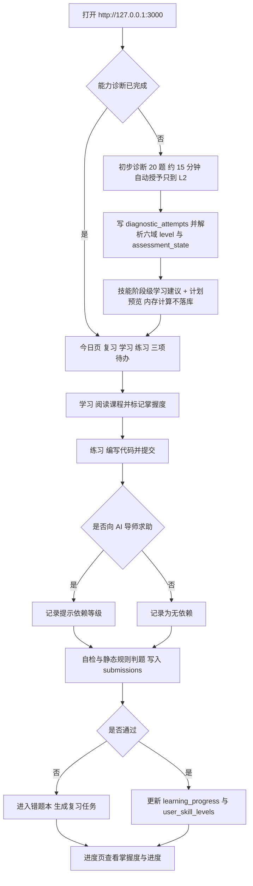

# AI Learning Copilot 产品需求文档（PRD）

**文档版本**：v1.2（统一口径 v2 对齐，Sprint 1A 冻结口径）
**产品版本**：0.1.0（发布版本号规则见 ROADMAP.md 第 1 节）
**仓库**：ai-learning-copilot
**读者**：产品负责人、前后端实现者、未来贡献者

本文档回答"做什么、做到什么程度算完成"。技术架构与接口契约见 ARCHITECTURE.md，数据模型见 DATABASE.md，排期与验收见 ROADMAP.md，视觉与交互规范见 DESIGN_SYSTEM.md。

所有取值（端口、接口路径、表名、颜色值、术语）以 Sprint 0 权威决策表为准。文档与代码冲突时，先改决策表，再同步代码与文档，不允许单方面只改其中一侧。

模块编号（模块 1–8）只标识功能域，不代表建设顺序，建设顺序见 ROADMAP.md。全文统一使用"路线 A""能力诊断""AI 导师""提示依赖""开发中"五个词，不换用近义词。

## 1. 产品定位与目标用户

### 1.1 一句话定位

AI Learning Copilot 是面向非计算机理工科背景初学者的 AI 应用开发学习系统：给出一条固定路线（路线 A）、可验证的练习反馈，以及在关键节点"不直接给答案"的 AI 导师。

### 1.2 与现有学习方式的差别

| 现有方式 | 具体问题 | 本产品的做法 |
|---|---|---|
| 视频课程与教程合集 | 只能看，无法判断是否掌握 | 每个知识点配可提交的练习与可判定结果 |
| 通用 AI 聊天工具 | 直接给出完整代码，学会的是复制 | AI 导师按提示依赖等级回答，并记录依赖情况 |
| 刷题平台 | 题目与 AI 应用开发脱节，无项目产出 | 路线 A 的终点是 1 个可展示的 AI 应用 |

### 1.3 目标用户

**主画像（唯一优化对象）**：本科或研究生阶段的非计算机理工科学生（机械、材料、化工、生物、经管、医学等），以及工作 1–3 年、希望转向 AI 应用开发的非技术岗。

- 已有能力：能用浏览器与 Office，能照着步骤完成操作，能自行安装软件。
- 缺失能力：不理解变量、函数、数据结构；没读过 API 文档；没写过超过 50 行的程序。
- 可投入时间：每天 30–60 分钟，持续 8–12 周；不接受"先学 3 个月数学"。
- 动机：做出一个能写进简历、能在面试中演示的 AI 应用，而不是成为算法工程师。
- 设备：Windows 11 或 macOS 笔记本，8–16 GB 内存，可安装 Docker。

**反画像（不作为优化对象，允许被忽略）**：已能独立开发后端服务的人；AI 算法研究方向（需要数学与训练框架）；需要团队协作与权限管理的企业用户；以手机为主要设备的用户。

### 1.4 首版唯一路线：路线 A

路线 A 六阶段，顺序固定，不允许跳阶段。

| 阶段 | 主题 | 阶段产出 | 判定方式 |
|---|---|---|---|
| A1 | Python 基础 | 能写出含函数、列表、字典、文件读写的脚本 | 练习通过 + 自测问答 |
| A2 | 编程实践 | 能把需求拆成函数，能读懂报错并自行定位 | 练习通过 + 错题复现 |
| A3 | API | 能用 requests 调用第三方 HTTP API 并处理错误 | 练习通过 + 真实公开 API 调用 |
| A4 | LLM | 理解提示词、上下文、token、流式返回 | 练习通过 + 提示依赖记录完整 |
| A5 | RAG 与 Agent 基础 | 能把文档切分、检索、拼进提示并解释流程 | 练习通过 + 口述架构 |
| A6 | 简单 AI 项目 | 交付 1 个可运行、可展示的 AI 应用 | 项目验收清单全通过 |

首版内容规模目标（S7 结束）：60 节课程（A1–A6 各 16/12/10/10/8/4 节）、150 个练习（各 40/35/30/25/15/5 个）、3 个项目模板（命令行工具、RAG 知识库问答、简单 Agent 助手）。

### 1.5 完成首版后的能力断言

用户完成路线 A 后，必须能独立做到以下 5 件事，每条都可被第三方验证：

1. 从零写一个 100–200 行的 Python 脚本，调用至少 1 个 HTTP API，含异常处理。
2. 读懂并修改一段别人写的 Python 代码，说明每部分的作用。
3. 独立配置环境变量、安装依赖、读懂 traceback 并定位到出错行。
4. 解释自己项目的 RAG 或 Agent 流程，指出数据从用户输入到模型输出的每一步。
5. 在不使用 AI 补全的情况下，写出项目中核心函数的主体逻辑。

### 1.6 不做承诺

本产品不承诺就业，不承诺替代学历教育，不提供认证证书；首版不提供多用户、不提供对外部署、不提供在线代码执行。

## 2. 用户痛点

| 编号 | 现象（可观察） | 根因 | 首版对应模块 |
|---|---|---|---|
| P1 | 收藏 20 个教程，不知道从哪个开始，反复重学 Python 前 3 章 | 缺少唯一的、有顺序的路线 | 模块 2 个性化学习路线 |
| P2 | 用 AI 生成代码后能跑通，但被问"这行为什么这么写"答不出来 | AI 直接给答案，学习过程被跳过 | 模块 5 AI 导师 |
| P3 | 自认为学会了，一到独立写就卡住 | 缺少可验证的反馈，只有"看懂了" | 模块 1 能力诊断、模块 4 在线代码练习 |
| P4 | 上周学的 API 调用这周全忘 | 没有复习机制，错题不复现 | 模块 6 错题本与定时复习 |
| P5 | 学完不知道做什么，简历上没有可展示的东西 | 没有项目实践与产出路径 | 模块 7 GitHub 项目实践 |
| P6 | 越用 AI 越依赖，离开 AI 写不出 10 行 | 提示使用过程不可见、不被记录 | 模块 5 AI 导师（提示依赖） |

痛点证据状态：以上 6 条来自需求方的经验判断，尚未做用户访谈验证。待确认：S1 用能力诊断问卷与 5 名目标用户访谈校验 P1–P6 的优先级；若排序变化，只调整模块 1 与模块 2 的内容优先级，不改变模块集合。

## 3. MVP 范围与非目标

### 3.1 在范围内（首版必须交付）

| 模块 | 首版交付形态 | 完成判定 |
|---|---|---|
| 模块 1 能力诊断 | 20 题初步诊断（约 15 分钟），产出 6 个技能域各一个 level 加一个 assessment_state，自动授予只到 L2 | user_skill_levels 有 6 条 evidence_kind='diagnostic' 的 established 记录（或 L0 回退态），自动授予等级取值只出现 L0、L1、L2，evidence_strength 只出现 'none' 或 'assessed' |
| 模块 2 个性化学习路线 | 按证据分级结果与学习时间档案（timezone 加 timezone_source、study_days、daily_minutes、weekly_minutes）给出技能阶段级学习建议与计划预览（内存计算、不落库）；周计划落库自 Sprint 2 起 | 建议与预览的每个数字都能由 user_profiles 与 user_skill_levels 复算；Sprint 1 的数据库不存在 study_plan_items 表与任何计划行 |
| 模块 3 编程知识学习 | 路线 A 的 60 节课程，含代码示例与自测问答 | 课程可读、可标记掌握度，进度写入 learning_progress |
| 模块 4 在线代码练习 | 150 个练习：题目、起始代码、自检用例、提交记录 | submissions 记录代码、运行输出、判题结果，且 ai_assistance_level 等于 max(用户自报等级, 关联 ai_interactions.dependency_level) |
| 模块 5 AI 导师 | DeepSeek 驱动的分级提示对话，记录提示依赖等级 | 每次调用写入 ai_interactions 且含 dependency_level |
| 模块 6 错题本与定时复习 | 未通过练习自动进错题本，按 1/3/7/14/30 天生成复习任务 | 到期项在今日页出现并可完成 |
| 模块 7 GitHub 项目实践 | 3 个项目模板、里程碑清单、仓库与演示链接登记 | projects 记录 status 与 verified_checks |
| 模块 8 学习进度可视化 | 进度页展示掌握度、练习通过率、复习完成率、项目状态 | 页面数字全部可由数据库查询复现 |

**建设顺序（Sprint 顺序，全局唯一口径）**：八个功能需求一个都不删，只调整建设顺序，PRD 的模块编号 1–8 不随 Sprint 编号变化；本轮不要求一次做 60 节课 / 150 道题，验收优先级是小规模完整学习闭环（课程 → 练习 → 记录进度 → 生成下一次周计划）优先于内容数量。

| Sprint | 主题 | 最小交付 |
|---|---|---|
| S1 | 用户档案与能力诊断 | 学习档案 + 20 题诊断 + 六域证据分级结果 + 技能阶段级学习建议（计划预览不落库） |
| S2 | 学习路线与课程 | 3–5 节课 + 规则化学习路线生成（不调用 AI） |
| S3 | 练习与判题 | 5–10 道练习 + static_rule 判题 |
| S4 | AI 导师与提示依赖 | 分级提示回答 + dependency_level 记录 |
| S5 | 错题本与间隔复习 | 1/3/7/14/30 天复习任务 |
| S6 | 项目实践与进度可视化 | 1 个可展示项目 + 进度页 |
| S7 | 打磨、可观测性与开源准备 | 5 份文档口径一致、验收条件齐全 |

### 3.2 非目标（首版明确不做）

| 非目标 | 说明 | 替代做法 | 重新评估触发条件 |
|---|---|---|---|
| 前沿 AI 新闻 | 与学习闭环无关，维护成本高 | 不提供 | 用户调研中 30% 以上主动提出 |
| 论文分析 | 目标用户不具备阅读论文的前置知识 | 不提供 | 出现明确的进阶用户群 |
| 智能推荐 | 推荐需要行为数据量，单用户冷启动无意义 | 路线 A 固定顺序 + 诊断结果排序 | 单个实例交互数据超过 10 万条且内容库超过 500 节 |
| 真实代码执行沙箱 | 安全边界与运维成本远超首版需要 | 用户本地运行，粘贴运行输出，系统做自检与静态规则对照；另交《安全代码执行方案评估》文档比较四种方案，本轮不安装、不实现任何沙箱 | 有预算做隔离执行环境与资源限额，且评估文档已定方案 |
| 多用户认证体系 | 首版单用户本地使用 | 单用户档案（users 单行种子数据） | 需要多人共用或对外开放时 |
| 对外部署 | 首版只在本地开发环境运行 | Docker Compose 本地拓扑 | 首版开源并通过验收后 |

非目标不是"以后一定做"，而是"当前不投入"。任何一项进入范围，都必须先改本文档，再动代码。

### 3.3 边界补充

- 单用户：系统面向一个本地用户，不做登录、注册、找回密码、权限。
- 不收费：首版不接入支付，DeepSeek 调用费用由使用者自行承担。
- 不执行用户代码：练习判题不运行用户代码，判定来源见 ARCHITECTURE.md 第 4.2 节；static_rule 只代表静态规则检查通过，不等于代码真实运行通过（措辞边界见第 5.4 节）。

## 4. 用户使用流程

### 4.1 首次进入（一次性，约 15 分钟）

| 步骤 | 页面 | 用户动作 | 系统动作 | 写入 |
|---|---|---|---|---|
| 1 | /（今日） | 打开 http://127.0.0.1:3000 | 检查诊断状态 | 读 users、user_profiles |
| 2 | /（今日） | 点击"开始能力诊断" | 载入 20 题 | 读 skills |
| 3 | /（今日） | 答题（6 个技能域） | 暂存作答 | 不写库（浏览器暂存） |
| 4 | /（今日） | 提交诊断 | 按证据层级解析 6 域 level 与 assessment_state，自动授予只到 L2，不授予 L3/L4 | 写 diagnostic_attempts 1 行；写 user_skill_levels 每域 1 行（evidence_kind='diagnostic'，evidence_ref='diag:<attempt_id>'） |
| 5 | /（今日） | 确认学习目标、学习日 study_days、每日可用分钟数 daily_minutes 与 timezone | 按 users.timezone 推导技能阶段级学习建议与本周计划预览（内存计算） | 写 user_profiles（study_days、daily_minutes、timezone_source='user_confirmed'）；不写任何计划行 |
| 6 | /learn | 进入第一节课 | 展示今日待办 | 无写入 |

### 4.2 单日学习循环（约 40 分钟）

| 时段 | 时长 | 页面 | 内容 |
|---|---|---|---|
| 复习 | 8 分钟 | /（今日） | 完成 review_tasks 中到期的复习项（通常 2–5 项） |
| 学习 | 15 分钟 | /learn | 读 1 节课，标记课程掌握度自评（默认 L0 未评估，上限 L0–L2；只写 learning_progress） |
| 练习 | 12 分钟 | /practice | 完成 1–2 个练习并提交 |
| 总结 | 5 分钟 | /progress | 查看今日新增掌握度与提示依赖次数 |

### 4.3 主流程图



### 4.4 异常流程

| 情况 | 用户看到 | 系统行为 |
|---|---|---|
| AI 导师不可用（未配置 DEEPSEEK_API_KEY 或上游超时） | 未配置时提示"AI 导师未配置，暂不可用"；调用失败时提示"AI 导师暂不可用"，两种情况都附本地引导要点 | 不阻塞练习；失败时写 ai_interactions 失败记录；练习照常可提交 |
| 数据库不可用 | 页面显示错误态与重试按钮，说明"数据服务不可用" | `/api/v1/ready` 返回 503；不展示伪造进度数据 |
| 今日无到期复习 | 复习区空状态"今天没有到期复习"，并显示下次到期时间 | 不生成空任务，不计入完成率 |
| 诊断未完成即访问 /learn | 引导回今日页完成诊断 | 不展示课程内容 |

## 5. 各模块功能需求

每个模块给出输入、输出、验收要点与不做范围。验收要点写成可判定断言，可用界面操作或数据库查询验证。

### 5.1 模块 1 · 能力诊断

**实现阶段**：S1 用户档案与能力诊断。

**输入**：20 道题的作答（单选 12 题、代码阅读 5 题、改错 3 题）；question_set_version 与 rule_version；学习日 study_days 与每日可用分钟数 daily_minutes；目标方向。

**输出**：6 个技能域（对应 A1–A6）各一个 level（0–4）加一个 assessment_state，每级附一句中文解释与"下一步做什么"；同时写入 user_skill_levels 每域一行（level、evidence_kind、verification_method、evidence_strength 生成列、assessment_state、evidence_ref、evidence_count），并把本次作答写入 diagnostic_attempts 一行，六行 user_skill_levels 的 evidence_ref 统一为 `diag:<attempt_id>`。20 题初步诊断只自动授予 L1 与 L2；L3/L4 在 Sprint 1–3 不可自动授予，只能以 requested_verification（用户申请）存在；诊断输出必须写明「这是学习起点评估，不是能力认证」。

等级定义是全局唯一口径，DATABASE.md 与 ROADMAP.md 使用同一张表：

| 等级 | 名称 | 判定标准（可判定） | 授予来源 evidence_kind | 证据强度 evidence_strength | 证据层 tier | 是否可由初步诊断授予 | MVP 是否可达 |
|---|---|---|---|---|---|---|---|
| L0 | 未评估 | 该域无任何 established 证据；系统回退值，不得推测 | 无（回退态） | none | — | 是 | 是 |
| L1 | 认识概念 | 能选出正确选项，不能独立写代码：该域诊断正确率 >= 60% | diagnostic | assessed | 1 | 是 | 是 |
| L2 | 能跟做 | 能照着示例改出可运行代码：该域诊断正确率 >= 85%，或 practice 且 static_rule 通过 | diagnostic 或 practice | assessed | 2 | 是 | 是 |
| L3 | 能独立完成 | tier 3 证据（runtime_test 或 manual_review）且该域 >= 3 次不同题目通过，每次 ai_assistance_level='none' | practice | verified | 3 | 否 | 否：Sprint 1–3 不可自动授予，仅可作 requested_verification 申请 |
| L4 | 能迁移应用 | 已满足 L3，且 >= 1 次 exercise.kind='transfer' 的迁移任务通过，界面状态恒为 pending_review（不落库；落库形态见 DATABASE §4.4） | transfer | verified | 3 | 否 | 否：Sprint 1–3 不可自动授予，仅可作 requested_verification 申请 |

L0 的两种含义必须区分，界面文案不同，两者都不得显示为"能力弱"：

| assessment_state | 触发条件 | level | evidence_strength | 界面文案 |
|---|---|---|---|---|
| unassessed | 该域从无任何评估记录 | 0 | none | 「尚未评估」 |
| assessed_below_threshold | 参加过诊断但该域正确率 < 60%，evidence_ref 指向该诊断批次 | 0 | none | 「已测，未达 L1 门槛」 |

证据层级 tier 定义（数字越大越强）：tier 3 = verification_method in ('runtime_test','manual_review')；tier 2 = evidence_kind in ('practice','transfer') 且 verification_method='static_rule'；tier 1 = evidence_kind='diagnostic'；tier 0 = evidence_kind='self_assessment'（不产生等级，只记申请）。

证据与展示的五条硬规则：

- evidence_strength 是生成列（由 verification_method 决定），任何行不得手写：runtime_test 或 manual_review -> verified；static_rule -> assessed；self_report -> self_reported；none -> none。
- 诊断得分通过（>= 60% 或 >= 85%）只证明客观题答对，不等于代码能力经过验证：诊断行 evidence_strength 只能是 'assessed'，不得为 'verified'。
- evidence_strength='none' 只允许出现在 level=0 的行上（由 CHECK 约束表达）。
- 用户自评（evidence_kind='self_assessment'）不产生等级：写一行 level=0、state='requested_verification'，并提示需要实践证据。
- 缺乏证据的技能域不得用相邻域、平均分或问卷观感推测；L0 不得展示为"能力弱"。

当前等级解析规则（唯一口径，可执行 SQL）：只取 assessment_state='established' 的行，按 (tier DESC, created_at DESC, id DESC) 每域取第一条；requested_verification 行永不参与、永不作为展示等级。

```sql
WITH scored AS (
  SELECT s.*,
         CASE
           WHEN s.verification_method IN ('runtime_test','manual_review') THEN 3
           WHEN s.evidence_kind IN ('practice','transfer') AND s.verification_method = 'static_rule' THEN 2
           WHEN s.evidence_kind = 'diagnostic' THEN 1
           ELSE 0
         END AS tier
  FROM user_skill_levels s
  WHERE s.user_id = :user_id AND s.assessment_state = 'established'
), ranked AS (
  SELECT *, row_number() OVER (PARTITION BY skill_id ORDER BY tier DESC, created_at DESC, id DESC) AS rn
  FROM scored
)
SELECT skill_id, level, assessment_state, evidence_kind, evidence_strength, evidence_ref, evidence_count, tier
FROM ranked WHERE rn = 1
ORDER BY skill_id;
```

回退：某域无 established 行时展示 level=0，并取该域最新一条非 established 行的 assessment_state（unassessed / assessed_below_threshold / requested_verification）；完全无记录则为 unassessed。同层可升可降（同一 tier 内取最新），弱层永不覆盖强层。

七个取值例子是全局唯一口径，在 PRD、DATABASE、ARCHITECTURE、ROADMAP、CONTRACT 五份文档中逐字一致：

| # | 事件序列 | 当前展示 | 依据 |
|---|---|---|---|
| 1 | 只做过一次诊断，该域正确率 40% | level 0，state=assessed_below_threshold | 有诊断记录但未达 L1 阈值 60% |
| 2 | 诊断正确率 70% | level 1，state=established，evidence_kind=diagnostic | tier 1 |
| 3 | 先诊断 70%，后又诊断 90% | level 2 | tier 1 内取最新（同层可升） |
| 4 | 再抢先做诊断 55% | level 1（较原 L2 降级） | diagnostic 同层内以最新一次为准，因此允许降级 |
| 5 | 已有诊断 L2（tier 1），一次 static_rule 练习通过 | level 2，evidence_kind=practice | tier 2 > tier 1，弱层不覆盖强层 |
| 6 | 用户自评 L4 | 展示等级不变；新增 1 行 level=0、state=requested_verification | self_assessment 不产生等级 |
| 7 | 未来某次 runtime_test 通过并累计 3 次不同题目 | level 3，evidence_strength=verified | tier 3；Sprint 1 不可达 |

注：第 4 行示例用于说明「同层取最新」会降级——若你希望同层也不降级，需在 S2 前另行决策，本轮按「同层取最新」。

**验收要点**：

- 诊断可中断并从上次题目继续；刷新页面不丢当前作答。
- 提交后 3 秒内显示 6 个域的 level 与 assessment_state，每个等级可展开看到"依据哪几题得出"，页面固定显示「这是学习起点评估，不是能力认证」。
- 诊断结果中不得出现自动授予的 L3 或 L4：established 行的 level 只能落在 0、1、2，evidence_strength 只能是 'assessed'，任何行不得为 'verified'。
- L0 的两种含义界面文案不同：「尚未评估」对应 unassessed，「已测，未达 L1 门槛」对应 assessed_below_threshold，两者都不得显示为"能力弱"。
- 重复提交诊断只追加新行：diagnostic_attempts 新增一行且 attempt_id 不同，user_skill_levels 追加 6 行，历史行不被覆盖，六行 evidence_ref 指向同一 diag:<attempt_id>。
- 诊断不依赖 AI：未配置 DeepSeek 密钥时诊断仍可完成。

**不做**：不做自适应出题（固定 20 题）；不做与他人对比的排名；不做由初步诊断授予 L3/L4 的路径。

### 5.2 模块 2 · 个性化学习路线

**实现阶段**：S1 只交付技能阶段级学习建议与不落库的计划预览（规则化计算，不调用 AI）；周计划与今日待办自 Sprint 2 起实现。

**输入**：user_skill_levels 解析出的 6 个展示等级（0–4，Sprint 1 最高 L2）与各自 assessment_state；学习时间档案（users.timezone 与 timezone_source、study_days、daily_minutes、weekly_minutes）；起点日期。

**输出**：技能阶段级学习建议（advice：指向路线 A 的当前阶段与下一步动作）与计划预览。计划预览是内存计算、不落库：可展示「本周 3 天 / 每天 60 分钟 / 建议投入阶段 1」这类推导，但不得产生带 target_id 的行；Sprint 1 不创建 study_plan_items 表、不写入任何计划行，周计划与今日待办自 Sprint 2 起落库。

学习时间档案（user_profiles，全局唯一口径；timezone 与 timezone_source 是 users 表的列，随本节一并冻结）：

| 字段 | 类型与约束 | 说明 |
|---|---|---|
| study_days | smallint[] NOT NULL DEFAULT '{1,3,5}' | 1=周一…7=周日；长度 1–7；元素取值 1–7 且不重复（触发器 + 服务层校验） |
| daily_minutes | smallint NOT NULL default 60，CHECK 15–480 | 每日可用分钟数，是唯一的时间预算来源 |
| weekly_minutes | 生成列 = cardinality(study_days) * daily_minutes | 不单独写入；上限 7 x 480 = 3360 由基础列约束保证 |
| timezone | varchar(64) NOT NULL default 'Asia/Shanghai' | 「今日/本周」的唯一边界来源，禁止使用服务器时区 |
| timezone_source | varchar(16) NOT NULL default 'default'，CHECK in ('default','user_confirmed') | 为 'default' 时档案页必须要求用户显式确认，未确认前不展示「今日/本周」推导；确认后写 'user_confirmed' |

数据库约束三条（study_days）：CHECK (cardinality(study_days) BETWEEN 1 AND 7)、CHECK (study_days <@ ARRAY[1,2,3,4,5,6,7]::smallint[])、NOT NULL；元素去重 CHECK 无法表达，改由 BEFORE INSERT OR UPDATE 触发器 trg_user_profiles_study_days_unique 检查并同时做服务层校验。

学习计划落库（study_plan_items，第 14 张表，S2 建表；本节的表结构随 Sprint 2 的迁移落地）：id bigint PK identity；user_id bigint NOT NULL, FK -> users；week_start date NOT NULL（用户时区的周一）；plan_date date NOT NULL；kind varchar(16) NOT NULL CHECK in ('lesson','exercise','review')；target_id bigint NOT NULL；planned_minutes smallint NOT NULL CHECK 15–480；status varchar(16) NOT NULL default 'scheduled' CHECK in ('scheduled','done','skipped','expired')；rationale varchar(200) NOT NULL；dedupe_key varchar(120) NOT NULL；created_at/updated_at。唯一约束 uq_study_plan_items_dedupe (user_id, dedupe_key)，dedupe_key = '{week_start}|{plan_date}|{kind}|{target_id}'。

六条时间规则是全局唯一口径，Sprint 2 起生效；本轮只冻结规则，Sprint 1 不实现调度代码、不建 study_plan_items 表、不写任何计划行：

| 编号 | 规则 | 可判定口径 |
|---|---|---|
| R1 | 时间不超支 | 同一 plan_date 的 sum(planned_minutes) <= user_profiles.daily_minutes |
| R2 | 不强制每天 | 一周内 distinct(plan_date) 数 <= cardinality(study_days)，且每个 plan_date 必须属于 study_days；非学习日不分配任何计划项 |
| R3 | 跳过学习日 | 用户把某日任务置 skipped 后不自动顺延到次日；跳过不写 mistakes、不计失败 |
| R4 | 幂等 | 同一 (user_id, week_start) 重复生成，记录数不变（由 uq_study_plan_items_dedupe 保证）；重复生成只允许更新 status='scheduled' 的行，不插入新行 |
| R5 | 可解释 | 每条任务必须有 rationale（例：「L2 + 周一可用 60 分钟 -> 1 节课 25 分钟 + 1 道练习 20 分钟」），UI 可展开 |
| R6 | 时区 | week_start 与 plan_date 按 users.timezone 以用户本地日历计算并落库为 date；前端不判断"今天" |

**验收要点**：

- 计划预览不落库：预览返回 computed=true、persisted=false，数据库不存在 study_plan_items 表，也不存在任何带 target_id 的计划行。
- 技能阶段级建议必须可解释：每条建议写明依据（域 level + assessment_state + study_days + daily_minutes），例：「路线 A 阶段 1，本周 3 天，每天 60 分钟」。
- timezone_source='default' 时，页面不展示任何「今日/本周」推导；用户显式确认后写入 'user_confirmed' 才展示。
- 学习档案校验：study_days 长度 1–7、元素取值 1–7、元素不重复；daily_minutes 15–480；越界或重复返回 422 且不写库。
- 以下自 Sprint 2 起生效（R1、R2、R3、R5）：今日待办三类各 0–3 项且 sum(planned_minutes) <= daily_minutes（R1）；待办项能点进具体课程或练习、无占位链接（R5）；一周内出现任务的日期数不超过 study_days 元素数（R2）；跳过不顺延、不写 mistakes、连续跳过 3 天提示"计划落后 3 天"（R3）。
- 以下自 Sprint 2 起生效（R4 与 R6 的调度部分）：同一 (user_id, week_start) 重复生成后该周记录数不变（R4）；每周一按 users.timezone 生成下一周计划，生成过程不调用 AI。

**不做**：不做智能推荐排序；不做多路线并行；不做自动顺延或自动追赶。

### 5.3 模块 3 · 编程知识学习

**实现阶段**：S2 学习路线与课程（最小交付：3–5 节课 + 规则化学习路线生成，不调用 AI）。

**输入**：用户从今日页或路线页选择的课程；课程 markdown 正文与代码示例。

**输出**：可读课程页、掌握度标记（**课程自评：默认 L0（未评估），上限 L0–L2；L3/L4 不得通过课程自评获得**）、learning_progress 行更新（status、progress_pct；time_spent_seconds 改为「用户显式上报为可选，当前未实现自动统计」）。

**验收要点**：

- 课程正文支持代码高亮、一键复制、可折叠的自测问答。
- progress_pct 由用户显式操作驱动，上限 100；停留时间/滚动深度统计**未实现（延期 Sprint 3）**，不得据此判定完成或掌握。**打开课程不写入**：打开不等于 in_progress、也不等于 completed，写入只发生在用户显式提交时。
- 掌握度由用户显式选择，默认 L0（未评估），取值**上限 L0–L2**：界面不提供 L3/L4 选项，服务端对 `self_assessment > 2` 返回 422；L3/L4 只能走技能域证据（tier 3 申请），不得通过课程自评获得。课程级掌握度只写入 learning_progress，不写入 user_skill_levels，也不作为技能域等级的证据。
- 重复学习同一课程不重置进度；time_spent_seconds 的自动累计与节流上报**未实现（延期 Sprint 3）**，该列保持 0 或历史值不变。

**不做**：不做视频内容；不生成课程正文以外的 AI 内容。

### 5.4 模块 4 · 在线代码练习

**实现阶段**：S3 练习与判题（最小交付：5–10 道练习 + static_rule 判题）。

**输入**：练习的题目、起始代码与自检用例；用户提交的代码文本与本地运行输出。

**输出**：submissions 记录（code_text、run_output_text、judging_mode、is_passed、verification_method、verification_strength、ai_assistance_level、score）与页面判题结果；未通过时生成 mistakes 与 review_tasks。

写入边界是全局唯一口径：submissions 只有三列可写（is_passed、verification_method、ai_assistance_level）；verification_strength、used_ai 与 passed_with_ai 是 PostgreSQL 生成列，任何代码不得直接写；has_prompt_dependency 不落库，改为查询派生（EXISTS ai_interactions）。

| 列 | 定义 |
|---|---|
| is_passed | boolean NULL。只表示可判定的结论：static_rule 判定通过 = true；判定失败或用户确认未通过 = false；无法判定 = NULL |
| verification_method | varchar(16) NOT NULL default 'none'，CHECK in ('none','self_report','static_rule','runtime_test','manual_review')。取代原 verification_status 列；'none' 表示这次提交无法验证 |
| verification_strength | 生成列 GENERATED ALWAYS AS (CASE WHEN verification_method IN ('runtime_test','manual_review') THEN 'verified' WHEN verification_method='static_rule' THEN 'assessed' WHEN verification_method='self_report' THEN 'self_reported' ELSE 'none' END) STORED |
| ai_assistance_level | varchar(16) NOT NULL default 'none'，CHECK in ('none','hint','partial_code','full_answer')。写入值 = max(用户自报等级, 本次关联 ai_interactions 的 dependency_level)，按 none < hint < partial_code < full_answer 取最大 |
| used_ai | 生成列 GENERATED ALWAYS AS (ai_assistance_level <> 'none') STORED |
| passed_with_ai | 生成列 GENERATED ALWAYS AS (is_passed IS TRUE AND ai_assistance_level <> 'none') STORED |

依赖等级只有一套枚举与一套排序：ai_interactions.dependency_level 与 submissions.ai_assistance_level 使用同一枚举、同一排序（none < hint < partial_code < full_answer），两者均 NOT NULL。

六种情况唯一取值表（在 PRD、ARCHITECTURE、DATABASE、ROADMAP、CONTRACT 五份文档中逐字一致）：

| # | 情况 | is_passed | verification_method | verification_strength（生成列） | ai_assistance_level | used_ai（生成列） | passed_with_ai（生成列） | 可作 L3 证据 |
|---|---|---|---|---|---|---|---|---|
| 1 | 完全独立通过（静态规则） | true | static_rule | assessed | 'none' | false | false | 否 |
| 2 | 使用 hint 后通过 | true | static_rule | assessed | 'hint' | true | true | 否 |
| 3 | 使用 partial_code 后通过 | true | static_rule | assessed | 'partial_code' | true | true | 否 |
| 4 | 使用 full_answer 后通过 | true | static_rule | assessed | 'full_answer' | true | true | 否 |
| 5 | 练习未通过 | false | static_rule 或 self_report | assessed 或 self_reported | 任意 | 按等级 | false | 否 |
| 6 | 无法验证的自检结果 | NULL | none | none | 任意 | 按等级 | false | 否 |
| 7 | 真实执行通过（未来） | true | runtime_test 或 manual_review | verified | 任意 | 按等级 | 视等级 | 是（且需 none） |

两条硬约束：不可能出现「ai_assistance_level<>'none' 且 is_passed=true 且 passed_with_ai=false」（由生成列表达式保证）；verification_strength in ('none','self_reported') 的记录不得计为"已验证通过"，也不得计入任何掌握度或 L3 证据。

MVP 等级上限是全局唯一口径：static_rule 只能产出 verification_strength='assessed'，不得授予 L3/L4；Sprint 1–3 期间任何域都不得自动出现 L3 或 L4，L3/L4 只能以 requested_verification（用户申请）存在。L3 的授予条件（契约保留，Sprint 1 不可达）：tier 3 证据（runtime_test 或 manual_review）且 >= 3 次不同题目且 ai_assistance_level='none'；L4：已满足 L3 且 >= 1 次 transfer，状态一律 pending_review。

评测真实性边界（界面措辞与文档表述都受此约束）：

- self_check 只代表用户自检结论，系统无法验证代码是否真的运行。
- static_rule 只代表静态规则检查（必须/禁止出现的语法结构 + 输出文本比对），不等于代码真实运行通过。
- 用户粘贴的 run_output_text 不构成"代码确实运行过"的证明。
- 未实际执行的代码不得宣称"通过真实自动测试"；界面禁止出现"已通过自动测试""实时运行结果"，统一用"静态规则检查通过""自检记录"。
- verification_strength in ('self_reported','none') 的自检结果不能作为 L3/L4 的充分证据；只有 verification_strength='verified' 且 ai_assistance_level='none' 计入 L3。

**必交文档**：《安全代码执行方案评估》，至少比较四种方案并给出与现有 static_rule 的兼容路径——自建隔离容器 + 资源/网络限额；gVisor 或 Firecracker 微虚机；第三方判题 API；WASM 沙箱（如 Pyodide）。验收条件：文档含隔离强度、资源限额能力、成本、运维复杂度、与现有 static_rule 的兼容路径。本轮不安装、不实现任何沙箱。

**验收要点**：

- 判题不执行用户代码。首版判定来源为 judging_mode ∈ self_check、static_rule、manual，页面必须显示本次判定属于哪一种，并按上表展示对应的 verification_method 与 verification_strength（生成列）。
- 用户必须粘贴本地运行输出才能提交；粘贴为空时提交按钮禁用并说明原因；粘贴内容只是文本，不构成"代码确实运行过"的证明。
- static_rule 至少支持 3 类规则：必须出现的语法结构（如 def、requests.get）、禁止出现的关键字（如 eval）、运行输出与自检用例期望值完全匹配。
- 提交后立即显示结果，并显示本次是否借助 AI 通过（依据生成列 used_ai 与 passed_with_ai，用户不可直接写这两列）。
- 提交写入的 ai_assistance_level 必须等于 max(用户自报等级, 本次关联 ai_interactions 的 dependency_level)；界面不得出现"已通过自动测试""实时运行结果"等表述。
- 每次提交生成新行，不覆盖历史；练习详情页显示最近 10 次提交。

**不做**：不做服务端代码执行；不做代码相似度查重；本轮不安装、不实现任何沙箱。

### 5.5 模块 5 · AI 导师（DeepSeek）

**实现阶段**：S4 AI 导师与提示依赖。

**输入**：用户问题文本；上下文（当前课程或练习的 id 与必要片段）；用户选择的求助等级。

**输出**：分级回答；ai_interactions 一条记录（含 dependency_level）；练习提交时按 max(用户自报等级, 本次关联 ai_interactions 的 dependency_level) 写入 submissions.ai_assistance_level（used_ai 与 passed_with_ai 为生成列，不直接写）。

提示依赖四级是全局唯一口径：

| 等级 | 值 | 含义 | 允许的回答形态 |
|---|---|---|---|
| 无依赖 | none | 未使用 AI | 不产生记录 |
| 提示级 | hint | 只要方向，不要代码 | 提问式引导，最多指出 1 个排查方向 |
| 片段级 | partial_code | 要少量代码 | 不超过 5 行的示例，并必须说明适用条件 |
| 完整答案级 | full_answer | 直接要答案 | 给完整答案，同时把该次提交标记为借助 AI 通过 |

ai_interactions.dependency_level 与 submissions.ai_assistance_level 共用上表同一套枚举与同一套排序（none < hint < partial_code < full_answer），两者均 NOT NULL；提交时按 max(用户自报等级, 本次关联 ai_interactions 的 dependency_level) 写入 ai_assistance_level，不得写入小于 dependency_level 的值。

**验收要点**：

- 默认等级为 hint；选择 full_answer 时必须勾选"我知道这会降低本次练习的掌握度证据"。
- hint 等级的回答必须包含至少 1 个反问或下一步动作；只给答案的输出不允许出现在 hint 等级。
- 未配置 DEEPSEEK_API_KEY 时，对话区显示"AI 导师未配置，暂不可用"，页面不崩溃，练习与复习不受影响。
- 每次调用无论成功或失败都写 ai_interactions；失败记录 status='failed' 与 error_code。
- 前端不接触任何密钥；设置区只显示"AI 服务已配置"或"AI 服务未配置"两种状态。
- 模型名由环境变量配置，默认 deepseek-flash；复杂任务预留 deepseek-v4-pro，更换模型不需要改代码。

**不做**：不做多模型对比；不做与课程无关的通用写作；不做学习阶段之外的联网检索。

### 5.6 模块 6 · 错题本与定时复习

**实现阶段**：S5 错题本与间隔复习。

**输入**：未通过的 submissions、用户手动加入的题目、复习结果（通过或未通过）。

**输出**：mistakes 条目（含 error_type 与用户反思）、review_tasks 计划、复习后更新的 repetition_no 与 mistakes.status。

间隔规则是全局唯一口径：首次失败后 1 天复习；连续通过则按 3、7、14、30 天递增；任意一次复习未通过则回到 1 天并重置计数；连续 3 次通过后 mistakes.status='resolved'，不再生成新任务。

**验收要点**：

- 今日页只显示 scheduled_for 早于或等于当日 23:59（用户时区）且状态为 scheduled 或 due 的任务。
- 复习项显示原题、上次错误类型、上次提交时间，并可一键回到原练习。
- 复习完成必须选择结果（通过或未通过）；跳过时任务标记 status='skipped' 并在 1 天后重新出现。
- 错题本支持按技能域与状态筛选；已 resolved 的条目默认折叠。

**不做**：不做间隔算法参数自定义；不做错题导出。

### 5.7 模块 7 · GitHub 项目实践

**实现阶段**：S6 项目实践与进度可视化。

**输入**：3 个项目模板；用户的仓库地址、演示地址、里程碑勾选。

**输出**：projects 记录（status、repo_url、demo_url、verified_checks、completed_at）与进度页项目卡片。

**验收要点**：

- 每个模板给出目标、不少于 6 条的验收清单、不少于 3 个里程碑、最小可演示标准。
- 项目完成判定必须是验收清单全部通过，用户不能只点"完成"按钮。
- 仓库与演示地址做格式校验（必须为 https 且 host 非空）；可访问性校验方式见第 11 节待确认事项。
- verified_checks 保存每条清单项的校验结果与校验时间。

**不做**：不做仓库托管与代码提交；不代用户创建 GitHub 仓库。

### 5.8 模块 8 · 学习进度可视化

**实现阶段**：S6 项目实践与进度可视化。

**输入**：learning_progress、submissions、review_tasks、projects、ai_interactions 的聚合数据。

**输出**：进度页 4 个区块：掌握度分布（按技能域 L0–L4）、练习通过率与趋势、复习完成率、项目状态；每块标注数据来源与统计区间。

**验收要点**：

- 页面所有数字都能用一条数据库查询复现，不出现前端估算值。
- 完成率（progress）与掌握度（mastery）必须分开展示，文案不得把完成率表述为"已掌握"。
- 每个区块显示统计区间（最近 7 天或全部）与空数据态；无数据时显示"暂无数据"，不得用 0% 进度条冒充数据。
- 数据返回前显示骨架屏，返回后替换；不出现图表库默认主题色与渐变。

**不做**：不做社交分享；不做导出报告（属延后事项）。

## 6. 关键用户故事

**US-01** 作为准备转行的非计算机专业学生，我希望在 15 分钟内完成能力诊断，以便知道自己的真实起点，而不是凭感觉选课。
- 验收要点：提交后 3 秒内出现 6 个起点等级，且取值只落在 L0–L2，页面标注「这是学习起点评估，不是能力认证」；每个等级可展开查看依据题目；未完成诊断时访问 /learn 被引导回今日页。

**US-02** 作为编程基础薄弱的初学者，我希望系统直接告诉我今天该学哪一节、做哪个练习，以便不必每天花 20 分钟做选择。
- 验收要点：今日待办三类各 0–3 项；每项可点进具体 lesson 或 exercise；连续跳过 3 天后出现落后提示。

**US-03** 作为学习者，我希望在 AI 导师只给我方向时能自己把问题解决掉，以便真正学会而不是复制。
- 验收要点：hint 等级回答包含至少 1 个反问；该次调用在 ai_interactions 中 dependency_level='hint'；提交记录 ai_assistance_level='hint'，生成列 used_ai=true 且 passed_with_ai=true（用了 hint 才通过即计为借助 AI 通过）。

**US-04** 作为担心自己过度依赖 AI 的学习者，我希望看到自己有多少次是借助 AI 才通过的，以便判断真实水平。
- 验收要点：进度页显示低依赖通过率；submissions 中 passed_with_ai 与实际 AI 调用记录一致；每项统计标注区间与数据来源。

**US-05** 作为照抄代码跑通却讲不出原因的学习者，我希望提交前必须粘贴运行输出并看到判定来源，以便确认自己真的跑过。
- 验收要点：运行输出为空时提交按钮禁用；判题结果标注 self_check、static_rule、manual 之一；界面不出现"已通过自动测试""实时运行结果"，统一用"静态规则检查通过""自检记录"。

**US-06** 作为容易遗忘的学习者，我希望错题按固定间隔回到我面前，以便不再"上周学的这周全忘"。
- 验收要点：失败后 1 天生成复习任务；连续通过时间隔为 3、7、14、30 天；连续 3 次通过后状态变 resolved 且不再生成新任务。

**US-07** 作为没有项目经验的学习者，我希望照着模板完成一个可展示的 AI 应用，以便简历上有真实产出。
- 验收要点：projects 记录 repo_url 与 demo_url 通过格式校验；验收清单全通过才能置为 done。

**US-08** 作为非计算机背景的学习者，我希望看到掌握度而不只是"完成率"，以便不被 100% 进度欺骗。
- 验收要点：进度页掌握度与完成率分属两个区块且文案不同；掌握度来自 user_skill_levels 的等级分布。

**US-09** 作为自学者，我希望系统在数据库不可用时明确报错而不是显示假数据，以便知道该修环境而不是怀疑自己。
- 验收要点：数据库不可用时 `/api/v1/ready` 返回 503 且 checks.database.status='disconnected'；前端展示错误态与重试按钮。

**US-10** 作为想复用学习记录的用户，我希望我的提示与回答可以被导出和删除，以便控制自己的数据。
- 验收要点：ai_interactions 中提示与响应按脱敏规则存储；导出与删除入口在设置区可见（S7 交付）。

**US-11** 作为尝试开源的贡献者，我希望文档能告诉我在哪一层加代码，以便不破坏现有结构。
- 验收要点：ARCHITECTURE.md 给出模块边界与越界清单；ROADMAP.md 每个 Sprint 有可判定验收条件。

**US-12** 作为使用者，我希望未完成的功能被明确标注为开发中且点不动，以便不把半成品当缺陷。
- 验收要点：不可用入口显示"开发中"徽标，按 DESIGN_SYSTEM.md 规范呈现，点击不跳转空白页，且不发起网络请求。

## 7. 可验证的验收条件

每条都是可判定断言。标注（已实现）的条目对应 Sprint 0 已落地契约；（待实现）的条目属于后续 Sprint。

### 7.1 环境与接口契约

- **AC-01**（已实现）请求 `GET http://127.0.0.1:8000/api/v1/health` 返回 HTTP 200，响应体同时含 status='ok'、service='ai-learning-copilot-api'、version、environment、timestamp、ai_configured 六个字段。
- **AC-02**（已实现）在未设置 DEEPSEEK_API_KEY 的环境下，health 返回 200 且 ai_configured=false，服务正常启动。
- **AC-03**（已实现）数据库可用时 `GET /api/v1/ready` 返回 200，status='ready'，checks.database.status='connected'，且含 latency_ms。
- **AC-04**（已实现）停止 PostgreSQL 后 `GET /api/v1/ready` 返回 503，status='not_ready'，checks.database.status='disconnected'，且含 detail；同时 health 仍返回 200。
- **AC-05**（已实现）就绪检查只执行 SELECT 1，不对业务表做任何查询。
- **AC-06**（已实现）来自 http://localhost:3000 与 http://127.0.0.1:3000 的跨域请求获得允许，其他来源不在默认白名单内。
- **AC-07**（已实现）PostgreSQL 只监听 127.0.0.1:5432，从局域网其他主机无法连接。
- **AC-08**（已实现）仓库中不存在任何真实 API Key；DEEPSEEK_API_KEY 仅通过环境变量注入。

### 7.2 学习闭环

- **AC-09**（待实现）首次完成诊断后，diagnostic_attempts 新增 1 行，user_skill_levels 中该用户 6 条记录（每域 1 条）的 evidence_ref 全部等于 `diag:<attempt_id>` 且该 attempt_id 在 diagnostic_attempts 中存在；再次提交诊断新增 1 个 attempt 行并追加 6 行 user_skill_levels，历史行不被 UPDATE（与 DATABASE.md 第 4.4 节的追加式设计一致）。
- **AC-10**（待实现，Sprint 2 起生效）今日页待办三类（复习、学习、练习）各自数量在 0–3 之间，且每项可点击进入对应页面。
- **AC-11**（**未实现，延期至 Sprint 3，不计入已验收**）原口径「课程页停留时间每增加 60 秒，learning_progress.time_spent_seconds 增加不少于 45 秒」不适用：前端不上报、后端不接受 time_spent_seconds 写入；补实现前不得计为已通过。
- **AC-12**（待实现）练习提交时 run_output_text 为空，提交按钮处于禁用态且页面给出可见原因文案。
- **AC-13**（待实现）练习提交成功后 submissions 新增一行，且该行 judging_mode 取值为 self_check、static_rule、manual 之一。
- **AC-14**（待实现）判题未通过时，同一事务内生成 1 条 mistakes 与 1 条 review_tasks，后者 scheduled_for 等于当前时间加 1 天。
- **AC-15**（待实现）进度页每个区块标注统计区间；清空数据后区块显示"暂无数据"而不是 0%。
- **AC-16**（待实现）掌握度与完成率在两个不同区块展示，且掌握度数值来自 user_skill_levels。

### 7.3 AI 导师与提示依赖

- **AC-17**（待实现）每次 AI 导师调用产生 1 条 ai_interactions，字段包含 provider、model、status、dependency_level。
- **AC-18**（待实现）提示依赖记录率为 100%：不存在调用成功但缺少 ai_interactions 记录的路径。
- **AC-19**（待实现）dependency_level='full_answer' 的练习提交，submissions.passed_with_ai 必须为 true。
- **AC-20**（待实现）DEEPSEEK_API_KEY 未配置时，AI 导师入口显示"未配置"状态，页面无未捕获异常（浏览器控制台无 error 级日志）。
- **AC-21**（待实现）DeepSeek 请求超时或返回 5xx 时，前端在 60 秒内收到可读错误提示，且 ai_interactions 记录 status='failed' 与 error_code。

### 7.4 错题与复习

- **AC-22**（待实现）复习连续通过时段间隔依次为 3、7、14、30 天；通过 3 次后 mistakes.status='resolved'。
- **AC-23**（待实现）复习任意一次未通过，下一次 scheduled_for 为当前时间加 1 天，且 repetition_no 重置为 1。
- **AC-24**（待实现）今日页不显示 scheduled_for 晚于当日 23:59 的复习任务。
- **AC-25**（待实现）跳过的复习任务 status='skipped'，并在 1 天后重新出现于今日页。

### 7.5 项目、数据与文档

- **AC-26**（待实现）repo_url 与 demo_url 非 https 时，项目卡片保存失败并给出明确校验提示。
- **AC-27**（待实现）验收清单未全部通过时，projects.status 不能被置为 done。
- **AC-28**（待实现）ai_interactions 中的提示与响应可按用户请求导出为 JSON，也可被删除或脱敏。
- **AC-29**（已实现）docs 下存在且仅存在 5 份基线文档，每份只有一个一级标题。
- **AC-30**（已实现）5 份文档中的接口路径、端口、表名、颜色值与权威决策表一致，无第二种写法。

### 7.6 统一口径 v2 的可判定断言

- **AC-31**（待实现）诊断不自动授予 L3/L4：一次初步诊断后，user_skill_levels 中 assessment_state='established' 的行 level 只落在 0、1、2，evidence_strength 只出现 'assessed'，任何行不得为 'verified'；页面同样不出现自动授予的 L3 或 L4。
- **AC-32**（待实现）用了 hint、partial_code、full_answer 的记录 passed_with_ai 必须为 true：查询 submissions 中 ai_assistance_level <> 'none' AND is_passed IS TRUE AND passed_with_ai IS NOT TRUE 的行，结果集为 0 行。
- **AC-33**（待实现）未验证记录不得计入掌握度：verification_strength in ('none','self_reported') 的提交不计为已验证通过，也不出现在任何掌握度或 L3 证据统计中（统计 SQL 带 verification_strength='verified' AND ai_assistance_level='none' 过滤）。
- **AC-34**（待实现，Sprint 2 起生效）同一周重复生成计划记录数不变：对同一 (user_id, week_start) 连续生成 2 次，第 2 次后该周 study_plan_items 记录数与第 1 次相同，只有 status='scheduled' 的行被更新，status in ('done','skipped') 的行 status 与 updated_at 均不变。
- **AC-35**（待实现）本地只监听回环：web 127.0.0.1:3000、api 127.0.0.1:8000、postgres 127.0.0.1:5432，局域网另一台主机连接三者均失败。
- **AC-36**（待实现）诊断批次可追溯：一次提交后 user_skill_levels 的 6 行 evidence_ref 全部等于 `diag:<attempt_id>`，对应 diagnostic_attempts 行存在，其 answers 与 domain_scores 为 JSONB，total_questions > 0 且 total_correct >= 0。
- **AC-37**（待实现）L0 两态文案不同：assessment_state='unassessed' 的域在页面上显示「尚未评估」，'assessed_below_threshold' 的域显示「已测，未达 L1 门槛」，两者文案不同且都不出现"能力弱"。
- **AC-38**（待实现）重复诊断只追加不覆盖：同一份答案连续提交 2 次，diagnostic_attempts 得到 2 个不同 attempt_id 的行，user_skill_levels 由 6 行变为 12 行，第一次提交的 6 行内容与 updated_at 保持不变。
- **AC-39**（待实现）timezone_source='default' 时不得展示今日/本周推导：档案未确认前，今日页与计划预览不出现任何「今天/本周/周一」文案与日期数字；用户显式确认后 timezone_source 变为 'user_confirmed' 才展示。
- **AC-40**（待实现）study_days 重复值被拒绝：`PUT /api/v1/users/me/profile` 提交 study_days=[1,1,3] 返回 422，数据库触发器 trg_user_profiles_study_days_unique 对直接 UPDATE 同样 raise exception；[1,3,5] 与 [1,2,3,4,5,6,7] 通过，[]、[0]、[8] 返回 422。
- **AC-41**（待实现）计划预览不落库：`GET /api/v1/study-plan/preview` 返回 computed=true、persisted=false，Sprint 1 的数据库不存在 study_plan_items 表，且预览请求后 users、user_profiles、user_skill_levels 的行数与 updated_at 均不变。

## 8. 产品成功指标

指标分领先指标与滞后指标。领先指标反映过程是否健康，滞后指标反映结果是否出现。每条都给出可执行口径与数据来源表。

### 8.1 领先指标

| 编号 | 指标 | 口径 | 数据来源 | S7 目标 |
|---|---|---|---|---|
| L1 | 诊断完成率 | 提交诊断的实例数除以打开今日页的实例数 | user_skill_levels（evidence_kind='diagnostic'） | ≥ 80% |
| L2 | 首周任务完成率 | 首周完成的待办数除以首周下发待办数 | learning_progress、submissions、review_tasks | ≥ 60% |
| L3 | 练习提交率 | 至少有一次提交的练习数除以已开放练习数 | submissions | ≥ 70% |
| L4 | 到期复习完成率 | status='done' 的到期任务数除以当日到期任务数 | review_tasks | ≥ 70% |
| L5 | 提示依赖记录率 | 有 dependency_level 的 AI 调用数除以 AI 调用总数 | ai_interactions | = 100% |
| L6 | 低依赖通过率 | passed_with_ai=false 且 is_passed=true 的提交数除以通过提交总数 | submissions | ≥ 60% |

### 8.2 滞后指标

| 编号 | 指标 | 口径 | 数据来源 | S7 目标 |
|---|---|---|---|---|
| G1 | 路线完成率 | 完成 A1–A6 全部课时要求的实例数除以开始路线实例数 | learning_progress | ≥ 40% |
| G2 | 掌握度达标率 | 6 个技能域中至少 4 个达到 L2 的实例数除以完成路线实例数 | user_skill_levels | ≥ 50% |
| G3 | 项目产出率 | status='done' 且 verified_checks 全部通过的 projects 数除以完成路线实例数 | projects | ≥ 50% |
| G4 | 30 天留存 | 完成诊断后第 30 天仍有学习行为的实例数除以完成诊断实例数 | learning_progress.last_opened_at | ≥ 25% |

注：G2 口径为 L2 达标；L3/L4 达标率自引入真实执行验证后启用，Sprint 1–3 不可达。

### 8.3 如何用系统数据测量

- 所有指标只读取数据库，不依赖埋点平台；每次统计把口径与查询语句写进指标说明，便于复算。
- 掌握度类指标只读 user_skill_levels（等级与证据来源）与 diagnostic_attempts（批次），不读 learning_progress.progress_pct，避免把完成率当掌握度；verification_strength in ('none','self_reported') 或 assessment_state='requested_verification' 的记录不计入掌握度达标。
- 提示依赖类指标只读 ai_interactions.dependency_level 与 submissions 的 ai_assistance_level、passed_with_ai；三者必须能互相印证：ai_assistance_level = max(用户自报等级, dependency_level)，passed_with_ai 由生成列保证。出现不一致时修复写入逻辑，不改统计口径。
- 示例口径（示意，业务表在 S1 之后才创建）：

```sql
-- L6 低依赖通过率
SELECT
  count(*) FILTER (WHERE is_passed AND NOT passed_with_ai)::numeric
  / nullif(count(*) FILTER (WHERE is_passed), 0) AS low_dependency_pass_rate
FROM submissions
WHERE created_at >= now() - interval '30 days';
```

- 单用户本地部署时，指标只能验证口径可计算，不能验证目标值达成；目标值用于开源后多实例汇总评估。这一点必须在任何对外材料中说明，不得把本地单用户数据当作产品验证结论。

## 9. 非功能性需求

| 类别 | 指标 | 目标值 | 验证方式 |
|---|---|---|---|
| 性能 | health 接口响应 | 本地 p95 ≤ 50ms | 连续 100 次请求统计分位 |
| 性能 | ready 接口响应（含一次 SELECT 1） | 本地 p95 ≤ 100ms | 同上 |
| 性能 | 列表接口响应（1 万行 submissions） | p95 ≤ 300ms | 造数后压测单页请求 |
| 性能 | 前端首屏 | Lighthouse 移动端 LCP ≤ 2.5s，性能分 ≥ 90 | 本地 production 构建后跑 Lighthouse |
| 性能 | 首页首屏 JS | gzip 后 ≤ 250KB | next build 输出 |
| 性能 | 交互反馈 | 点击后 100ms 内出现可见状态变化 | 手动测量与截图对比 |
| 可用性 | 缺 DEEPSEEK_API_KEY 时启动 | 服务正常启动，health 返回 200 | 移除环境变量后重启验证 |
| 可用性 | 数据库故障隔离 | health 仍 200，ready 返回 503 | 停库后请求两个接口 |
| 可用性 | 错误边界覆盖 | 5 个路由段全部有 error 边界，单页异常不白屏 | 注入抛错组件逐个验证 |
| 可用性 | 本地冷启动 | api 与 web 各自冷启动到可访问 ≤ 10s | 计时记录 |
| 可访问性 | 键盘可达 | 全部交互元素可 Tab 到达并有可见焦点环 | 键盘走查全部页面 |
| 可访问性 | 文本对比度 | 正文 ≥ 4.5:1，非文本 UI ≥ 3:1 | 对比度计算与审查（已知例外见 DESIGN_SYSTEM.md） |
| 可访问性 | 语义结构 | 每页 1 个 h1，主区域有 landmark，表单控件有 label | axe 扫描 0 serious 级问题 |
| 可访问性 | 减少动效 | prefers-reduced-motion 生效时无非必要动画 | 系统设置切换后走查 |
| 安全 | 密钥泄露面 | 前端产物、日志、数据库三处均无密钥明文 | 三处 grep 与人工检查 |
| 安全 | 数据库暴露面 | 只监听 127.0.0.1:5432 | ss 与外部连接测试 |
| 安全 | 本地监听面 | web 127.0.0.1:3000、api 127.0.0.1:8000、postgres 127.0.0.1:5432，均不对局域网或公网开放 | 局域网另一台主机连接测试 + 端口监听检查 |
| 安全 | CORS 白名单 | 默认仅 localhost:3000 与 127.0.0.1:3000 | 从非白名单源发起请求被拒 |
| 安全 | 输入校验 | 提示 ≤ 4000 字符，代码 ≤ 20000 字符，超限返回 422 | 边界值请求 |
| 安全 | 日志脱敏 | 日志不含完整提示词与响应原文，只记长度与哈希前缀 | 检查日志样本 |
| 可维护性 | 后端测试 | 覆盖率 ≥ 70%，config 与路由层 ≥ 90% | pytest --cov |
| 可维护性 | 前端质量 | ESLint 0 error，TypeScript strict 0 error | npm run lint 与 tsc |
| 可维护性 | 迁移可重放 | 空库执行 alembic upgrade head 成功 | CI 干净库验证 |
| 可维护性 | 代码规模 | 单文件 ≤ 400 行，单函数 ≤ 50 行（软上限，超出需说明） | 评审时检查 |

安全原则：本地无认证版本一律只监听回环地址（127.0.0.1），不对局域网或公网开放。

## 10. 术语表

| 术语 | 定义 | 不使用的同义词 |
|---|---|---|
| 路线 A | 首版唯一学习路线：Python 基础、编程实践、API、LLM、RAG 与 Agent 基础、简单 AI 项目 | 学习路径、课程体系 |
| 能力诊断 | 20 题初步诊断，产出 6 个技能域的 level 加 assessment_state（证据分级），自动授予只到 L2，L3/L4 只能以 requested_verification 申请 | 能力测评、水平测试、能力认证 |
| 提示依赖 | 用户为完成学习任务而借助 AI 的程度，按 none、hint、partial_code、full_answer 四级记录 | AI 依赖度、提示使用情况 |
| AI 导师 | 模块 5 的 DeepSeek 驱动对话能力，按提示依赖等级分级回答 | AI 助教、AI 老师、学习助手 |
| 开发中 | 尚未可用功能的唯一标注用语，配合禁用交互与说明文案 | 即将推出、敬请期待、施工中 |
| 掌握度 | 技能域等级 L0–L4，来自 user_skill_levels 按 (tier DESC, created_at DESC, id DESC) 解析；L3 需 tier 3 证据（runtime_test 或 manual_review）且 >= 3 次不同题目、ai_assistance_level='none'；L4 需迁移任务通过且状态为 pending_review；Sprint 1–3 不可自动授予 L3/L4 | 学习程度、熟练度 |
| 完成率 | 课程与练习的完成比例，来自 learning_progress.progress_pct | 掌握率 |
| 技能域 | 路线 A 的六个阶段，一个阶段一个技能域 | 知识模块 |
| 判题 | 对练习提交的判定，来源为 self_check、static_rule、manual，不等于代码真实运行通过 | 自动评测、批改 |
| 静态规则检查 | static_rule 的结果表述：必须/禁止出现的语法结构比对与输出文本比对通过 | 自动测试通过、实时运行结果 |
| 自检记录 | self_check 的结果表述：用户自检确认，系统无法验证代码是否真的运行 | 测试通过、已验证 |
| 今日待办 | 今日页的复习、学习、练习三类任务 | 每日任务清单 |

## 11. 待确认事项

已定项不再列入本节：诊断等级口径见第 5.1 节，submissions 可写列与生成列方案见第 5.4 节，Sprint 顺序见第 3.1 节。

- 待确认：users 表是否在 S1 引入认证相关字段。首版多用户认证是明确非目标，默认不引入；若上游要求，需要同步修改 PRD 第 3.2 节与 DATABASE.md 第 4.1 节。
- 待确认：诊断 20 题、15 分钟是否足以覆盖 6 个技能域。S1 用 5 名目标用户实测后定稿，题量变化时同步更新本文件第 5.1 节与 ROADMAP.md 的 S1 验收条件。
- 待确认：在无执行沙箱的前提下，以 self_check 为主的判题是否被用户接受。S3 在 3 名目标用户上验证；若不接受，退路是把 static_rule 的规则集扩大，而不是引入代码执行。
- 待确认：项目仓库与演示链接是否需要通过 GitHub API 或 HEAD 请求做可访问性校验。若需要，凭据管理方案必须先定稿，否则保持仅做格式校验。
