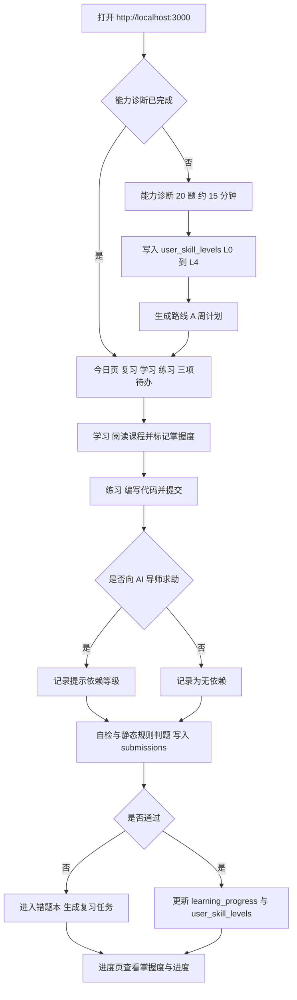

# AI Learning Copilot 产品需求文档（PRD）

**文档版本**：v1.0（Sprint 0 基线）
**产品版本**：0.1.0（发布版本号规则见 ROADMAP.md 第 1 节）
**仓库**：ai-learning-copilot
**读者**：产品负责人、前后端实现者、未来贡献者

本文档回答"做什么、做到什么程度算完成"。技术架构与接口契约见 ARCHITECTURE.md，数据模型见 DATABASE.md，排期与验收见 ROADMAP.md，视觉与交互规范见 DESIGN_SYSTEM.md。

所有取值（端口、接口路径、表名、颜色值、术语）以 Sprint 0 权威决策表为准。文档与代码冲突时，先改决策表，再同步代码与文档，不允许单方面只改其中一侧。

模块编号（模块 1–8）只标识功能域，不代表建设顺序，建设顺序见 ROADMAP.md。全文统一使用"路线 A""能力诊断""AI 导师""提示依赖""开发中"五个词，不换用近义词。

## 1. 产品定位与目标用户

### 1.1 一句话定位

AI Learning Copilot 是面向非计算机理工科背景初学者的 AI 应用开发学习系统：给出一条固定路线（路线 A）、可验证的练习反馈，以及在关键节点"不直接给答案"的 AI 导师。

### 1.2 与现有学习方式的差别

| 现有方式 | 具体问题 | 本产品的做法 |
|---|---|---|
| 视频课程与教程合集 | 只能看，无法判断是否掌握 | 每个知识点配可提交的练习与可判定结果 |
| 通用 AI 聊天工具 | 直接给出完整代码，学会的是复制 | AI 导师按提示依赖等级回答，并记录依赖情况 |
| 刷题平台 | 题目与 AI 应用开发脱节，无项目产出 | 路线 A 的终点是 1 个可展示的 AI 应用 |

### 1.3 目标用户

**主画像（唯一优化对象）**：本科或研究生阶段的非计算机理工科学生（机械、材料、化工、生物、经管、医学等），以及工作 1–3 年、希望转向 AI 应用开发的非技术岗。

- 已有能力：能用浏览器与 Office，能照着步骤完成操作，能自行安装软件。
- 缺失能力：不理解变量、函数、数据结构；没读过 API 文档；没写过超过 50 行的程序。
- 可投入时间：每天 30–60 分钟，持续 8–12 周；不接受"先学 3 个月数学"。
- 动机：做出一个能写进简历、能在面试中演示的 AI 应用，而不是成为算法工程师。
- 设备：Windows 11 或 macOS 笔记本，8–16 GB 内存，可安装 Docker。

**反画像（不作为优化对象，允许被忽略）**：已能独立开发后端服务的人；AI 算法研究方向（需要数学与训练框架）；需要团队协作与权限管理的企业用户；以手机为主要设备的用户。

### 1.4 首版唯一路线：路线 A

路线 A 六阶段，顺序固定，不允许跳阶段。

| 阶段 | 主题 | 阶段产出 | 判定方式 |
|---|---|---|---|
| A1 | Python 基础 | 能写出含函数、列表、字典、文件读写的脚本 | 练习通过 + 自测问答 |
| A2 | 编程实践 | 能把需求拆成函数，能读懂报错并自行定位 | 练习通过 + 错题复现 |
| A3 | API | 能用 requests 调用第三方 HTTP API 并处理错误 | 练习通过 + 真实公开 API 调用 |
| A4 | LLM | 理解提示词、上下文、token、流式返回 | 练习通过 + 提示依赖记录完整 |
| A5 | RAG 与 Agent 基础 | 能把文档切分、检索、拼进提示并解释流程 | 练习通过 + 口述架构 |
| A6 | 简单 AI 项目 | 交付 1 个可运行、可展示的 AI 应用 | 项目验收清单全通过 |

首版内容规模目标（S7 结束）：60 节课程（A1–A6 各 16/12/10/10/8/4 节）、150 个练习（各 40/35/30/25/15/5 个）、3 个项目模板（命令行工具、RAG 知识库问答、简单 Agent 助手）。

### 1.5 完成首版后的能力断言

用户完成路线 A 后，必须能独立做到以下 5 件事，每条都可被第三方验证：

1. 从零写一个 100–200 行的 Python 脚本，调用至少 1 个 HTTP API，含异常处理。
2. 读懂并修改一段别人写的 Python 代码，说明每部分的作用。
3. 独立配置环境变量、安装依赖、读懂 traceback 并定位到出错行。
4. 解释自己项目的 RAG 或 Agent 流程，指出数据从用户输入到模型输出的每一步。
5. 在不使用 AI 补全的情况下，写出项目中核心函数的主体逻辑。

### 1.6 不做承诺

本产品不承诺就业，不承诺替代学历教育，不提供认证证书；首版不提供多用户、不提供对外部署、不提供在线代码执行。

## 2. 用户痛点

| 编号 | 现象（可观察） | 根因 | 首版对应模块 |
|---|---|---|---|
| P1 | 收藏 20 个教程，不知道从哪个开始，反复重学 Python 前 3 章 | 缺少唯一的、有顺序的路线 | 模块 2 个性化学习路线 |
| P2 | 用 AI 生成代码后能跑通，但被问"这行为什么这么写"答不出来 | AI 直接给答案，学习过程被跳过 | 模块 5 AI 导师 |
| P3 | 自认为学会了，一到独立写就卡住 | 缺少可验证的反馈，只有"看懂了" | 模块 1 能力诊断、模块 4 在线代码练习 |
| P4 | 上周学的 API 调用这周全忘 | 没有复习机制，错题不复现 | 模块 6 错题本与定时复习 |
| P5 | 学完不知道做什么，简历上没有可展示的东西 | 没有项目实践与产出路径 | 模块 7 GitHub 项目实践 |
| P6 | 越用 AI 越依赖，离开 AI 写不出 10 行 | 提示使用过程不可见、不被记录 | 模块 5 AI 导师（提示依赖） |

痛点证据状态：以上 6 条来自需求方的经验判断，尚未做用户访谈验证。待确认：S1 用能力诊断问卷与 5 名目标用户访谈校验 P1–P6 的优先级；若排序变化，只调整模块 1 与模块 2 的内容优先级，不改变模块集合。

## 3. MVP 范围与非目标

### 3.1 在范围内（首版必须交付）

| 模块 | 首版交付形态 | 完成判定 |
|---|---|---|
| 模块 1 能力诊断 | 20 题诊断（约 15 分钟），产出 6 个技能域的 L0–L4 等级 | user_skill_levels 有对应记录且 source='diagnostic' |
| 模块 2 个性化学习路线 | 按诊断结果生成路线 A 的周计划与今日待办 | 今日待办每条可追溯到 lesson 或 exercise |
| 模块 3 编程知识学习 | 路线 A 的 60 节课程，含代码示例与自测问答 | 课程可读、可标记掌握度，进度写入 learning_progress |
| 模块 4 在线代码练习 | 150 个练习：题目、起始代码、自检用例、提交记录 | submissions 记录代码、运行输出、判题结果 |
| 模块 5 AI 导师 | DeepSeek 驱动的分级提示对话，记录提示依赖等级 | 每次调用写入 ai_interactions 且含 dependency_level |
| 模块 6 错题本与定时复习 | 未通过练习自动进错题本，按 1/3/7/14/30 天生成复习任务 | 到期项在今日页出现并可完成 |
| 模块 7 GitHub 项目实践 | 3 个项目模板、里程碑清单、仓库与演示链接登记 | projects 记录 status 与 verified_checks |
| 模块 8 学习进度可视化 | 进度页展示掌握度、练习通过率、复习完成率、项目状态 | 页面数字全部可由数据库查询复现 |

### 3.2 非目标（首版明确不做）

| 非目标 | 说明 | 替代做法 | 重新评估触发条件 |
|---|---|---|---|
| 前沿 AI 新闻 | 与学习闭环无关，维护成本高 | 不提供 | 用户调研中 30% 以上主动提出 |
| 论文分析 | 目标用户不具备阅读论文的前置知识 | 不提供 | 出现明确的进阶用户群 |
| 智能推荐 | 推荐需要行为数据量，单用户冷启动无意义 | 路线 A 固定顺序 + 诊断结果排序 | 单个实例交互数据超过 10 万条且内容库超过 500 节 |
| 真实代码执行沙箱 | 安全边界与运维成本远超首版需要 | 用户本地运行，粘贴运行输出，系统做自检与静态规则对照 | 有预算做隔离执行环境与资源限额 |
| 多用户认证体系 | 首版单用户本地使用 | 单用户档案（users 单行种子数据） | 需要多人共用或对外开放时 |
| 对外部署 | 首版只在本地开发环境运行 | Docker Compose 本地拓扑 | 首版开源并通过验收后 |

非目标不是"以后一定做"，而是"当前不投入"。任何一项进入范围，都必须先改本文档，再动代码。

### 3.3 边界补充

- 单用户：系统面向一个本地用户，不做登录、注册、找回密码、权限。
- 不收费：首版不接入支付，DeepSeek 调用费用由使用者自行承担。
- 不执行用户代码：练习判题不运行用户代码，判定来源见 ARCHITECTURE.md 第 4.2 节。

## 4. 用户使用流程

### 4.1 首次进入（一次性，约 15 分钟）

| 步骤 | 页面 | 用户动作 | 系统动作 | 写入 |
|---|---|---|---|---|
| 1 | /（今日） | 打开 http://localhost:3000 | 检查诊断状态 | 读 users、user_profiles |
| 2 | /（今日） | 点击"开始能力诊断" | 载入 20 题 | 读 skills |
| 3 | /（今日） | 答题（6 个技能域） | 暂存作答 | 不写库（浏览器暂存） |
| 4 | /（今日） | 提交诊断 | 计算 6 个技能域等级 | 写 user_skill_levels（source='diagnostic'） |
| 5 | /（今日） | 确认学习目标与每周可投入时间 | 生成路线 A 周计划 | 写 user_profiles、learning_progress 初始行 |
| 6 | /learn | 进入第一节课 | 展示今日待办 | 无写入 |

### 4.2 单日学习循环（约 40 分钟）

| 时段 | 时长 | 页面 | 内容 |
|---|---|---|---|
| 复习 | 8 分钟 | /（今日） | 完成 review_tasks 中到期的复习项（通常 2–5 项） |
| 学习 | 15 分钟 | /learn | 读 1 节课，标记掌握度（L0–L4） |
| 练习 | 12 分钟 | /practice | 完成 1–2 个练习并提交 |
| 总结 | 5 分钟 | /progress | 查看今日新增掌握度与提示依赖次数 |

### 4.3 主流程图



### 4.4 异常流程

| 情况 | 用户看到 | 系统行为 |
|---|---|---|
| AI 导师不可用（未配置 DEEPSEEK_API_KEY 或上游超时） | 未配置时提示"AI 导师未配置，暂不可用"；调用失败时提示"AI 导师暂不可用"，两种情况都附本地引导要点 | 不阻塞练习；失败时写 ai_interactions 失败记录；练习照常可提交 |
| 数据库不可用 | 页面显示错误态与重试按钮，说明"数据服务不可用" | `/api/v1/ready` 返回 503；不展示伪造进度数据 |
| 今日无到期复习 | 复习区空状态"今天没有到期复习"，并显示下次到期时间 | 不生成空任务，不计入完成率 |
| 诊断未完成即访问 /learn | 引导回今日页完成诊断 | 不展示课程内容 |

## 5. 各模块功能需求

每个模块给出输入、输出、验收要点与不做范围。验收要点写成可判定断言，可用界面操作或数据库查询验证。

### 5.1 模块 1 · 能力诊断

**输入**：20 道题的作答（单选 12 题、代码阅读 5 题、改错 3 题）；用户可投入时间与目标方向。

**输出**：6 个技能域（对应 A1–A6）各一个 L0–L4 等级，每级附一句中文解释与"下一步做什么"；同时写入 user_skill_levels 每域一条。

等级定义是全局唯一口径，DATABASE.md 与 ROADMAP.md 使用同一张表：

| 等级 | 名称 | 判定标准 |
|---|---|---|
| L0 | 未评估 | 无诊断或练习证据 |
| L1 | 认识概念 | 能选出正确选项，不能独立写代码 |
| L2 | 能跟做 | 能照着示例改出可运行代码 |
| L3 | 能独立完成 | 不借助 AI 能独立完成同类练习 |
| L4 | 能迁移应用 | 能把该域方法用到新问题上并解释原因 |

**验收要点**：

- 诊断可中断并从上次题目继续；刷新页面不丢当前作答。
- 提交后 3 秒内显示 6 个等级，每个等级可展开看到"依据哪几题得出"。
- 同一天重复提交诊断只追加记录，不覆盖历史；历史以 last_assessed_at 与 created_at 区分。
- 诊断不依赖 AI：未配置 DeepSeek 密钥时诊断仍可完成。

**不做**：不做自适应出题（固定 20 题）；不做与他人对比的排名。

### 5.2 模块 2 · 个性化学习路线

**输入**：user_skill_levels 的 6 个等级、每周可投入时间（分钟）、起点日期。

**输出**：路线 A 的周计划（每周 3–5 个学习单元）与今日三项待办（复习、学习、练习）；每项可追溯到具体的 lesson 或 exercise。

**验收要点**：

- 今日待办固定为三类，每类 0–3 项；每项显示预计时长，合计不超过每日可用时长（每周分钟数除以 7，向下取整到 5 分钟）。
- 待办项必须能点进具体课程或练习，页面内不存在占位链接。
- 跳过某节课时计划顺延而不堆叠；连续跳过 3 天，今日页显示"计划落后 3 天"并给出合并两天的追赶建议。
- 每周一生成下一周计划；生成过程不调用 AI，规则化即可。

**不做**：不做智能推荐排序；不做多路线并行。

### 5.3 模块 3 · 编程知识学习

**输入**：用户从今日页或路线页选择的课程；课程 markdown 正文与代码示例。

**输出**：可读课程页、掌握度标记（L0–L4）、learning_progress 行更新（status、progress_pct、time_spent_seconds）。

**验收要点**：

- 课程正文支持代码高亮、一键复制、可折叠的自测问答。
- 停留时间与滚动深度用于计算 progress_pct，上限 100；"打开页面"不得直接记为 completed。
- 掌握度由用户显式选择，默认 L1；选择 L3 及以上时提示"建议先完成配套练习再提高掌握度"，但不阻止提交。
- 重复学习同一课程累加 time_spent_seconds，不重置 progress_pct。

**不做**：不做视频内容；不生成课程正文以外的 AI 内容。

### 5.4 模块 4 · 在线代码练习

**输入**：练习的题目、起始代码与自检用例；用户提交的代码文本与本地运行输出。

**输出**：submissions 记录（code_text、run_output_text、judging_mode、is_passed、score）与页面判题结果；未通过时生成 mistakes 与 review_tasks。

**验收要点**：

- 判题不执行用户代码。首版判定来源为 judging_mode ∈ self_check、static_rule、manual，页面必须显示本次判定属于哪一种。
- 用户必须粘贴本地运行输出才能提交；粘贴为空时提交按钮禁用并说明原因。
- static_rule 至少支持 3 类规则：必须出现的语法结构（如 def、requests.get）、禁止出现的关键字（如 eval）、运行输出与自检用例期望值完全匹配。
- 提交后立即显示结果，并显示本次是否借助 AI 通过（依据 submissions.used_ai 与 passed_with_ai）。
- 每次提交生成新行，不覆盖历史；练习详情页显示最近 10 次提交。

**不做**：不做服务端代码执行；不做代码相似度查重。

### 5.5 模块 5 · AI 导师（DeepSeek）

**输入**：用户问题文本；上下文（当前课程或练习的 id 与必要片段）；用户选择的求助等级。

**输出**：分级回答；ai_interactions 一条记录（含 dependency_level）；练习提交时回填 submissions 的提示依赖字段。

提示依赖四级是全局唯一口径：

| 等级 | 值 | 含义 | 允许的回答形态 |
|---|---|---|---|
| 无依赖 | none | 未使用 AI | 不产生记录 |
| 提示级 | hint | 只要方向，不要代码 | 提问式引导，最多指出 1 个排查方向 |
| 片段级 | partial_code | 要少量代码 | 不超过 5 行的示例，并必须说明适用条件 |
| 完整答案级 | full_answer | 直接要答案 | 给完整答案，同时把该次提交标记为借助 AI 通过 |

**验收要点**：

- 默认等级为 hint；选择 full_answer 时必须勾选"我知道这会降低本次练习的掌握度证据"。
- hint 等级的回答必须包含至少 1 个反问或下一步动作；只给答案的输出不允许出现在 hint 等级。
- 未配置 DEEPSEEK_API_KEY 时，对话区显示"AI 导师未配置，暂不可用"，页面不崩溃，练习与复习不受影响。
- 每次调用无论成功或失败都写 ai_interactions；失败记录 status='failed' 与 error_code。
- 前端不接触任何密钥；设置区只显示"AI 服务已配置"或"AI 服务未配置"两种状态。
- 模型名由环境变量配置，默认 deepseek-flash；复杂任务预留 deepseek-v4-pro，更换模型不需要改代码。

**不做**：不做多模型对比；不做与课程无关的通用写作；不做学习阶段之外的联网检索。

### 5.6 模块 6 · 错题本与定时复习

**输入**：未通过的 submissions、用户手动加入的题目、复习结果（通过或未通过）。

**输出**：mistakes 条目（含 error_type 与用户反思）、review_tasks 计划、复习后更新的 repetition_no 与 mistakes.status。

间隔规则是全局唯一口径：首次失败后 1 天复习；连续通过则按 3、7、14、30 天递增；任意一次复习未通过则回到 1 天并重置计数；连续 3 次通过后 mistakes.status='resolved'，不再生成新任务。

**验收要点**：

- 今日页只显示 scheduled_for 早于或等于当日 23:59（用户时区）且状态为 scheduled 或 due 的任务。
- 复习项显示原题、上次错误类型、上次提交时间，并可一键回到原练习。
- 复习完成必须选择结果（通过或未通过）；跳过时任务标记 status='skipped' 并在 1 天后重新出现。
- 错题本支持按技能域与状态筛选；已 resolved 的条目默认折叠。

**不做**：不做间隔算法参数自定义；不做错题导出。

### 5.7 模块 7 · GitHub 项目实践

**输入**：3 个项目模板；用户的仓库地址、演示地址、里程碑勾选。

**输出**：projects 记录（status、repo_url、demo_url、verified_checks、completed_at）与进度页项目卡片。

**验收要点**：

- 每个模板给出目标、不少于 6 条的验收清单、不少于 3 个里程碑、最小可演示标准。
- 项目完成判定必须是验收清单全部通过，用户不能只点"完成"按钮。
- 仓库与演示地址做格式校验（必须为 https 且 host 非空）；可访问性校验方式见第 11 节待确认事项。
- verified_checks 保存每条清单项的校验结果与校验时间。

**不做**：不做仓库托管与代码提交；不代用户创建 GitHub 仓库。

### 5.8 模块 8 · 学习进度可视化

**输入**：learning_progress、submissions、review_tasks、projects、ai_interactions 的聚合数据。

**输出**：进度页 4 个区块：掌握度分布（按技能域 L0–L4）、练习通过率与趋势、复习完成率、项目状态；每块标注数据来源与统计区间。

**验收要点**：

- 页面所有数字都能用一条数据库查询复现，不出现前端估算值。
- 完成率（progress）与掌握度（mastery）必须分开展示，文案不得把完成率表述为"已掌握"。
- 每个区块显示统计区间（最近 7 天或全部）与空数据态；无数据时显示"暂无数据"，不得用 0% 进度条冒充数据。
- 数据返回前显示骨架屏，返回后替换；不出现图表库默认主题色与渐变。

**不做**：不做社交分享；不做导出报告（属延后事项）。

## 6. 关键用户故事

**US-01** 作为准备转行的非计算机专业学生，我希望在 15 分钟内完成能力诊断，以便知道自己的真实起点，而不是凭感觉选课。
- 验收要点：提交后 3 秒内出现 6 个等级；每个等级可展开查看依据题目；未完成诊断时访问 /learn 被引导回今日页。

**US-02** 作为编程基础薄弱的初学者，我希望系统直接告诉我今天该学哪一节、做哪个练习，以便不必每天花 20 分钟做选择。
- 验收要点：今日待办三类各 0–3 项；每项可点进具体 lesson 或 exercise；连续跳过 3 天后出现落后提示。

**US-03** 作为学习者，我希望在 AI 导师只给我方向时能自己把问题解决掉，以便真正学会而不是复制。
- 验收要点：hint 等级回答包含至少 1 个反问；该次调用在 ai_interactions 中 dependency_level='hint'；提交记录 used_ai=true 且 passed_with_ai=false。

**US-04** 作为担心自己过度依赖 AI 的学习者，我希望看到自己有多少次是借助 AI 才通过的，以便判断真实水平。
- 验收要点：进度页显示低依赖通过率；submissions 中 passed_with_ai 与实际 AI 调用记录一致；每项统计标注区间与数据来源。

**US-05** 作为照抄代码跑通却讲不出原因的学习者，我希望提交前必须粘贴运行输出并看到判定来源，以便确认自己真的跑过。
- 验收要点：运行输出为空时提交按钮禁用；判题结果标注 self_check、static_rule、manual 之一。

**US-06** 作为容易遗忘的学习者，我希望错题按固定间隔回到我面前，以便不再"上周学的这周全忘"。
- 验收要点：失败后 1 天生成复习任务；连续通过时间隔为 3、7、14、30 天；连续 3 次通过后状态变 resolved 且不再生成新任务。

**US-07** 作为没有项目经验的学习者，我希望照着模板完成一个可展示的 AI 应用，以便简历上有真实产出。
- 验收要点：projects 记录 repo_url 与 demo_url 通过格式校验；验收清单全通过才能置为 done。

**US-08** 作为非计算机背景的学习者，我希望看到掌握度而不只是"完成率"，以便不被 100% 进度欺骗。
- 验收要点：进度页掌握度与完成率分属两个区块且文案不同；掌握度来自 user_skill_levels 的等级分布。

**US-09** 作为自学者，我希望系统在数据库不可用时明确报错而不是显示假数据，以便知道该修环境而不是怀疑自己。
- 验收要点：数据库不可用时 `/api/v1/ready` 返回 503 且 checks.database.status='disconnected'；前端展示错误态与重试按钮。

**US-10** 作为想复用学习记录的用户，我希望我的提示与回答可以被导出和删除，以便控制自己的数据。
- 验收要点：ai_interactions 中提示与响应按脱敏规则存储；导出与删除入口在设置区可见（S7 交付）。

**US-11** 作为尝试开源的贡献者，我希望文档能告诉我在哪一层加代码，以便不破坏现有结构。
- 验收要点：ARCHITECTURE.md 给出模块边界与越界清单；ROADMAP.md 每个 Sprint 有可判定验收条件。

**US-12** 作为使用者，我希望未完成的功能被明确标注为开发中且点不动，以便不把半成品当缺陷。
- 验收要点：不可用入口显示"开发中"徽标，按 DESIGN_SYSTEM.md 规范呈现，点击不跳转空白页，且不发起网络请求。

## 7. 可验证的验收条件

每条都是可判定断言。标注（已实现）的条目对应 Sprint 0 已落地契约；（待实现）的条目属于后续 Sprint。

### 7.1 环境与接口契约

- **AC-01**（已实现）请求 `GET http://localhost:8000/api/v1/health` 返回 HTTP 200，响应体同时含 status='ok'、service='ai-learning-copilot-api'、version、environment、timestamp、ai_configured 六个字段。
- **AC-02**（已实现）在未设置 DEEPSEEK_API_KEY 的环境下，health 返回 200 且 ai_configured=false，服务正常启动。
- **AC-03**（已实现）数据库可用时 `GET /api/v1/ready` 返回 200，status='ready'，checks.database.status='connected'，且含 latency_ms。
- **AC-04**（已实现）停止 PostgreSQL 后 `GET /api/v1/ready` 返回 503，status='not_ready'，checks.database.status='disconnected'，且含 detail；同时 health 仍返回 200。
- **AC-05**（已实现）就绪检查只执行 SELECT 1，不对业务表做任何查询。
- **AC-06**（已实现）来自 http://localhost:3000 与 http://127.0.0.1:3000 的跨域请求获得允许，其他来源不在默认白名单内。
- **AC-07**（已实现）PostgreSQL 只监听 127.0.0.1:5432，从局域网其他主机无法连接。
- **AC-08**（已实现）仓库中不存在任何真实 API Key；DEEPSEEK_API_KEY 仅通过环境变量注入。

### 7.2 学习闭环

- **AC-09**（待实现）首次完成诊断后，user_skill_levels 中针对该用户的记录条数恰好 6 且每条 source='diagnostic'；再次提交诊断只追加 6 行，历史行不被覆盖（与 DATABASE.md 第 4.4 节的追加式设计一致）。
- **AC-10**（待实现）今日页待办三类（复习、学习、练习）各自数量在 0–3 之间，且每项可点击进入对应页面。
- **AC-11**（待实现）课程页停留时间每增加 60 秒，learning_progress.time_spent_seconds 增加不少于 45 秒（允许节流误差）。
- **AC-12**（待实现）练习提交时 run_output_text 为空，提交按钮处于禁用态且页面给出可见原因文案。
- **AC-13**（待实现）练习提交成功后 submissions 新增一行，且该行 judging_mode 取值为 self_check、static_rule、manual 之一。
- **AC-14**（待实现）判题未通过时，同一事务内生成 1 条 mistakes 与 1 条 review_tasks，后者 scheduled_for 等于当前时间加 1 天。
- **AC-15**（待实现）进度页每个区块标注统计区间；清空数据后区块显示"暂无数据"而不是 0%。
- **AC-16**（待实现）掌握度与完成率在两个不同区块展示，且掌握度数值来自 user_skill_levels。

### 7.3 AI 导师与提示依赖

- **AC-17**（待实现）每次 AI 导师调用产生 1 条 ai_interactions，字段包含 provider、model、status、dependency_level。
- **AC-18**（待实现）提示依赖记录率为 100%：不存在调用成功但缺少 ai_interactions 记录的路径。
- **AC-19**（待实现）dependency_level='full_answer' 的练习提交，submissions.passed_with_ai 必须为 true。
- **AC-20**（待实现）DEEPSEEK_API_KEY 未配置时，AI 导师入口显示"未配置"状态，页面无未捕获异常（浏览器控制台无 error 级日志）。
- **AC-21**（待实现）DeepSeek 请求超时或返回 5xx 时，前端在 60 秒内收到可读错误提示，且 ai_interactions 记录 status='failed' 与 error_code。

### 7.4 错题与复习

- **AC-22**（待实现）复习连续通过时段间隔依次为 3、7、14、30 天；通过 3 次后 mistakes.status='resolved'。
- **AC-23**（待实现）复习任意一次未通过，下一次 scheduled_for 为当前时间加 1 天，且 repetition_no 重置为 1。
- **AC-24**（待实现）今日页不显示 scheduled_for 晚于当日 23:59 的复习任务。
- **AC-25**（待实现）跳过的复习任务 status='skipped'，并在 1 天后重新出现于今日页。

### 7.5 项目、数据与文档

- **AC-26**（待实现）repo_url 与 demo_url 非 https 时，项目卡片保存失败并给出明确校验提示。
- **AC-27**（待实现）验收清单未全部通过时，projects.status 不能被置为 done。
- **AC-28**（待实现）ai_interactions 中的提示与响应可按用户请求导出为 JSON，也可被删除或脱敏。
- **AC-29**（已实现）docs 下存在且仅存在 5 份基线文档，每份只有一个一级标题。
- **AC-30**（已实现）5 份文档中的接口路径、端口、表名、颜色值与权威决策表一致，无第二种写法。

## 8. 产品成功指标

指标分领先指标与滞后指标。领先指标反映过程是否健康，滞后指标反映结果是否出现。每条都给出可执行口径与数据来源表。

### 8.1 领先指标

| 编号 | 指标 | 口径 | 数据来源 | S7 目标 |
|---|---|---|---|---|
| L1 | 诊断完成率 | 提交诊断的实例数除以打开今日页的实例数 | user_skill_levels（source='diagnostic'） | ≥ 80% |
| L2 | 首周任务完成率 | 首周完成的待办数除以首周下发待办数 | learning_progress、submissions、review_tasks | ≥ 60% |
| L3 | 练习提交率 | 至少有一次提交的练习数除以已开放练习数 | submissions | ≥ 70% |
| L4 | 到期复习完成率 | status='done' 的到期任务数除以当日到期任务数 | review_tasks | ≥ 70% |
| L5 | 提示依赖记录率 | 有 dependency_level 的 AI 调用数除以 AI 调用总数 | ai_interactions | = 100% |
| L6 | 低依赖通过率 | passed_with_ai=false 且 is_passed=true 的提交数除以通过提交总数 | submissions | ≥ 60% |

### 8.2 滞后指标

| 编号 | 指标 | 口径 | 数据来源 | S7 目标 |
|---|---|---|---|---|
| G1 | 路线完成率 | 完成 A1–A6 全部课时要求的实例数除以开始路线实例数 | learning_progress | ≥ 40% |
| G2 | 掌握度达标率 | 6 个技能域中至少 4 个达到 L3 的实例数除以完成路线实例数 | user_skill_levels | ≥ 50% |
| G3 | 项目产出率 | status='done' 且 verified_checks 全部通过的 projects 数除以完成路线实例数 | projects | ≥ 50% |
| G4 | 30 天留存 | 完成诊断后第 30 天仍有学习行为的实例数除以完成诊断实例数 | learning_progress.last_opened_at | ≥ 25% |

### 8.3 如何用系统数据测量

- 所有指标只读取数据库，不依赖埋点平台；每次统计把口径与查询语句写进指标说明，便于复算。
- 掌握度类指标只读 user_skill_levels（等级与证据来源），不读 learning_progress.progress_pct，避免把完成率当掌握度。
- 提示依赖类指标只读 ai_interactions.dependency_level 与 submissions.passed_with_ai，两者必须能互相印证；若出现不一致，以 ai_interactions 为准并修复写入逻辑。
- 示例口径（示意，业务表在 S1 之后才创建）：

```sql
-- L6 低依赖通过率
SELECT
  count(*) FILTER (WHERE is_passed AND NOT passed_with_ai)::numeric
  / nullif(count(*) FILTER (WHERE is_passed), 0) AS low_dependency_pass_rate
FROM submissions
WHERE created_at >= now() - interval '30 days';
```

- 单用户本地部署时，指标只能验证口径可计算，不能验证目标值达成；目标值用于开源后多实例汇总评估。这一点必须在任何对外材料中说明，不得把本地单用户数据当作产品验证结论。

## 9. 非功能性需求

| 类别 | 指标 | 目标值 | 验证方式 |
|---|---|---|---|
| 性能 | health 接口响应 | 本地 p95 ≤ 50ms | 连续 100 次请求统计分位 |
| 性能 | ready 接口响应（含一次 SELECT 1） | 本地 p95 ≤ 100ms | 同上 |
| 性能 | 列表接口响应（1 万行 submissions） | p95 ≤ 300ms | 造数后压测单页请求 |
| 性能 | 前端首屏 | Lighthouse 移动端 LCP ≤ 2.5s，性能分 ≥ 90 | 本地 production 构建后跑 Lighthouse |
| 性能 | 首页首屏 JS | gzip 后 ≤ 250KB | next build 输出 |
| 性能 | 交互反馈 | 点击后 100ms 内出现可见状态变化 | 手动测量与截图对比 |
| 可用性 | 缺 DEEPSEEK_API_KEY 时启动 | 服务正常启动，health 返回 200 | 移除环境变量后重启验证 |
| 可用性 | 数据库故障隔离 | health 仍 200，ready 返回 503 | 停库后请求两个接口 |
| 可用性 | 错误边界覆盖 | 5 个路由段全部有 error 边界，单页异常不白屏 | 注入抛错组件逐个验证 |
| 可用性 | 本地冷启动 | api 与 web 各自冷启动到可访问 ≤ 10s | 计时记录 |
| 可访问性 | 键盘可达 | 全部交互元素可 Tab 到达并有可见焦点环 | 键盘走查全部页面 |
| 可访问性 | 文本对比度 | 正文 ≥ 4.5:1，非文本 UI ≥ 3:1 | 对比度计算与审查（已知例外见 DESIGN_SYSTEM.md） |
| 可访问性 | 语义结构 | 每页 1 个 h1，主区域有 landmark，表单控件有 label | axe 扫描 0 serious 级问题 |
| 可访问性 | 减少动效 | prefers-reduced-motion 生效时无非必要动画 | 系统设置切换后走查 |
| 安全 | 密钥泄露面 | 前端产物、日志、数据库三处均无密钥明文 | 三处 grep 与人工检查 |
| 安全 | 数据库暴露面 | 只监听 127.0.0.1:5432 | ss 与外部连接测试 |
| 安全 | CORS 白名单 | 默认仅 localhost:3000 与 127.0.0.1:3000 | 从非白名单源发起请求被拒 |
| 安全 | 输入校验 | 提示 ≤ 4000 字符，代码 ≤ 20000 字符，超限返回 422 | 边界值请求 |
| 安全 | 日志脱敏 | 日志不含完整提示词与响应原文，只记长度与哈希前缀 | 检查日志样本 |
| 可维护性 | 后端测试 | 覆盖率 ≥ 70%，config 与路由层 ≥ 90% | pytest --cov |
| 可维护性 | 前端质量 | ESLint 0 error，TypeScript strict 0 error | npm run lint 与 tsc |
| 可维护性 | 迁移可重放 | 空库执行 alembic upgrade head 成功 | CI 干净库验证 |
| 可维护性 | 代码规模 | 单文件 ≤ 400 行，单函数 ≤ 50 行（软上限，超出需说明） | 评审时检查 |

## 10. 术语表

| 术语 | 定义 | 不使用的同义词 |
|---|---|---|
| 路线 A | 首版唯一学习路线：Python 基础、编程实践、API、LLM、RAG 与 Agent 基础、简单 AI 项目 | 学习路径、课程体系 |
| 能力诊断 | 20 题诊断，产出 6 个技能域的 L0–L4 等级 | 能力测评、水平测试 |
| 提示依赖 | 用户为完成学习任务而借助 AI 的程度，按 none、hint、partial_code、full_answer 四级记录 | AI 依赖度、提示使用情况 |
| AI 导师 | 模块 5 的 DeepSeek 驱动对话能力，按提示依赖等级分级回答 | AI 助教、AI 老师、学习助手 |
| 开发中 | 尚未可用功能的唯一标注用语，配合禁用交互与说明文案 | 即将推出、敬请期待、施工中 |
| 掌握度 | 技能域等级 L0–L4，来自 user_skill_levels | 学习程度、熟练度 |
| 完成率 | 课程与练习的完成比例，来自 learning_progress.progress_pct | 掌握率 |
| 技能域 | 路线 A 的六个阶段，一个阶段一个技能域 | 知识模块 |
| 判题 | 对练习提交的判定，来源为 self_check、static_rule、manual | 自动评测、批改 |
| 今日待办 | 今日页的复习、学习、练习三类任务 | 每日任务清单 |

## 11. 待确认事项

- 待确认：users 表是否在 S1 引入认证相关字段。首版多用户认证是明确非目标，默认不引入；若上游要求，需要同步修改 PRD 第 3.2 节与 DATABASE.md 第 4.1 节。
- 待确认：诊断 20 题、15 分钟是否足以覆盖 6 个技能域。S1 用 5 名目标用户实测后定稿，题量变化时同步更新本文件第 5.1 节与 ROADMAP.md 的 S1 验收条件。
- 待确认：在无执行沙箱的前提下，以 self_check 为主的判题是否被用户接受。S4 在 3 名目标用户上验证；若不接受，退路是把 static_rule 的规则集扩大，而不是引入代码执行。
- 待确认：项目仓库与演示链接是否需要通过 GitHub API 或 HEAD 请求做可访问性校验。若需要，凭据管理方案必须先定稿，否则保持仅做格式校验。
